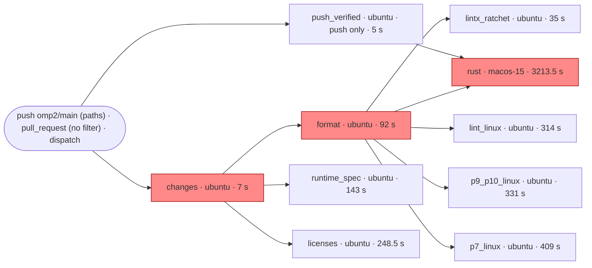

# OMP² CI Test Acceleration: Critical Path, Cache Policy, Artifact Reuse and Plan

Status: research. Nothing here is implemented. Section 10 ("Implement now") gives the Phase 1–2 workflow
changes that the evidence supports, ready to apply. Every later phase needs its own measurement and
the owner's approval.
Date: 2026-10-11

Scope. This report covers the `ci.yml` workflow only:
- its execution graph and critical path;
- where time goes in each job;
- why a warm Cargo cache still rebuilds about 22 workspace members;
- cache key policy;
- reusing build artifacts between jobs (nextest archives);
- consolidating jobs, sharding, caching test results, selecting tests, remote execution;
- runner-minute cost;
- a staged plan.

It adds to `docs/research/omp2-build-acceleration.md` and does not repeat it. That report is the
inventory and the BuildBuddy/ADR 0040 reconciliation; its §6 "cache churn" and "duplicate e2e
graphs" items are worked out in full here. ADR 0040 owner constraints apply unchanged: **no Bazel
migration**, and **BuildBuddy is never a hard dependency**.

Evidence conventions:
- **OBSERVED**: read from the GitHub Actions API or job logs on 2026-10-11, or from the tree.
  - Run evidence comes from worktree `0f3fc1342d`.
  - File and line citations were re-checked against the `origin/omp2`-based tree used for this
    document. That tree's `ci.yml` has no `protobuf` job; `0f3fc1342d` adds one, and no sampled
    run contains it.
- **V**: verified from external documentation or tool help (Cargo Book, nextest `--help` on
  0.9.146, `actions/cache` `action.yml` at the pinned SHA `0057852b`).
- **[INFERENCE]**: reasoning that was not observed.
- **UNVERIFIED**: could not be checked.
- Timings are given as median / p90 with n. p90 is nearest-rank, which for n=10 is the 9th value.
  API timestamps have 1 s resolution. Build/run splits come from log timestamps.

Samples:
- **Sample R (n=10)**: the 10 most recent successful runs in which `rust` ran.
  - 38125007166, 38121080254, 38116855282, 38106760942, 38103334528, 38061071397,
    38054471321 (push), 38051067974, 38049924244, 38049202805.
- **Sample A (n=10)**: the 10 most recent successful runs in which the CI jobs ran.
  - PRs: 38125007166, 38121080254, 38116855282, 38106760942, 38103334528.
  - Pushes, all with `rust` skipped by `push_verified`: 38127067908, 38120425785, 38110897963,
    38106690990, 38064207482.
- **Wider sample** (cache-hit statistics, F2): 40 successful runs from 2026-10-09T15:56Z to
  2026-10-11T09:40Z. Linux jobs n=31; macOS `rust` n=21, skipped in 19.
- **Excluded**: docs-only PRs, where every job after `changes` was skipped, and run 38015744243,
  which was re-run and has negative queue offsets.

## 1. Execution graph and critical path



The `needs` edges are OBSERVED in `ci.yml`:
- `format` needs `changes`.
- `rust` has `needs: [format, push_verified]` (`ci.yml:243-244`).
- `lintx_ratchet`, `lint_linux`, `p9_p10_linux` and `p7_linux` have `needs: format`.
- No job uploads or downloads artifacts. The only things passed between jobs are
  `changes.outputs.ci`, `push_verified.outputs.verified` and GitHub caches.

Durations in the graph are job medians: `rust` from Sample R, the others from Sample A.

| Job (`name:`; **bold** = required check) | Runner | Compiles | Tests | Cargo cache key | Critical path |
|---|---|---|---|---|---|
| `changes` (Detect CI-relevant changes) | ubuntu-24.04 | — | PR files vs `.github/ci-paths.txt` | — | yes, 7 s |
| `format` (**Rust format**) | ubuntu-24.04 | rustfmt | `cargo fmt --check`, `check-ci-paths.py` | — | **yes**: `rust` waits for it |
| `lintx_ratchet` (**Error-formatting ratchet (lintx)**) | ubuntu-24.04 | `tools/lintx` workspace | lintx tests, ratchet | `lintx-…`, exact | no |
| `runtime_spec` (**Runtime symbol and dependency contracts**) | ubuntu-24.04 | `cargo -Zscript scripts/check-spec.rs` (builds `omp-core`, `omp-tool`), **uncached** | spec | none | no |
| `licenses` (**License policy and release notices**) | ubuntu-24.04 | `cargo install` just/cargo-deny/cargo-about on a cache miss | `just license-check` | `compliance-tools-…`, exact | no |
| `push_verified` (Pushed tree already verified) | ubuntu-24.04 | — | tree equality, plus the head's `rust` conclusion | — | gates `rust` on pushes |
| `rust` (**Rust workspace and acceptance proofs**) | `fromJSON(vars.MACOS_RUNNER \|\| '"macos-15"')`; all of Sample R ran on hosted `macos-15-arm64` | (1) clippy, dev/check; (2) nextest workspace build, test profile (LLVM); (3) doctests; (4) `-p omp-e2e --tests --no-run` | ~10.2k tests in 233–235 binaries; doctests; Python examples gate; e2e lib, P1–P6, P7, P12, P8 contract | `cargo-macOS-ARM64-<hash>-<sha>` | **yes, 10/10 in Sample R** |
| `lint_linux` (**Lint workspace (Linux)**) | ubuntu-24.04 | clippy, x86_64, dev/check | — | `cargo-lint-linux-…-<sha>` | only on pushes where `rust` is skipped |
| `p9_p10_linux` (**Acceptance proofs P9, P10 and tool sources (Linux)**) | ubuntu-24.04 | test-profile `-p omp-e2e` graph (968 units cold) | P9, P10, P11, `tool_sources` | `cargo-e2e-linux-…-<sha>`, fallback `cargo-p7-…` | no |
| `p7_linux` (**Terminal proof P7 (Linux PTY)**) | ubuntu-24.04 | the **same** `-p omp-e2e` graph (968 units cold) | `p7_tui`, `p7_tsp` | `cargo-p7-…-<sha>` | last job on 4/5 pushes in Sample A |

The required checks are the eight `context` entries in `.github/rulesets/omp2-protected.json`.
`scripts/check-ci-paths.py` enforces that each one is a `name:` of a `ci.yml` job. **No change in
this report renames any of them.**

### Critical path: `changes` → `format` → `rust` (OBSERVED, Sample R, n=10)

- `rust` was the last job to finish in **10/10** runs.
- Every Linux job had ended by about 700 s after run creation. `rust` ended between 2006 and 4584 s.
- PR run wall time: **3330 / 3807 s** (n=10).
- `rust` job total: **3213.5 / 3735 s** (n=10; min 1897, max 4471).
- On pushes where `rust` is skipped, run wall time is **582 / 702 s** (n=5). The critical path is
  then `p7_linux` (4 of 5) or `lint_linux` (1 of 5).

## 2. Bottleneck analysis: measured shares per job

### `rust` (Sample R, n=10; offsets from run creation)

| Bucket | Median s | p90 s | Share | Content |
|---|---|---|---|---|
| Dependency wait (`changes` + `format`) | ~106 | 127 | 3% | `rust` job created at +65…+134 s |
| Runner queue | 8 | 9 | <1% | hosted macOS picks up in 6–16 s |
| Setup | ~56 | ~210 | 2–6% | checkout 5, toolchain 8, brew 28.5, nextest 1, Python state 12, cargo restore 0.5 (p90 138) |
| **Compile** | **~2480** | ~3180 | **~77%** | clippy 553.5; workspace test build 1660 (p90 2152); e2e `--no-run` 265.5 (p90 313); doctest build 4.5 |
| Test execution | ~490 | ~530 | ~15% | workspace 327 (p90 364; 10186–10234 tests, 12 skipped); doctests ~50; e2e ~115 (P7 93.5) |
| Cache save | 99.5 | 111 | 3% | 5.22–5.24 GB on **every** run; it is the job's last step, so it sits on the critical path |

Observations about the workspace test build (logs, n=10):
- Cold builds compile 903 units. The last `Compiling` line appears at +271…+629 s, but
  `Finished` arrives **604–1810 s later**.
- Warm runs (38049924244, 38051067974, 38061071397) compile only 23 member units and still take
  1302–1713 s.
- Cargo logs neither link nor codegen phases, so this tail cannot be split further from these
  logs.
- [INFERENCE] The tail is member codegen under `[profile.test] codegen-backend = "llvm"`
  (`.cargo/config.toml`) plus linking 233 test binaries. 96 test targets statically link CPython;
  local macOS debug `omp_e2e_host` is 735,876,928 B.

### Linux jobs (Sample A, n=10)

Shares are step medians divided by the job median. Medians do not sum exactly to the job median.

| Job | Total med / p90 | Queue | Setup (checkout + toolchain + apt + Python + Cargo restore) | Compile | Test | Save |
|---|---|---|---|---|---|---|
| `format` | 92 / 94 | 2.5 (3%) | 13 (14%) | — | `cargo fmt` 75 (82%) | — |
| `lintx_ratchet` | 35 / 42 | 2.5 | 14.5 | (in test and ratchet) | 3.5 + 8 | 1 |
| `runtime_spec` | 143 / 150 | 3 (2%) | 13 (9%) | check-spec 125 (87%; build and run not split) | | — |
| `licenses` | 248.5 / 333 | 2.5 | 13 | **tool install 293 / 314 on a miss (n=6; 6/10 missed)** | license-check 10 | 1 |
| `lint_linux` | 314 / 479 | 2.5 (1%) | 4 + 9 + 12.5 + 1.5 + 5.5 = 32.5 (10%) | clippy 257 / 437 (82%) | — | 7.5 (2%) |
| `p9_p10_linux` | 331 / 378 | 3 (1%) | 4 + 10 + 13.5 + 1 + 25 = 53.5 (16%) | 226 + 6 = 232 (70%) | 7 + 2.6 ≈ 10 (3%) | 20.5 (6%) |
| `p7_linux` | 409 / 591 | 3 (1%) | 4 + 9.5 + 13 + 2 + 19.5 = 48 (12%) | 232 / 441 (57%) | 91 / 92 (22%) | 15.5 (4%) |

Conclusions (OBSERVED):
1. **Queueing does not matter.** Linux waits 2–4 s; macOS 6–16 s.
2. **The PR critical path is bound by compilation in one macOS job** that runs four compile
   phases in series: clippy, the workspace test build, doctests and e2e `--no-run`. About 77% of
   the path is compilation; test execution is about 15%.
3. **Linux jobs are compile-bound, not test-bound.** P9–P11 run 7 tests in about 10 s, and P7
   runs 17 tests in about 90 s. `p7_linux` and `p9_p10_linux` compile the same graph twice: cold,
   both report 968 `Compiling` units with 47 members (run 38064207482).

Ranked levers, with bands that sections 3–9 justify:

| # | Lever | Band (PR wall unless noted) | Basis |
|---|---|---|---|
| 1 | Workspace test-build tail (codegen and link) | 300–900 s [INFERENCE] | needs `--timings` first (Phase 4) |
| 2 | Clippy in series ahead of the tests in `rust` | 450–650 s | measured clippy 553.5 / 713, minus a parallel restore |
| 3 | macOS cache save on every run | ~100 s | measured 99.5 / 111 |
| 4 | Second cargo invocation for `e2e --no-run` | 100–250 s [INFERENCE] | measured 265.5 / 313 for 1 `Compiling` unit |
| 5 | `format` gate ahead of `rust` | 90–110 s | measured offsets +65…+134 |
| 6 | Build-script mtime cascade (§3) | 0 s on PRs (off path); 100–250 s on pushes [INFERENCE] | measured warm vs cold Linux builds |
| 7 | Duplicate P7/P9 builds | 0 s wall on PRs; ~270 s compute per run | measured 226–232 s build + ~45 s setup |

## 3. Root cause of the ~22-member rebuild on a cache hit: build-script mtime cascade

### Observation (OBSERVED)

Runs 38116855282 (`f749037f`, restored from `aedb7058`) and 38125007166 (`2aafcc11`, restored from
`de41dc5f`) had no `crates/` file changes between the restored SHA and HEAD (GitHub compare).
Even so:
- `lint_linux` recompiled exactly **8 units**: `omp-{ai,app,catalog,e2e,proto,py,tools,tui}`.
  These are exactly the 8 crates with a `build.rs`. It re-checked 16 more.
- `p7_linux` and `p9_p10_linux` recompiled **22–25 members**. In run 38121080254 both jobs show the
  same list, `omp-proto … omp-e2e`.
- macOS warm runs recompile 23 member units (above). That is the same cascade on the critical path.

### Mechanism

1. **`checksum-freshness` is already on** (`.cargo/config.toml:53`). It does not cover build-script
   inputs. **V**: the Cargo Book (unstable features, `checksum-freshness`) says files ingested by a
   build script, meaning the paths named by `cargo::rerun-if-changed`, keep using mtime.
2. **`actions/checkout` gives every file a fresh mtime** on each run (OBSERVED: every job runs a
   fresh checkout). Restored `target/` keeps the build-script timestamps of the run that saved the
   cache, because `actions/cache` uses tar, which keeps mtimes [INFERENCE].
3. Every `rerun-if-changed` path that points into the checkout is therefore "newer" than the
   recorded run. The build script reruns, its package rebuilds, and every dependent rebuilds.
   `omp-proto` sits under almost every member.

The `rerun-if-changed` lines that fire after a fresh checkout (OBSERVED in the tree):

| Crate | File:line | Tracked path | Fresh after checkout? |
|---|---|---|---|
| omp-proto | `crates/proto/build.rs:33`, `:42` | `crates/proto/proto/` (directory) and every `.proto` | yes (tracked) |
| omp-tui | `crates/tui/build.rs:16`, `:17` | `icons.tsv`, `assets/login` | yes |
| omp-ai | `crates/ai/build.rs:24`, `:113`, `:132` | `fixtures/llm-oracle/vendor-schemas/...` | yes |
| omp-tools | `crates/tools/build.rs:27` | `docs/` (whole directory) | yes |
| omp-catalog | `crates/catalog/build.rs:38` | source lock and snapshot | yes |
| omp-py | `crates/py/build.rs:125`, `:126`, `:127`, `:134` | `crates/py/python/`, `requirements.txt`, `scripts/pack-pymodules.py`, `crates/tools/url-vocab.json` | yes |
| omp-py | `crates/py/build.rs:73`, `:74`, `:227` | `vendor/python/{PYTHON.json,stdlib.bin}`, `.requirements.stamp` | only on a Python-cache miss: regenerated (OBSERVED: `pyo3`/`pyo3-ffi` also recompile then, runs 38120425785, 38125007166, 38127067908) |
| omp-app | `crates/app/build.rs:31` | `.git/packed-refs`, `.git/refs/tags` (only if present) | yes: created by checkout |
| omp-py, omp-app, omp-e2e, omp-tools | `crates/py-link/src/lib.rs:116` (via `omp_py_link::emit()`; `crates/e2e/build.rs:4`) | `crates/py/link/cpython.dynamic-list` (Linux) / `.macho-list` (macOS) | **yes**. This is why the trivial `omp-e2e` build script reruns too |
| same | `crates/py-link/src/lib.rs:78`, `:82`, `:90` | `vendor/python/PYTHON.json`, `needs-lld`, `crates/py/scripts/ld64.lld` | `ld64.lld` yes (macOS); vendor files only on a Python miss |

### Fix options

| Option | Fixes the cascade? | Correct? | Verdict |
|---|---|---|---|
| (a) Narrow `rerun-if-changed` | **No.** Every input that stays tracked still has a fresh mtime. Dropping tracking would leave stale `OUT_DIR`s | — | Reject |
| (b) `checksum-freshness` | Already enabled (`.cargo/config.toml:53`); does not apply to build-script inputs (V) | — | Not a fix. Upstream work on checksummed build-script inputs is outside this repo |
| (c) Restore mtimes from commit times (`git restore-mtime`) | Yes | **No.** A PR commit dated before the cached build would keep stale `OUT_DIR`s | Reject |
| (d) Cache key changes | No; keys do not affect mtimes | — | Reject as a fix (keys are §4) |
| **(e) Age the checkout to a fixed epoch, then touch only the paths that differ from the commit the cache was saved at** | Yes | Yes: changed inputs end up newer than any recorded build-script run; unchanged inputs end up older. With checksum-freshness, Rust sources are compared by content anyway (V); touching the changed ones only adds a margin | **Adopt** |
| (f) Persistent workspace (self-hosted target dir, `macos-build-state`) | Avoids it on the Mac: the checkout keeps a stable path, but `git clean` plus checkout still rewrites tracked files [INFERENCE] | — | Out of scope (§7, G) |

**Choice: (e).** It is the only option that is both effective and correct.
- It needs the commit the cache was built from. That SHA is already the suffix of every Cargo cache
  key (`…-${{ github.sha }}`), and `actions/cache/restore` exposes it as `cache-matched-key` (V).
- It fails safe. If no SHA-keyed entry was restored, the commit cannot be fetched, or the diff
  fails, the step leaves the fresh mtimes alone. The result is today's behaviour: a full
  build-script rerun.
- Four more details:
  - **Deletions.** A removed `.proto` changes a tracked directory. The step therefore also touches
    every parent directory of a changed path.
  - **Untouched trees.** `target/` (the restored cache) and `vendor/` (the Python cache, whose tar
    mtimes are already consistent) are pruned.
  - **Tags.** `.git/refs/tags` and `.git/packed-refs` are aged only when the checkout has no tags.
    `actions/checkout` fetches no tags by default [INFERENCE from checkout defaults], so the
    embedded changelog is the same fallback text in the saving run and the restoring run. If tags
    are ever fetched, the step leaves those refs fresh and `omp-app` reruns (correct).
  - **Where it applies.** Linux jobs only. macOS stops caching `target/` in Phase 1 (§4).

Acceptance:
- A PR that changes no crate shows 0 `Compiling omp-proto` and 0 `Compiling omp-e2e` in
  `lint_linux`, `p9_p10_linux` and `p7_linux`.
- A PR that changes only `crates/tui` shows at most `omp-tui` and its dependents.
- An injected `.proto` edit still recompiles `omp-proto`.
- An injected `crates/py/link/cpython.dynamic-list` edit still reruns the four `omp_py_link`
  consumers.

## 4. Cache key analysis and policy

### Today (OBSERVED)

- Every Cargo key ends in `${{ github.sha }}`: `ci.yml:327` (macOS), `:431` (lint), `:503` (e2e),
  `:580` (p7). An exact hit is impossible except on a re-run.
  - `actions/cache` therefore saves on **every** run: ~5.2 GB (macOS) + ~0.6 GB (lint) +
    ~1.4 GB (e2e) + ~1.2 GB (p7). That is **~8.4 GB of new entries per run** against the 10 GB
    repository limit.
- Current usage is 10,707,852,031 B in 15 entries. **No `cargo-macOS` entry exists.** Every
  remaining Cargo entry belongs to `refs/pull/251/merge`, `refs/pull/253/merge` or
  `refs/heads/omp2`.
- PR-ref entries can be read only by that PR, yet they evict the `omp2` entries that every PR
  restores from.
- `push_verified` skips `rust` on `omp2` pushes (5/5 in Sample A; 19/40 in the wide sample), so no
  `omp2` macOS entry is written.
  - The last ones came from 38046502596 (`f0a1cf5`) and 38054471321 (`fa04929`).
  - After those were evicted, every PR `rust` started cold: 7/10 misses in Sample R, including
    the latest 5 in a row.
- The macOS `target/` cache is net negative even when it hits (wide sample, n=21: 9 hits, 12
  misses):
  - lint step p50 is 460 s on a hit vs 692 s on a miss (−232 s);
  - test-workspace p50 is 2036 vs 1968 s, so no gain;
  - a hit costs a 93–172 s restore; every run pays a 76–177 s save.
  - Expected gain per run at hit rate $h$: $h\,(232-130) - 100 < 0$ for every $h \le 1$.
- The `python-*` key is written by three parallel Linux jobs: **"Unable to reserve cache" 7× in 30
  Linux logs**.
- `cargo-e2e-linux` (1431 MB) and `cargo-p7` (1181 MB) hold essentially the same graph; each ref
  stores both.

### Recommended policy

| Cache | Key | Restore | Save | Size per ref |
|---|---|---|---|---|
| macOS Cargo | `cargo-registry-<os>-<arch>-<hash(Cargo.lock)>`, **no `target`**, new prefix so old full entries are never prefix-restored | `actions/cache` | on miss only (content key) | registry and git db: small (size UNVERIFIED) |
| Linux lint | unchanged key (keeps the `-<sha>` suffix; §3 needs it) | `actions/cache/restore`, prefix | `actions/cache/save` **only on `push`**, skipped on an exact hit | ~0.6 GB |
| Linux e2e (P7 + P9) | **one** key, `cargo-e2e-linux-…-<sha>` | both jobs restore it | `p9_p10_linux` only, on `push`; on pushes it also builds the P7 binaries so the entry covers both | ~1.4 GB |
| `python-*` (Linux) | unchanged | `actions/cache/restore` in p7 and p9 | `lint_linux` only (single writer) | 92 MB |
| `compliance-tools`, `lintx` | unchanged | | | 12 / 25 MB |

[INFERENCE] Steady state is one `omp2` generation of about 2.2 GB of Linux entries plus small
entries, instead of ~8.4 GB per run. Branch entries stop being evicted by PR entries.

## 5. Artifact reuse and strategies A–G

### nextest archive feasibility (V for flags; OBSERVED for code)

Flags and behaviour (nextest 0.9.146, same as CI's pin at `ci.yml` `nextest@0.9.146`):
- `cargo nextest archive --archive-file F` writes a `.tar.zst` with:
  - the test binaries;
  - the `CARGO_BIN_EXE_*` binaries of the same package;
  - workspace build-script `OUT_DIR`s, one level deep.
- Source code is not included; the consumer must check out the same revision.
- `run --archive-file` cannot be combined with `-p`, `--workspace`, `--test`, `--locked` and
  related flags. Filtersets replace them, e.g. `-E 'binary(p7_tui) | binary(p7_tsp)'`.
- `--extract-to $GITHUB_WORKSPACE --extract-overwrite` recreates the original absolute layout.
  Every ubuntu-24.04 job checks out at `/home/runner/work/oh-my-pi/oh-my-pi` (OBSERVED, 15 logs).
- Every sampled Linux job ran image `ubuntu-24.04` `20261002.596`, so archives stay valid within
  one run.

| Test group | Class | Reason |
|---|---|---|
| `omp-e2e` P7, P9–P11, `--lib` | **Archive-safe** | runtime binary resolution (`e2e/src/support/process.rs:46-79`); temp-dir sockets; PTY needs only `TERM` |
| `omp-e2e` `tool_sources` | Same checkout path, plus system `python3` | `env!("CARGO_MANIFEST_DIR")` at `tool_sources.rs:23` |
| `omp-e2e` P12, `p8_baselines` | Not for Linux | Seatbelt-only; P8 runs on macOS |
| ai, ar, edit, catalog, chat, tools, shell (fixtures, insta) | Same checkout path | baked `env!("CARGO_MANIFEST_DIR")` |
| app, shell-builtins | `--extract-to <workspace>` | baked `env!("CARGO_BIN_EXE_*")` |
| `stock_sdk_clients`; sandbox bwrap/gvisor; webview; audio | Consumer environment (uv, bwrap, runsc, OS) | host tools |
| `omp-py`, envd, driver | Archive-safe on Linux | static CPython; embedded stdlib |
| Doctests | **Not archivable** | nextest cannot run doctests |
| Clippy | Not applicable | no binaries |

### Break-even model

Symbols: one producer, N consumers.
- B: build time per job, ≈225 s warm / ≈340 s cold (OBSERVED).
- S: archive size.
- u, d: upload and download throughput.
- X: extraction time.
- O: fixed job overhead, ≈50–80 s (OBSERVED).

Formulas:
- Compute saved: $\Delta C = (N-1)\,B - O - S/u - N\,(S/d + X)$.
- Wall-time change: $\Delta W \approx O + S/u + S/d + X > 0$ **for every N**. Consumers wait for
  the producer.

For P7 + P9 (N=2), assuming S ≈ 1.5–2.5 GB [UNVERIFIED], u = d ≈ 150 MB/s (cache throughput
observed at 133–182 MB/s) and X ≈ 15 s:
- ΔC ≈ +100 s of runner time;
- **ΔW ≈ +60 to +100 s.**

The repository is PUBLIC, so standard hosted runners cost nothing (V, GitHub billing docs). Compute
saved has no money value; only wall time and the 10 GB cache budget matter.

### Verdict per strategy

| | Strategy | Verdict | Reason |
|---|---|---|---|
| A | Independent builds per job (today) | **Keep** for jobs with different graphs | clippy (check/dev), Linux e2e (test, x86_64) and macOS (test, aarch64) share no artifacts |
| B | Shared dependency cache | **Adopt** (Phases 1–2) | single-writer branch entries (§4) plus the mtime fix (§3) make a restored `target/` actually warm |
| C | Shared test binaries (nextest archive) | **Defer** | ΔW > 0 for N=2. Trigger: ≥3 Linux consumers of one graph, e.g. adding the Linux workspace suite |
| D | Shared `target/` as an artifact | **Reject** | moves 1.2–5.2 GB per run with the same ΔW > 0 as C; cannot cross OSes; B already shares it through the cache |
| E | sccache | **Reject now, Defer** | the Linux waste is build-script reruns, which sccache re-executes anyway. The macOS cost is linking, which sccache does not cache. It competes for the 10 GB budget. Local measurement was mixed (`docs/audits/sccache-mac-measurement.md`). Revisit after Phase 2 with a per-unit hit rate |
| F | Bazel remote cache | **Reject** | ADR 0040 owner constraint (no Bazel migration) |
| G | Persistent remote workspace (self-hosted Mac via `MACOS_RUNNER` plus `macos-build-state`; BuildBuddy snapshots) | **Defer to Phase 7** | mechanism exists. `docs/BRANCH_PROTECTION.md` records about 52 min hosted vs about 15 min warm self-hosted for the job, and 3 tests that failed only on hosted. Needs an owner decision on runner availability; BuildBuddy stays non-gating (ADR 0040) |

## 6. Job consolidation: merge `p7_linux` and `p9_p10_linux`?

Measured inputs (Sample A, n=10):
- `p7_linux` 409 / 591 s: build 232 / 441, tests 91, setup ≈48, save 15.5.
- `p9_p10_linux` 331 / 378 s: build 226 / 245, tests ≈10 + 2.6, setup ≈53.5, save 20.5.

Merged job [INFERENCE]: setup ≈50, plus one build of both binary sets ≈232–290 (an estimated
0–60 s for the extra test-binary links), plus tests 91 + 10 + 3, plus save ≈20.
- **Wall ≈ 410–470 s**, against today's `max(p7, p9)` median of 409 s: **−0 to +60 s**.
- **Compute saved ≈ 230–280 s per run.**
- One ~1.2–1.4 GB cache entry fewer per ref.

Costs:
- Two required checks would collapse into one name. The ruleset JSON, `docs/BRANCH_PROTECTION.md`
  and the owner's ruleset import would all have to change together.
- No PR wall time is gained; both jobs are off the PR critical path.

**Verdict: Defer.** Phase 1 gets the cache-space benefit without renaming anything: one
`cargo-e2e-linux` key, one writer, and the P7 binaries built into it on pushes. Revisit in Phase 5
if Linux compute ever has a price, or if after Phase 2 the merged job is measured to stay within
+30 s of the slower job.

## 7. Sharding, test-result caching, test selection, remote execution

| Technique | Verdict | Reason |
|---|---|---|
| Sharding on Linux (`--partition hash:m/n`) | **Reject** | Test time is 10–92 s per job. Each extra shard pays 50–80 s of setup plus a build or an archive download. `threads-required = "num-cpus"` for `omp-e2e` (`.config/nextest.toml:42-50`) already serializes e2e |
| Sharding on macOS | **Defer** | Execution is 327 / 364 s (n=10) against about 2480 s of compile. k shards save at most (1 − 1/k)·327 s and need an archive of about 235 binaries, about 96 of them CPython-static [INFERENCE: tens of GB]. Revisit if execution exceeds 15 min; then use `hash:`, never the deprecated `count:` |
| Test-result caching (Bazel-style) | **Reject now, Defer** | No hermetic input digest: fixtures read through `env!("CARGO_MANIFEST_DIR")`, spawned binaries, `TERM`/`OMP_*`, host tools. The e2e proofs are nondeterministic by design and `retries = 0` on purpose (`nextest.toml:31-33`). Little test time is left to save. Revisit only for pure unit-test binaries once archives give stable binary hashes |
| Test selection (run only affected crates) | **Defer** | `changes` already skips whole runs on non-CI paths. Per-crate selection needs a reverse-dependency graph and risks silently dropping coverage of a required check. Build time, not test time, dominates |
| Remote execution (BuildBuddy, REAPI) | **Defer** | Governed by ADR 0040 and `omp2-build-acceleration.md` §8 (phases D–E). Non-gating; never a hard dependency |

## 8. Cost: runner minutes per variant (parameterized; no prices)

Per CI run:

$$C_{run} = m_{mac}\,p_{mac} + m_{lin}\,p_{lin}$$

Per day, with $P$ PR runs (where `rust` runs) and $R$ pushes (where it is skipped):

$$C_{day} = P\,C_{PR} + R\,C_{push}$$

$p_{mac}$ and $p_{lin}$ are per-minute prices from the account's billing. For this PUBLIC
repository, standard hosted runners are free (V), so $p = 0$ unless larger runners are adopted.

| Variant | $m_{mac}$ per PR run | $m_{lin}$ per PR run | PR wall | Basis |
|---|---|---|---|---|
| Baseline | 53.6 min (3213.5 s) | 26.3 min (1579.5 s = sum of Sample A medians, changes 7 s included) | 3330 / 3807 s | OBSERVED, n=10 |
| Baseline push (`rust` skipped) | 0 | 26.4 min (+ `push_verified` 5 s) | 582 / 702 s | OBSERVED, n=5 |
| After Phase 1 | ≈51.3–52.1 min (−100 s save; ≈−30 s expected net of lost hits at 3/10) | ≈25.6 min (−43.5 s of PR saves: 7.5 + 20.5 + 15.5) | ≈3120–3150 s | [INFERENCE] |
| After Phase 2 | `rust` −100…−250 s; plus `lint_macos` ≈ 614–773 s (≈60 s setup + clippy 553.5 / 713) | −(100–300) s from the mtime fix [INFERENCE] | ≈2900–3050 s | [INFERENCE] |
| After Phase 3 | `rust` −553.5 s (clippy removed); macOS total ≈ baseline ± 3 min | as Phase 2 | **≈2300–2700 s** | [INFERENCE] |

Other parameters:
- A larger macOS runner (paid `-xlarge`) enters only through $p_{mac}$ and an unmeasured
  $m_{mac}$; Phase 7 measures it.
- Cache storage is not billed within the 10 GB repository limit. The cost there is eviction.

## 9. Staged plan

Rules that apply to every phase:
- **Benchmark**: at least 5 PR runs where `rust` runs and at least 5 `omp2` pushes, each with run
  IDs. Report median and p90 per job and per key step, plus the hit/miss state of every cache.
  - Compare against Sample R/A.
  - macOS host variance is large: 1897–4471 s with no change. Claim an improvement only when the
    median moves by more than the band and the p90 does not regress.
- **Correctness**, every phase:
  - Unchanged test counts: nextest `Summary` for the workspace (10186–10234 run, 12 skipped,
    adjusted for tests the PR itself adds); P7 17; P9–P11 4 + 3; `tool_sources` passes; P1–P6,
    P12 and P8 contract pass; doctests pass.
  - `just check-ci-paths` passes.
  - The eight required check names are unchanged unless the phase says otherwise.

| Phase | Scope | Acceptance criteria | Correctness checks | Rollback |
|---|---|---|---|---|
| **0. Baseline** | Fix the comparison set: Sample R/A here, plus n ≥ 5 fresh runs on the current tip. Record cache-list size daily | Baseline table with run IDs; cache usage time series | — | n/a |
| **1. Cache policy and gate** (§10 diffs 1–4) | PR restore-only and push-only saves for Linux Cargo; one e2e key with p9 as writer; Python single writer; macOS registry-only cache; `rust` no longer waits on `format` | Over n ≥ 5 pushes: every Linux job gets an exact or prefix `omp2` hit in ≥ 4/5. No "Unable to reserve cache". Repo cache < 9 GB for a week. `rust` created ≤ 20 s after run creation. PR wall median ≤ baseline − 100 s | `Rust format` still fails a misformatted PR. Docs-only PR: all jobs skipped. Push with an identical tree: `rust` skipped | Revert the PR |
| **2. Mtime fix, single compile, shadow lint** (§10 diffs 5–7) | `source-mtimes` action in the 3 Linux jobs; one `--no-run` build for all test binaries in `rust`; `lint_macos` added, not required | No-crate PR: 0 `Compiling omp-proto` in Linux jobs. `rust` test build plus `--no-run` median down ≥ 100 s (n ≥ 5). `lint_macos` green on ≥ 1 PR | Injected `.proto`, `cpython.dynamic-list` and `crates/py/python` edits each still rebuild their crate. Test counts unchanged | Delete the step or job; restore the `Compile acceptance proofs` step |
| **3. Move clippy off the critical path** | Add `Lint workspace (macOS)` to `.github/rulesets/omp2-protected.json` and to `docs/BRANCH_PROTECTION.md` ("eight" → "nine" checks). The owner imports the ruleset; then remove the `Lint workspace` step from `rust` | PR wall median ≤ Phase 2 − 450 s (n ≥ 5) | Clippy failures on macOS still block a merge, through the new required check. Existing check names unchanged | Re-add the step to `rust`; drop the ruleset entry |
| **4. Measure the test-build tail** | `rust` with cargo `--timings` (nextest pass-through UNVERIFIED on 0.9.146; check `cargo nextest run --help`), HTML uploaded as an artifact. Then decide on merging CPython-linking integration-test binaries (233–235 binaries; 96 CPython-static) and re-test a seeded macOS `target/` cache with the mtime fix | Codegen and link split per unit for n ≥ 3 runs; written hypothesis with a band | — | n/a (measurement) |
| **5. Linux consolidation** | Merge P7 and P9 only if Phase 2 data show the merged wall ≤ max(p7, p9) + 30 s | Same as §6 | Required-check rename done in one PR together with the ruleset | Revert the PR and the ruleset |
| **6. Archives and sharding** | Only on the trigger in §5 C or §7 | Archive producer + max consumer ≤ current max Linux job p50 (n ≥ 5); identical per-binary test counts | Filtersets reproduce the `--test` sets | Single `if:` toggle (repository variable) back to local builds |
| **7. Runner/remote** | Larger macOS runner, self-hosted `MACOS_RUNNER`, or BuildBuddy, per ADR 0040 | Owner decision recorded; n ≥ 5 comparison | The 3 hosted-only failures in `BRANCH_PROTECTION.md` resolved | Unset `MACOS_RUNNER`; remove the workflow |

## 10. Implement now (Phase 1–2 diffs)

Rules for every diff below:
- Coverage is identical: every test, doctest, clippy invocation and required check still runs.
- No required check is renamed.
- `lint_macos` is added but not required.
- Line numbers refer to the current `ci.yml`.
- Action SHAs reuse the repository's pins; `actions/cache/restore` and `actions/cache/save` are
  sub-actions of the same pinned `actions/cache@0057852b…` (V).

### Diff 1 (Phase 1): `rust` stops waiting on `format` (`ci.yml:242-244`)

```diff
     # On a push, push_verified may show the tree already passed this job in
     # its pull request; a skipped or failed push_verified never skips it.
-    needs: [format, push_verified]
-    if: ${{ !cancelled() && needs.format.result == 'success' && needs.push_verified.outputs.verified != 'true' }}
+    # Nor is it gated on `Rust format`: waiting for `cargo fmt --check` held this
+    # job back ~106 s (median, n=10, docs/research/ci-test-acceleration.md). Rust
+    # format still reports, and fails, its own required check.
+    needs: [changes, push_verified]
+    if: ${{ !cancelled() && needs.changes.outputs.ci != 'false' && needs.push_verified.outputs.verified != 'true' }}
```

Risk: with `MACOS_RUNNER` pointing at a single self-hosted Mac, a misformatted PR now occupies that
runner. `cancel-in-progress` limits this to one run per PR.

### Diff 2 (Phase 1): macOS caches registry only (`ci.yml:315-330`)

```diff
       - name: Cache Cargo
-        # A self-hosted runner keeps its target directory outside the checkout
-        # (see above). Uploading it would mean tarring tens of GB against a
-        # 10 GB repository cache limit on every job.
+        # Registry and git sources only. The hosted target/ entry was ~5.2 GB of
+        # the 10 GB repository budget and lost time even on a hit: ~230 s less
+        # clippy against a ~130 s restore and a ~100 s save on every run
+        # (docs/research/ci-test-acceleration.md §4). A self-hosted runner keeps
+        # its target directory outside the checkout (see above). The new key
+        # prefix keeps old entries, which contain target/, from being restored.
         if: runner.environment == 'github-hosted'
         uses: actions/cache@0057852bfaa89a56745cba8c7296529d2fc39830 # v4.3.0
         with:
           path: |
             ~/.cargo/registry/index
             ~/.cargo/registry/cache
             ~/.cargo/git/db
-            target
-          key: cargo-${{ runner.os }}-${{ runner.arch }}-${{ hashFiles('Cargo.lock', 'Cargo.toml', 'crates/*/Cargo.toml', 'rust-toolchain.toml') }}-${{ github.sha }}
-          restore-keys: |
-            cargo-${{ runner.os }}-${{ runner.arch }}-${{ hashFiles('Cargo.lock', 'Cargo.toml', 'crates/*/Cargo.toml', 'rust-toolchain.toml') }}-
-            cargo-${{ runner.os }}-${{ runner.arch }}-
+          key: cargo-registry-${{ runner.os }}-${{ runner.arch }}-${{ hashFiles('Cargo.lock') }}
+          restore-keys: |
+            cargo-registry-${{ runner.os }}-${{ runner.arch }}-
```

### Diff 3 (Phase 1): Linux Cargo caches are restore-only on PRs and saved on push (one writer for the e2e graph)

`lint_linux` (`ci.yml:423-440`):

```diff
-      - name: Cache Cargo
-        uses: actions/cache@0057852bfaa89a56745cba8c7296529d2fc39830 # v4.3.0
+      - name: Restore Cargo cache
+        id: cargo-cache
+        uses: actions/cache/restore@0057852bfaa89a56745cba8c7296529d2fc39830 # v4.3.0
         with:
           path: |
             ~/.cargo/registry/index
             ~/.cargo/registry/cache
             ~/.cargo/git/db
             target
           key: cargo-lint-linux-${{ runner.os }}-${{ runner.arch }}-${{ hashFiles('Cargo.lock', 'Cargo.toml', 'crates/*/Cargo.toml', 'rust-toolchain.toml') }}-${{ github.sha }}
           restore-keys: |
             cargo-lint-linux-${{ runner.os }}-${{ runner.arch }}-${{ hashFiles('Cargo.lock', 'Cargo.toml', 'crates/*/Cargo.toml', 'rust-toolchain.toml') }}-
             cargo-lint-linux-${{ runner.os }}-${{ runner.arch }}-
 
       # `--keep-going` so one crate's violation does not mask the rest: the
       # queue this job exists to drain is only visible if cargo reports every
       # failing crate in a single run rather than stopping at the first.
       - name: Lint workspace
         run: cargo clippy --workspace --all-targets --locked --keep-going
+
+      # Only pushes write. A pull request's entry is readable by that pull
+      # request alone, and those entries evicted the branch entries every pull
+      # request restores from (docs/research/ci-test-acceleration.md §4).
+      - name: Save Cargo cache
+        if: github.event_name == 'push' && steps.cargo-cache.outputs.cache-hit != 'true'
+        uses: actions/cache/save@0057852bfaa89a56745cba8c7296529d2fc39830 # v4.3.0
+        with:
+          path: |
+            ~/.cargo/registry/index
+            ~/.cargo/registry/cache
+            ~/.cargo/git/db
+            target
+          key: ${{ steps.cargo-cache.outputs.cache-primary-key }}
```

`p9_p10_linux` (`ci.yml:442-522`): the comment, the Cargo cache step, and a push-only P7 build so
the one entry covers both jobs.

```diff
   # run here, on a hosted Linux runner, so the single self-hosted Mac (the
-  # `rust` job's queue) does not get longer. Same provisioning as p7_linux,
-  # and its Cargo cache is the fallback seed so a cold cache starts warm.
+  # `rust` job's queue) does not get longer. Same provisioning as p7_linux.
+  # Both jobs build the same omp-e2e test graph, so they share one Cargo
+  # cache entry; this job is its only writer.
   p9_p10_linux:
@@
-      - name: Cache Cargo
-        uses: actions/cache@0057852bfaa89a56745cba8c7296529d2fc39830 # v4.3.0
+      - name: Restore Cargo cache
+        id: cargo-cache
+        uses: actions/cache/restore@0057852bfaa89a56745cba8c7296529d2fc39830 # v4.3.0
         with:
           path: |
             ~/.cargo/registry/index
             ~/.cargo/registry/cache
             ~/.cargo/git/db
             target
           key: cargo-e2e-linux-${{ runner.os }}-${{ runner.arch }}-${{ hashFiles('Cargo.lock', 'Cargo.toml', 'crates/*/Cargo.toml', 'rust-toolchain.toml') }}-${{ github.sha }}
           restore-keys: |
             cargo-e2e-linux-${{ runner.os }}-${{ runner.arch }}-${{ hashFiles('Cargo.lock', 'Cargo.toml', 'crates/*/Cargo.toml', 'rust-toolchain.toml') }}-
             cargo-e2e-linux-${{ runner.os }}-${{ runner.arch }}-
-            cargo-p7-${{ runner.os }}-${{ runner.arch }}-${{ hashFiles('Cargo.lock', 'Cargo.toml', 'crates/*/Cargo.toml', 'rust-toolchain.toml') }}-
-            cargo-p7-${{ runner.os }}-${{ runner.arch }}-
@@
       - name: Run tool source routing check
         run: cargo nextest run --profile ci -p omp-e2e --test tool_sources --locked
+
+      # The saved entry also seeds p7_linux, so it carries P7's test binaries.
+      - name: Build P7 binaries for the shared cache
+        if: github.event_name == 'push' && steps.cargo-cache.outputs.cache-hit != 'true'
+        run: cargo nextest run --profile ci -p omp-e2e --test p7_tui --test p7_tsp --no-run --locked
+
+      - name: Save Cargo cache
+        if: github.event_name == 'push' && steps.cargo-cache.outputs.cache-hit != 'true'
+        uses: actions/cache/save@0057852bfaa89a56745cba8c7296529d2fc39830 # v4.3.0
+        with:
+          path: |
+            ~/.cargo/registry/index
+            ~/.cargo/registry/cache
+            ~/.cargo/git/db
+            target
+          key: ${{ steps.cargo-cache.outputs.cache-primary-key }}
```

`p7_linux` (`ci.yml:572-583`): restore the shared entry and never save.

```diff
-      - name: Cache Cargo
-        uses: actions/cache@0057852bfaa89a56745cba8c7296529d2fc39830 # v4.3.0
+      # Restores the omp-e2e graph that p9_p10_linux saves on pushes; this job
+      # never writes, so the graph is stored once per ref.
+      - name: Restore Cargo cache
+        id: cargo-cache
+        uses: actions/cache/restore@0057852bfaa89a56745cba8c7296529d2fc39830 # v4.3.0
         with:
           path: |
             ~/.cargo/registry/index
             ~/.cargo/registry/cache
             ~/.cargo/git/db
             target
-          key: cargo-p7-${{ runner.os }}-${{ runner.arch }}-${{ hashFiles('Cargo.lock', 'Cargo.toml', 'crates/*/Cargo.toml', 'rust-toolchain.toml') }}-${{ github.sha }}
+          key: cargo-e2e-linux-${{ runner.os }}-${{ runner.arch }}-${{ hashFiles('Cargo.lock', 'Cargo.toml', 'crates/*/Cargo.toml', 'rust-toolchain.toml') }}-${{ github.sha }}
           restore-keys: |
-            cargo-p7-${{ runner.os }}-${{ runner.arch }}-${{ hashFiles('Cargo.lock', 'Cargo.toml', 'crates/*/Cargo.toml', 'rust-toolchain.toml') }}-
-            cargo-p7-${{ runner.os }}-${{ runner.arch }}-
+            cargo-e2e-linux-${{ runner.os }}-${{ runner.arch }}-${{ hashFiles('Cargo.lock', 'Cargo.toml', 'crates/*/Cargo.toml', 'rust-toolchain.toml') }}-
+            cargo-e2e-linux-${{ runner.os }}-${{ runner.arch }}-
```

### Diff 4 (Phase 1): `python-*` single writer (`ci.yml:481` in p9, `:558` in p7)

Apply the same change in both jobs. `lint_linux` keeps `actions/cache` and is the only writer.

```diff
       - name: Cache embedded Python
         id: python-cache
-        uses: actions/cache@0057852bfaa89a56745cba8c7296529d2fc39830 # v4.3.0
+        # lint_linux is this key's only writer: three jobs saving it raced
+        # ("Unable to reserve cache" in 7 of 30 Linux logs).
+        uses: actions/cache/restore@0057852bfaa89a56745cba8c7296529d2fc39830 # v4.3.0
```

`cache-hit` remains available as an output, so the following `Prepare embedded Python` condition is
unchanged (V).

### Diff 5 (Phase 2): new composite action `.github/actions/source-mtimes/action.yml`

```yaml
name: Source mtimes for a restored target
description: >
  Ages the checkout to a fixed epoch and leaves new only the paths that differ
  from the commit the restored Cargo cache was saved at. Cargo compares
  build-script inputs (cargo::rerun-if-changed) by mtime even with
  checksum-freshness on, and actions/checkout makes every file new, so every
  build script, and every crate above omp-proto, reran on each warm cache.
  Fails safe: anything unexpected leaves the checkout's mtimes alone, which
  is a full build-script rerun.

inputs:
  matched-key:
    description: cache-matched-key of the Cargo cache restore; empty when nothing was restored.
    required: true

runs:
  using: composite
  steps:
    - name: Age sources that match the cached commit
      shell: bash
      env:
        MATCHED_KEY: ${{ inputs.matched-key }}
      run: |
        set -euo pipefail
        # Every Cargo key ends in the commit it was saved at.
        base="${MATCHED_KEY##*-}"
        if [ -z "$MATCHED_KEY" ] || ! [[ "$base" =~ ^[0-9a-f]{40}$ ]]; then
          echo "No commit-keyed Cargo cache was restored; checkout mtimes left as they are"
          exit 0
        fi
        if ! git cat-file -e "$base^{commit}" 2>/dev/null \
          && ! git fetch --no-tags --depth=1 origin "$base"; then
          echo "::warning::Cannot fetch cache commit $base; checkout mtimes left as they are"
          exit 0
        fi
        changed=$(mktemp)
        if ! git diff -z --name-only --no-renames "$base" HEAD > "$changed"; then
          echo "::warning::Cannot diff against cache commit $base; checkout mtimes left as they are"
          exit 0
        fi
        # Older than any build-script run the cache recorded. target/ is the
        # restored cache and vendor/ the Python cache; both keep their own times.
        epoch=946684800
        find . \( -path ./.git -o -path ./target -o -path ./vendor \) -prune -o -print0 \
          | xargs -0 -r touch -h -d "@$epoch"
        # omp-app's build script tracks the tag refs. With no tags fetched they
        # embed the same fallback changelog as the cached run did.
        if [ -z "$(git tag --list)" ]; then
          for ref in .git/packed-refs .git/refs/tags; do
            if [ -e "$ref" ]; then
              find "$ref" -print0 | xargs -0 -r touch -h -d "@$epoch"
            fi
          done
        fi
        # Changed paths and every parent directory stay new; parents cover
        # deletions under a tracked directory such as crates/proto/proto.
        count=0
        while IFS= read -r -d '' path; do
          if [ -e "$path" ] || [ -L "$path" ]; then
            touch -h "$path"
          fi
          dir=$(dirname "$path")
          while :; do
            if [ -d "$dir" ]; then
              touch -h "$dir"
            fi
            if [ "$dir" = . ]; then
              break
            fi
            dir=$(dirname "$dir")
          done
          count=$((count + 1))
        done < "$changed"
        echo "Aged the checkout; $count path(s) differ from $base and stay new"
```

Wire it into `lint_linux`, `p9_p10_linux` and `p7_linux`, directly after each `Restore Cargo cache`
step from Diff 3:

```diff
       - name: Restore Cargo cache
         id: cargo-cache
         uses: actions/cache/restore@0057852bfaa89a56745cba8c7296529d2fc39830 # v4.3.0
         with:
           …
+
+      - uses: ./.github/actions/source-mtimes
+        with:
+          matched-key: ${{ steps.cargo-cache.outputs.cache-matched-key }}
```

`.github/actions/**` is already a CI path in both `ci.yml` `push.paths` and
`.github/ci-paths.txt`, so no gate edit is needed.

### Diff 6 (Phase 2): one cargo invocation builds every test binary in `rust` (`ci.yml:334-348`)

```diff
       - name: Lint workspace
         run: cargo clippy --workspace --all-targets --locked
 
+      # One cargo invocation builds every test binary, the acceptance proofs
+      # included, so their codegen and links overlap the workspace tail instead
+      # of following it as a second invocation (265.5 s median, n=10, for one
+      # unit). Features are unified workspace-wide (.cargo/config.toml
+      # [resolver]), so the `--exclude omp-e2e` and `-p omp-e2e` runs below
+      # find these artifacts fresh.
+      - name: Build test binaries
+        run: cargo nextest run --profile ci --workspace --no-run --locked
+
       - name: Test workspace
         run: cargo nextest run --profile ci --workspace --exclude omp-e2e --locked
@@
       - name: Gate frozen Python examples
         run: python3 scripts/check-python-examples.py
 
-      - name: Compile acceptance proofs
-        run: cargo nextest run -p omp-e2e --tests --no-run --locked
-
       - name: Run harness unit tests and acceptance proofs P1-P6
```

Coverage: the default `--workspace` target selection is a superset of `-p omp-e2e --tests`. Every
run step is unchanged.

### Diff 7 (Phase 2): shadow `lint_macos` job (insert after `rust`, before `lint_linux`'s comment at `ci.yml:377`)

```yaml
  # The macOS clippy pass on its own runner, in parallel with `rust`. Not a
  # required check yet. Once it has reported green on a pull request, it joins
  # the ruleset and the `Lint workspace` step leaves `rust`, taking 553.5 s
  # (median, n=10) off the critical path
  # (docs/research/ci-test-acceleration.md, Phase 3). No target/ cache: a
  # warm clippy (394-459 s) was no faster than a cold one (371-912 s).
  lint_macos:
    name: Lint workspace (macOS)
    needs: [changes, push_verified]
    if: ${{ !cancelled() && needs.changes.outputs.ci != 'false' && needs.push_verified.outputs.verified != 'true' }}
    runs-on: ${{ fromJSON(vars.MACOS_RUNNER || '"macos-15"') }}
    timeout-minutes: 45
    steps:
      - uses: actions/checkout@fbc6f3992d24b796d5a048ff273f7fcc4a7b6c09 # v5.1.0

      - name: Select pinned Rust toolchain
        run: |
          test "$(uname -m)" = arm64
          rustup show active-toolchain

      # Same provisioning as `rust`: build scripts link through ld64.lld.
      - name: Install native build tools
        if: runner.environment == 'github-hosted'
        env:
          HOMEBREW_NO_AUTO_UPDATE: "1"
        run: |
          brew install lld@22 uv zstd ninja
          ln -sf "$(brew --prefix lld@22)/bin/ld64.lld" /opt/homebrew/bin/ld64.lld
      - name: Check provisioned native build tools
        if: runner.environment != 'github-hosted'
        run: |
          missing=()
          [ -x /opt/homebrew/bin/ld64.lld ] || missing+=(lld)
          for tool in uv zstd ninja; do
            command -v "$tool" >/dev/null || missing+=("$tool")
          done
          if [ ${#missing[@]} -gt 0 ]; then
            echo "::error::Missing on this runner: ${missing[*]}. As the owner of the Homebrew prefix, run: brew install ${missing[*]}"
            exit 1
          fi

      - uses: ./.github/actions/macos-build-state
        with:
          min-free-gb: ${{ vars.CI_MIN_FREE_GB || '60' }}

      - name: Restore Cargo registry
        if: runner.environment == 'github-hosted'
        uses: actions/cache/restore@0057852bfaa89a56745cba8c7296529d2fc39830 # v4.3.0
        with:
          path: |
            ~/.cargo/registry/index
            ~/.cargo/registry/cache
            ~/.cargo/git/db
          key: cargo-registry-${{ runner.os }}-${{ runner.arch }}-${{ hashFiles('Cargo.lock') }}
          restore-keys: |
            cargo-registry-${{ runner.os }}-${{ runner.arch }}-

      # `--all-targets`, kept in sync with `just clippy` and the `rust` job.
      - name: Lint workspace
        run: cargo clippy --workspace --all-targets --locked
```

Known effects:
- The Python cache inside `macos-build-state` now has two macOS writers on a miss. The losing save
  logs "Unable to reserve cache" and does nothing else.
- On a single self-hosted Mac, `lint_macos` and `rust` run one after the other, not in parallel.
  Phase 3's saving assumes hosted runners.

### Phase 3 (not for now; the owner must apply the ruleset first)

- Add `{ "context": "Lint workspace (macOS)" }` to `.github/rulesets/omp2-protected.json`.
- Add it to the required list in `docs/BRANCH_PROTECTION.md` and change "eight" to "nine".
- After the owner imports the ruleset, delete the `Lint workspace` step from `rust`.

## Gaps

- The link versus codegen split of the macOS test-build tail: Phase 4 `--timings`.
- The macOS hosted runner's core count and RAM are not logged.
- When each cache entry was evicted; the API shows only current entries.
- Linux test-binary and archive sizes, and artifact-service throughput.
- Whether a fetch of an arbitrary reachable SHA (`git fetch origin <sha>`) works for every PR
  context. If it fails, the Diff 5 fallback is a full rerun, not a wrong build.
- Every Phase 1–3 band is [INFERENCE] until the n ≥ 5 benchmark in §9 is recorded.
