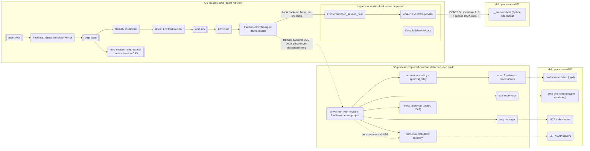

# OMP² envd Responsibility, Lifecycle, and Coupling Audit

Status: research; production refactor **not authorized**
Date: 2026-10-11

Baseline: ref `omp2` at `bc1e12d21b`. Facts were read with `git show omp2:…` and checked against code. I spot-checked symbols in a research checkout based on `origin/omp2`. Line numbers there drift by up to about 200 lines from the cited ones: `DEFAULT_RESULT_PROJECTION_BYTES` is at `server.rs:9634`, not 9550, and `wait_idle` is at 12576, not ~12405. So **cite the symbol**; treat line numbers as approximate. Anything not read directly in code or git output is marked **[INFERENCE]**. No builds, tests or benchmarks were run, so nothing here is a measured performance fact.

## Executive conclusion

`omp-envd` is **a legitimately central authority wrapped in a God-crate periphery**. It is not a God process.

- **The core is required centralization.** That core is:
  - the daemon transport;
  - the singular per-project document authority;
  - exec/sandbox/egress and the kill boundary;
  - the effect-token admission gate;
  - blobs and workspace generations;
  - Python host/worker/eval supervision.

  These are authority and state that must have one owner per project (README v1, ADRs 0006/0011/0036, Locked Deviations). They sit on the hot path of every environment tool call.
- **About 36k lines (~18%) of envd are a periphery of integrations.** Examples: browser, computer, GitHub, media/TTS, security scan, SSH, vault, schedules, a second VCS substrate, grep, and MCP config/OAuth.
  - No governing document assigns this periphery to envd.
  - Three omnibus commits brought most of it in: `caea1609c7`, `1839606706` and `de7a1c71a9`.
  - It is why envd depends on 31 of 48 workspace crates.
- **Most cross-crate co-change is the designed cost of a typed multi-process boundary.** Only 25 of 79 recent envd commits stayed inside envd. The co-changing commits are vertical features crossing `tool → proto → env → envd → driver → app`; envd did not create that pattern. Two coupling sources are envd's own:
  - the periphery;
  - a **vocabulary inversion**: envd depends on `omp-agent` approval and hook types, while driver imports envd-internal policy types.

**Recommendation: Alternative F (hybrid).** Keep the process topology and the core. Modularize inside the crate. Move the shared vocabulary into a contract crate below agent, envd and driver. Extract the periphery behind the existing `RegistryBridges`/`DynamicToolFactory` seams. Make hot-path and failure-path fixes only after the baseline in §12 exists. ADR 0045 records this as **proposed**.

---

## 1. Original purpose

### 1.1 Birth commit `768749cf01` (2026-08-14)

"feat(app): implemented environment daemon and worker supervision runtime". envd was born inside `crates/app/src/envd/{blobs,docs,exec,server,worker,workspace}.rs`. The commit body gives the original scope:

> "Introduce the `envd` subsystem supporting content-addressed blob storage, revision-pinned document leases, persistent shell execution, and workspace file search."
> "Implement transport-neutral Unix domain socket servers, protobuf framing, and tool invocation routing for native tools and Python workers."
> "Add Python tool worker supervision, discovery, JSON schema validation, and protocol handshake handling."

The client crate `crates/env` came the same day in `d77d4b6995`: "typed client boundary and request cancellation guards".

### 1.2 Crate split `8e3f027aae` (2026-08-22)

"refactor(envd): added exthost module and expanded bridge for process control". It renamed 102 files from `crates/app/src` into `crates/envd` and added `README.md` and `Cargo.toml`.

### 1.3 README founding rule (first `crates/envd/README.md`)

> "The daemon is the single owner of project environment resources. Clients request effects through the typed environment protocol instead of opening competing filesystem, process, document, worker, or extension-host authorities. Resource lifetimes, policy checks, cancellation, and recovery therefore remain attached to daemon-owned project state for both embedded and connected transports."
>
> "The crate is deliberately below the headless driver and application layers. Capabilities that require campaign state, inference composition, application-authored content, host RPC resources, or telemetry delivery enter through `RegistryBridges`."

### 1.4 Governing text today

- **AGENTS.md:39-44:** "`crates/env` (`omp-env`) is the typed environment-protocol client and owns no host resources. `crates/envd` (`omp-envd`) is the live project-environment host: daemon transport, filesystem/process/document/tool authorities, and Python extension-host/worker supervision. Host changes go to `omp-envd`; client protocol APIs go to `omp-env`."
- **AGENTS.md:11-12:** "hidden same-binary child dispatch delegates to `omp-envd` entry points and does not make app the host."
- **AGENTS.md:167-170:** "daemon implementation belongs in its host crate (`omp-envd` for the project environment), never in app presentation internals."
- **AGENTS.md:189-194:** "`crates/driver` is the reusable DI boundary for registries, concrete Tower services, `Inference` implementations, environment sessions, and higher-layer host bridges. `crates/app` … NEVER owns environment-host, extension-host, or Python-worker internals."
- **AGENTS.md:500-501 (Locked Deviation):** "File edits go through the envd document authority (versioned CAS + fuzzy 3-way rebase, typed conflict ranges)".
- **AGENTS.md:496-499 (Locked Deviation):** "Session shell owns pgids, signal escalation (TERM → grace → KILL), persistent cwd/exports, process-tree cleanup."
- **docs/architecture/processes.md (client/host split):** "`omp-env` is deliberately transport-facing and resource-free … `omp-envd` is the sole live host … A decoded in-process transport is an optimization of the same boundary, not permission to construct a second host."
- **ADR 0006:** "The host MUST own session state, inference, policy, tool routing, approval, limits, and journaling … The sandbox MUST own only environment execution". Also: "Duplex gateways from sandbox to host are prohibited, except the bounded eval parent bridge" (`omp_envd::eval::ParentSessionHost`).
- **ADR 0011:** "A tool, extension, or job MUST run in an execution unit the host can terminate."
- **ADR 0028 amendments (2026-10-06/07):** `effective_approval_mode` sits in `crates/envd/src/admission.rs`. "The daemon relays the prompt to the connection that issued the command, and only to it" (`approval_relay.rs`).
- **ADR 0036:** "Every extension host and every eval session is a killable child process (0011)."
- **ADRs that only record where something lives** (they do not *assign* it): 0007 worktrees, 0009 output bounds, 0018 `model_discovery`, 0025 `dyn`/media/TTS/browser, 0027 `tool_url`/`github_url`/`security_scan`, 0029 `report_issue`, 0037 ACP seam, 0039 schedules/generations.

### 1.5 The problem envd solves

There is one owner per project for effects and resources that must outlive any single session: documents/CAS, process groups, workspace, blobs, and killable Python children. Clients reach that owner over a bounded, cancellable, typed protocol. As a result, cancellation, bounding and recovery are properties of the owner, not of each tool (ADR 0006/0009/0011).

### 1.6 Later absorptions

- `de7a1c71a9` ("chore: smol refactor", 2026-09-04, 1,705 files) moved two former crates into envd:
  - `crates/docserver` (37 files) → `envd/src/docserver`
  - `crates/grep` → `envd/src/grep.rs`
- `03070a8c7b` moved one file in from `crates/agent`.
- `git log --follow` shows 29 commits on the README and 83 on `lib.rs`.

---

## 2. Intended vs accumulated responsibilities

**Labels.**
- **I** = intended: named in the birth commit, the README v1, AGENTS.md:39-44, or processes/extensions architecture docs.
- **I-ADR** = assigned by an ADR Decision or amendment.
- **A** = accumulated: arrived through a feature commit, and docs record only its location.
- Origins of modules born in app before `8e3f027aae` are attributed to app-era commits, because `--diff-filter=A` does not follow renames.

| Area | Modules | Origin | Label |
|---|---|---|---|
| Transport/lifecycle | `lib`, `server`, `windows`, `presence`, `recovery` | 768749cf01 … caea1609c7 | I |
| Policy-keyed daemon | `daemon_policy` | ad48ac6ac5 (2026-10-08) | I-ADR (0028) |
| Execution | `exec`, `process_store`, `process_log`, `process_identity`, `shell_child`, `direnv`, `exec_settings` | 768749cf01 / caea1609c7 | I |
| Sandbox/egress | `exec_sandbox`, `sandbox_proxy`, `exec_network_diag` | 07a732757a, 99453ce062, 8421cefe04 | I-ADR (0028) |
| Admission/policy | `admission`, `policy`, `tool_settings`, `host_settings`, `http_egress` | c8dc273e4f, 8e3f027aae, 02a9477e21 | I |
| Approval relay | `approval_relay` | 1b648d0f74 (2026-10-07) | I-ADR (0028) |
| Plan/fetch scopes | `write_scope`, `fetch_host`, `plugin_commands` | 2254cedcd1, 2c0e16c3bb, fd1dfec68c | A (feature-driven admission subjects) |
| Documents | `docserver/`, `docs`, `document_cache`, `editor_base`, `editor_sync` | 9c85c97b6a (own crate) → de7a1c71a9; 48378f7584 | I (Locked Deviation); editor I-ADR (0037) |
| Workspace/blobs | `workspace`, `workspace/operations`, `workspace_roots`, `blobs`, `ext_git` | 768749cf01, 8624d29e01 | I / I-ADR (0007, 0039) |
| Search inference bridge | `search_backend` | caea1609c7 | A |
| Grep engine | `grep.rs` | 26f85430c4 (own crate) → de7a1c71a9 | A |
| VCS substrate | `vcs/` (3.9k lines) | caea1609c7 | A (duplicates the purpose of `crates/vcs`) |
| Tools | `tools`, `tool_shell`, `tool_document`, `tool_search`, `tool_read_sources`, `tool_ast_grep`, `tool_lsp`, `tool_debug`, `resource_materializer`, `lsp_settings` | 55b98e8c8b … | I |
| Internal URLs | `tool_url/*` | 914739cfc4 | I-ADR (0027) for the mechanism; each scheme is A |
| Python | `exthost/`, `worker`, `worker_pool`, `site`, `eval/` | 768749cf01, 8e3f027aae, 363d697fa3 | I / I-ADR (0006, 0036) |
| MCP transports | `mcp/{stdio,http,legacy_sse,manager,timeout}` | caea1609c7 | I (processes.md; ADR 0011) |
| MCP config/OAuth/smithery/catalog | `mcp/{config*,discovery,oauth,smithery,filter,auth_authority}` | caea1609c7 | A |
| Devices | `devices_host` | c21c6d8a2f | I-ADR (0025) |
| Media/TTS | `media_devices`, `media_tts` | afc70c6cb4, 6f53a30649 | A |
| AutoQA | `report_issue` | 6f53a30649 | A |
| Security scan | `security_scan*` | 3ab56e2f9f | A |
| Browser | `browser_daemon`, `browser_relay` (3,977 lines), `browser_fetch` ("Application-owned …") | 1839606706, de7a1c71a9 | A |
| Desktop | `computer` | 1839606706 | A |
| GitHub | `github`, `github_url` | 1839606706, caea1609c7 | A |
| SSH | `ssh` | caea1609c7 | A (app also calls it directly) |
| Vault/Obsidian | `vault` | caea1609c7 | Partly I (durable state); Obsidian CLI is A |
| Memory | `memory`, `reflection_relay` | 8e3f027aae, 312c140d3d | A |
| Skills | `managed_skills`, `managed_skills_domain` (pure) | 1839606706, caea1609c7 | A |
| Schedules | `schedules`, `schedule_plan`, `journal_runtime` | ab079dfd29, 98ba8821a0 | A (ADR 0039: "partial, disarmed") |
| Model discovery | `model_discovery` | ab286867ab | A |
| Host facts | `host_info` | caea1609c7 | A (minor) |

**Accumulation pattern.** Three omnibus commits introduced most A modules:
- `caea1609c7` (2026-08-22) "unified environment, RPC and discovery management": 21 modules.
- `1839606706` (2026-08-22) "platform extensions for collaboration and automation".
- `de7a1c71a9` (2026-09-04) "chore: smol refactor".

None of these is a placement decision.

---

## 3. Dependency analysis

### 3.1 Size

- `crates/envd/src`: 179 `.rs` files, 199,669 lines.
- `crates/env/src`: 9 files, 8,675 lines.
- Largest files:
  - `server.rs`: 17,434 lines (tests from line 12,836)
  - `tools.rs`: 6,963
  - `exec.rs`: 6,294
  - `env/src/client.rs`: 5,413
- Largest subtrees: `docserver/` 37.8k, `mcp/` 19.9k, `exthost/` 15.5k, `eval/` 8.0k, `vcs/` 3.9k.

### 3.2 Fan-in and fan-out (Cargo)

| Crate | Fan-in (direct dependents) | Fan-out (internal `omp-*`) |
|---|---|---|
| `omp-envd` | 3: `app`, `driver`, `e2e` | **31 of 48 crate dirs (~65%)**; 84 dependency lines |
| `omp-env` | 6: `app`, `driver`, `e2e`, `envd`, `py`, `tools` | 3: `ar`, `core`, `proto` (resource-free, as documented) |

**envd's upward and sideways dependencies** (commit that added each in brackets):

| Dependency | Added in | Use |
|---|---|---|
| `omp-agent` | 8e3f027aae | 20 files. Approval types (`ApprovalRoute/Book/Decision/Spec/Scope/Ticket`, `TicketState`), hook types (`HookGate/Event/Patch/Dispatch/Phase`), `KernelSender`, `SessionAuthority`, `ExtensionRegistrar`, `EnvEvent::*` |
| `omp-ai` | de7a1c71a9 | 18 files (`mcp/*`, `github*`, `media_tts`, `model_discovery`, `security_scan/cloud`, `server`, `tools`) |
| `omp-session`, `omp-dom` | 03070a8c7b | — |
| `omp-desktop`, `omp-webview` | — | Only `computer` and `browser_*` |
| `omp-audio` | — | Only `media_*` |
| `omp-tools` | — | 50 files, 275 refs. **Intended** ("`omp-tool` defines contracts, `omp-tools` implements") |

**Cycles.** There are no Cargo cycles. There is a **layering inversion**:
- envd compiles against the kernel crate's approval and hook vocabulary;
- the kernel reaches envd only through driver.

[INFERENCE] This is logical bidirectionality (kernel → driver → envd for effects; envd → agent types for approval/hooks), not a Cargo cycle.

### 3.3 Co-occurrence (last 400 commits on `omp2`, 2026-09-29 → 2026-10-11)

185 commits touch `crates/`. **79 touch `crates/envd` (43%)**.

Crates touched per envd commit:

| Crates in commit | 1 | 2 | 3 | 4 | 5 | 6 | 7 | 8 | 9 |
|---|---|---|---|---|---|---|---|---|---|
| Commits | 25 | 15 | 12 | 10 | 5 | 6 | 3 | 2 | 1 |

Top co-changers: driver 23, app 22, tools 21, tool 17, proto 16, agent 12, env 10, chat 9, e2e 8, py 5.

A `--no-merges` window back to 2026-09-21 gives the same ranking: 116 of 321 crate-touching commits.

Feature buckets (keyword-based subject classification, medium confidence):

| Theme | Commits |
|---|---|
| Sandbox / approval / egress (ADR 0028) | 27 |
| Effect declaration / admission | 9 |
| Hygiene | 6 |
| Plan-mode write scope | 5 |
| ACP editor | 5 |
| Roster / hooks | 5 |
| Other (about 8 themes) | 22 |

- **About 14 distinct features in under two weeks.** But **36 of 79 commits are one theme** (sandbox/approval/admission), which ADR 0028 deliberately placed in envd.
- The periphery (browser, computer, github, media, schedules, security_scan) had **0** commits in the window. It costs build weight and dependency surface, not churn.

### 3.4 API surface

Counts from a PCRE scan of `^\s*pub …`, test files excluded. They include `pub` items in private modules, so the real external surface is smaller.

| Item | envd/src | env/src |
|---|---|---|
| All `pub` fns | 1,595 | 250 |
| `pub struct` | 584 | 39 |
| `pub enum` | 295 | 18 |
| `pub trait` | 48 | 1 (`Admitter`) |
| `pub mod` | 106 | 4 |
| `pub(crate)` items | 161 | 0 |

- `lib.rs` exposes about 50 top-level `pub mod`s and keeps 31 private.
- `env.proto` has 2,177 lines; `ClientFrame` has about 41 body variants.

**Callers reach past `EnvClient` into envd internals.** Counts are `omp_envd::<module>` references in app, driver and e2e:

| Module | Refs | Main consumers / types |
|---|---|---|
| `eval` | 36 | `ParentSessionHost`, `BridgeHostError`, `BridgeProgressSink` (driver kernel, workpool scheduler) |
| `mcp` | 27 | — |
| `exthost` | 21 | — |
| `admission` | 21 | `ApprovalPosture`, `SandboxState`, `ApprovalPolicy`, `ApprovalTier`, `effective_approval_mode` |
| `tool_settings` | 19 | `ApprovalMode` |
| `github_url` | 11 | — |
| `daemon_policy` | 10 | — |
| `exec_settings` | 9 | — |
| `search_backend` | 8 | — |
| `memory` | 8 | — |
| `managed_skills_domain` | 7 | Pure validation, used by `driver/src/discovery/skills.rs` |
| `ssh` | 6 | Library use by `app/src/ssh_cmd.rs` and `auth_broker_cmd.rs` |
| `site` | 5 | — |

### 3.5 Absorbed docserver and grep

- **docserver** was its own crate (`9c85c97b6a`) and is now `envd/src/docserver`, 37.8k lines.
  - It is the Locked-Deviation document authority, so its *ownership* belongs in envd's authority set.
  - *Living in the same crate* is not required. It runs as a tokio task in the daemon (`connect_or_start_docserver`), speaks its own `omp.document.v1` UDS protocol (`docserver/wire.rs`), and holds a `flock` (`docserver/types.rs:try_lock_authority`).
  - [INFERENCE] It is the cleanest extraction boundary inside the core. Extraction is optional and should be decided by build-time evidence.
- **grep** was `crates/grep` (one file) and is now `envd/src/grep.rs`, about 1.9k lines. It is a binding-free regex engine and holds no host resources. Moving it into envd was a by-product of an omnibus refactor, not a decision.

---

## 4. Current architecture

Legend: `subgraph` = **OS process**, `[[…]]` = **crate**, `(…)` = **module or type inside a crate**, dashed edges = **IPC across a process boundary**.

**Notes.** All OBSERVED (cited symbol) unless marked [INFERENCE].
- [INFERENCE] In attached mode, **Python extension hosts are children of the agent process**, not the daemon. `worker_config(trusted_extensions)` is called only from `connect_peer`/`start_embedded`, and the daemon's `ExtHostConfig::current` gets no trusted extensions.
- The driver also links `omp-envd` as a **library** (`ProjectEnvironment::attach`, `admission::*`, `tool_settings::*`, `eval::*`). So `omp-envd` code runs in both P1 and P2.
- `PartitionedEnvTransport` builds its remote set from `tools.rs:environment_tool_names` (`Locus::Environment`). Worker DATA routes Local (`partition.rs:route_data`).

### 4.1 Three deployment modes

`ProjectEnvironment::attach` (`envd/src/lib.rs`) selects the mode:

| Mode | Construction | Where environment tools run | Agent transport | Route of env tools |
|---|---|---|---|---|
| **Attached** (normal) | `attach_owner` connects, or spawns `omp envd …` (`spawn_project_daemon_with`, `process_group(0)`, `kill_on_drop(false)`, 10 s readiness) → `connect_peer` | Daemon (P2) | `EnvClient` → `PartitionedEnvTransport` → Local flume / Remote UDS | `declare_remote` (`tools.rs:declare_remote_environment`) |
| **Embedded fallback** | `start_attach_fallback` → `start_embedded`, used when the daemon can't be spawned or reached | Agent process (P1) | `EnvClient::in_process(64)`, flume, no serialization | `Registered` → `ToolRoute::Native`. No env frames; edits still use docserver UDS |
| **Isolated / worktree** | `ProjectEnvironment` isolated start (`lib.rs` ~1100, not read in full) | Agent process | As embedded | As embedded |

**Socket keys.** The daemon socket is keyed by executable build **and** policy digest (`omp_env::project_state::environment_socket`, `daemon_policy::from_con`). So one project may have several environment daemons, but exactly one docserver authority (flock).

---

## 5. Lifecycle (12 stages)

| # | Stage | Owner / executor | Authorizer | State holder | Why envd | Hot path? |
|---|---|---|---|---|---|---|
| 1 | Agent creation | driver `compose_kernel` → `Kernel::new` (`agent/src/loop.rs`) | con context + policy digest (`EnvironmentPolicyDrift`) | `Kernel`, `Session` | Tool registry (`environment.registry()`) and Python extension registrar come from the env host | No (once) |
| 2 | Environment resolution | envd lib `attach_owner` / `connect_peer` / `start_embedded` | OS uid; socket 0600 + uid check (`connect_owner_uds_frames`); `verify_daemon_policy`; `build_id::is_stale` | Socket path, hello | Daemon spawn/retire is envd code | No |
| 3 | Capability acquisition | envd `accept_hello`, `ConnectionState` grants; per call `Invocation::commit_args` | Grants per connection; effect token minted in driver, checked by `scope_authenticates` | `ConnectionState` | `ArgsCommitted` is "the sole effect-authorization gate" (`env.proto`) | **Yes** (scope check) |
| 4 | Resource allocation | envd `open_project` (daemon) / `open_session_host` | envd | `WorkspaceHost`, `BlobHost`, `ExecHost` (+`ProcessStore` in daemon only), MCP, docserver, `ExtHostSupervisor` | AGENTS.md: env owns no host resources | No |
| 5 | Execution init | `Dispatcher::prepare` (Session / Native / External unit) → envd `serve_frames` → `dispatch` → `open_invocation` | — | `PreparedCall`, `ConnectionState` | Only for env/worker tools | **Yes** |
| 6 | Tool execution | envd (bash `ExecHost`, edit `DocumentHost` → docserver, eval child); session host (Python ext); kernel (session tools) | Agent `Dispatcher::admit` for Native units; envd `AdmissionGate` for External units; driver approvals | envd / docserver | Effects happen where resources are owned | **Yes**: 2 RTT + about 5 docserver RTTs per edit |
| 7 | Agent-to-agent coordination | driver `subagent/spawn.rs` (`run_child` → full `compose_kernel`), `hub.rs` (SessionRegistry mailboxes) | depth/concurrency settings | Parent DOM, JobBoard | Worktrees (`create_worktree`), named processes. Messaging is envd-free | No |
| 8 | Process supervision | envd `ExecHost`/`SpawnBook`, `ExtHostSupervisor`, eval, `mcp/stdio` | envd | `ProcessStore` (`envd.lease` flock) | ADR 0011 kill boundary | Indirect |
| 9 | Persistence / recovery | `omp-session` → `omp-journal` (`.oms` + session CAS); `recover_process_disappearance`; `reconcile_jobs` | — | Journal (authoritative) | Not needed. envd only caches (CAS verdicts, grants) and `replicate_outcome_blob` copies into the session store | Outcome copy only |
| 10 | Cancellation | Dispatcher ladder (`interrupt_grace` → `Abort::EffectsUnknown`; 30 s detach) + envd `interrupt`/`cancel`/`cancel_all` | — | Tokens, `RunGuard` | Kill of env-owned processes | **Yes** |
| 11 | Error propagation | envd `ProtocolError` / typed verdicts → driver maps to `ExternalDispatchEvent::Aborted` → journaled `commit_abort` | — | Journal | Errors become journaled aborts, never kernel `Err` | **Yes** |
| 12 | Cleanup / termination | driver `ProjectLifecycle::drop` (never retires the daemon); envd `wait_idle` → `shutdown_managed`; `ExtHostSupervisor::shutdown` | — | — | Daemon idle exit | No |

### 5.1 Hot-path cost per attached remote env tool call (read from code, unmeasured)

**Mandatory:**
- 2 awaited round trips (4 frames): `InvokeTool` → `InvocationAccepted` (awaited before commit), then `ArgsCommitted` → `Verdict`.

**Conditional:**
- +1 RTT per `Admission`.
- +N `Update` frames.
- +≥1 `BlobGet` stream when the verdict is > 64 KiB.

**Per-frame work:**
- partition-router flume hop and route-table update;
- prost encode/decode;
- `write_all` + **`flush` per frame**;
- a cross-thread hop to `route_responses`.

**Verdict handling:**
- Always written to the env CAS (`put_verdict_bytes`).
- Inlined only if ≤ 64 KiB (Bounded) or ≤ 8 MiB (Complete).
- Then replicated into the session CAS: a second write.

**Edits:**
- A single-file edit makes about **5 docserver UDS round trips**: `open`, `read`, `commit_transaction`, then `open` + `read` in `read_committed_view`.

**Zero env IPC:**
- Session and native tools.
- Python worker tools go over in-process flume, not UDS.
- Embedded mode makes 0 env frames.

---

## 6. Control / execution / data plane classification

| Plane | Interactions | Owner | Per-call? |
|---|---|---|---|
| **Control** | Hello/ServerHello, Retire, Shutdown, Register/ReleasePresence, policy digest, `RevokeApprovalGrants`, `AcpBind`, `EvalReset`, worktree create/merge/destroy, named-process start/stop/restart/list, extension reload/quarantine, MCP inspector | envd `server`, `lib`, `presence`, `workspace/operations`, `exec`, `exthost` | No |
| **Execution** | `InvokeTool`, `ArgsCommitted`, `AdmitInvocation`/`Admission`, `Interrupt`, `Cancel`, `Verdict`, `Update`, `Exec`/`Stdin`/`Signal`/`Resize`, `ExecControl`, `ApprovalQuery`/`Answer`, `ReflectionQuery`, `EditRepairQuery` | envd `server`, `admission`, `exec`; driver `EnvToolExecutor` | **Yes** |
| **Data** | `BlobGet`/`Put*`/`Stat`, `DocumentOp`, `Walk`/`Search`, `AttachOutput`, `HttpRequest`, `DataRequest` Worker/Site/Resource/Mcp, `DapLaunch`/`Action`, LSP events | envd `blobs`, `docserver`, `workspace`, `http_egress`, `mcp` | **Yes** |

- The client-side split is executable code: `partition.rs:route_client_frame` and `route_data`.
- The planes **share one connection and one frame multiplex**. A control-plane failure (daemon gone) therefore stalls execution and data for every remote tool.

---

## 7. Failure containment

What happens when the envd daemon dies (attached mode):

| Component | Effect | Evidence |
|---|---|---|
| Kernel, journal, inference | Unaffected (P1) | Topology §4 |
| Relayed approval/reflection queries | Withdrawn on remote close | `partition.rs:withdraw_relayed`; test `partitioned_client_loses_daemon_queries_when_the_daemon_closes` |
| Pending remote request streams | **No error frame from the router.** They stay pending until cancelled, or until the next remote-bound frame fails `send_async` → `PartitionError::BackendClosed`. That **ends the whole router, including the Local backend** | `partition.rs:route` (`send_async(...).map_err(BackendClosed)`) |
| In-flight env calls | [INFERENCE] Settle via dispatcher interrupt grace as `EffectsUnknown`, or detach at the 30 s blocking limit | `dispatch.rs` interrupt/detach |
| Python worker tools (Local backend) | [INFERENCE] Lose transport once the router ends, even though their hosts live in P1 | as above |
| Reconnect | **None** in `EnvClient`. Recovery needs a recompose | `env/src/client.rs` (none found) |
| bash/exec children | [INFERENCE] Orphaned on daemon SIGKILL. There is no parent-death handling in `exec.rs`/`shell_child.rs`. Named processes are re-adopted by `recover_records` on the next start | `exec.rs`, `process_store.rs` |
| Eval kernels | Self-terminate via `getppid` watchdog | `eval/process.rs`; test `parent_death_watchdog_terminates_kernel_and_descendants` |
| Documents | flock released. Other compositions reconnect or rehost (`install_rehost`, `docs.rs:disconnect_generation` → `spawn_reconnect`). Committed bytes are on disk; leases are lost | `server.rs`, `docs.rs`; `fallback_notice` text |
| Journal | Authoritative and unaffected. Outcomes were already replicated or the call aborts | `kernel.rs:replicate_outcome_blob` |

**Single-instance assumptions:**
1. One docserver per project (flock).
2. One durable process-store owner (`envd.lease` flock).
3. Environment daemons are **per (build, policy)**, not per project.
4. [INFERENCE] Each subagent worktree is a separate project digest. So each child attaches to or spawns **its own daemon and docserver**, with up to 10 s readiness on first spawn.

**Conclusion.**
- Containment between the session and the environment is good: the journal survives.
- Containment *within* the client is weak: one dead backend takes the Local backend with it, and nothing reconnects.
- These are Optimize findings in `omp-env`, not reasons to restructure envd.

---

## 8. Invariants and minimum centralization

**Centralization types:**
- **authority**: a single decider.
- **state**: a single owner of mutable shared state.
- **coordination**: a single point for ordering or rendezvous.
- **execution**: must run in a specific killable or owning process.
- **implementation**: only code locality.

| Invariant | Source | Minimum centralization | Must it be the envd daemon? |
|---|---|---|---|
| No effects before `ArgsCommitted`; scoped DATA echoes the effect token | `env.proto` (`ArgsCommitted` docs); `server.rs:scope_authenticates` | **authority**, located at the process performing effects | No. Any resource-holding process; embedded mode already enforces this via Native admission |
| Document CAS: base revision, 3-way rebase, single writer per project | AGENTS.md:500; docserver flock | **authority + state**, across all omp processes | **Yes, an out-of-process singular owner.** This is the strongest reason for the daemon |
| Detached/named processes outlive sessions | `process_store.rs` lease; `exec.rs:recover_records` | **state** (durable lease) | Yes, for detached processes only |
| pgid TERM → grace → KILL, tree cleanup | AGENTS.md:496-499; ADR 0011; `SpawnBook::terminate` | **implementation** | No. Any supervisor |
| Cancellation yields a typed terminal (`EffectsUnknown`, never missing) | ADR 0011; `dispatch.rs` | **implementation** (dispatcher) + execution kill boundary | No |
| Extensions/eval never share the engine heap; killable | ADR 0011/0036 | **execution** (separate process) | No. Already met by session-host children |
| Crash recovery: journal-first close of unsettled calls | ADR 0003; `exit_diagnostics.rs:recover_process_disappearance` | **implementation** (session crate) | No |
| Subagent filesystem isolation | ADR 0007; `spawn.rs:run_child` | **coordination** (worktree authority) | Uses envd `workspace/operations`; per-project singular |
| Presented policy equals enforced policy | `kernel.rs` drift check; `verify_daemon_policy` | **coordination** at attach | Lifecycle only |
| Approval grants are a derivable cache of journaled decisions | ADR 0028; `RevokeSessionGrants` | **state** (journal) + **coordination** (relay to issuing connection) | No for state (journal). The relay is envd today |
| No parallel mutable source of truth | AGENTS.md:205-207 | **state** (journal) | No. envd must stay a cache |
| Sandbox/egress applies to every shell session | ADR 0028; `exec.rs:active_sandbox`, `sandbox_proxy` | **execution** (wraps spawn) | Wherever `ExecHost` runs |

**Reading.** Only **document authority** and **durable detached processes** strictly require a cross-session, out-of-process owner. Everything else needs either a single *decision function* (admission, approval mode) or a *kill boundary*. Today's daemon placement satisfies those, but the invariants do not demand it.

---

## 9. Ownership matrix

| Responsibility | Current owner | Intended owner | Hot path? | Centralization required? | Delegation candidate? | Evidence |
|---|---|---|---|---|---|---|
| Daemon transport, framing, hello, policy-keyed socket, presence, recovery | envd `server`, `lib`, `windows`, `daemon_policy`, `presence`, `recovery` | envd | Yes (every frame) | authority + state | No | README v1; AGENTS.md:41-44; processes.md |
| Document authority (leases, CAS, rebase, transactions, watch) | envd `docserver`, `docs`, `document_cache`, `editor_*` | envd | Yes | authority + state | No (could become a separate crate in the same process) | AGENTS.md:500; flock `try_lock_authority` |
| LSP/DAP sessions | envd `docserver/lsp*`, `dap*` | envd | Medium | execution + state | Modularize | processes.md |
| Process/shell exec, kill boundary, named processes | envd `exec`, `process_*`, `shell_child`, `tool_shell` | envd | Yes | execution + state | No | ADR 0011; `SpawnBook` |
| Sandbox compile, egress broker | envd `exec_sandbox`, `sandbox_proxy`, `exec_network_diag` | envd (ADR 0028) | Yes (every bash) | execution | Policy compile could move to `omp-sandbox`; broker stays | ADR 0028 amendments |
| Admission and approval posture | envd `admission`, `policy`, `tool_settings`, `approval_relay`, `fetch_host`, `write_scope` | ADR 0006: host. ADR 0028: `effective_approval_mode` in envd | Yes | authority | Vocabulary → contract crate; placement needs investigation for remote envd | ADR 0006 vs 0028; driver uses 21 `admission::` refs |
| Workspace search/walk | envd `workspace`, `tool_search`, `search_backend` | envd | Yes | implementation (read-only); execution for root grants | `search_backend` is an inference bridge | 768749cf01 |
| Grep engine | envd `grep.rs` | own crate before de7a1c71a9 | Yes | implementation | Yes (restore crate) | de7a1c71a9 rename |
| Workspace generations, CoW worktrees | envd `workspace/operations` | envd (ADR 0007, 0039) | Low | state | No | ADR 0007 |
| Blob CAS | envd `blobs` | envd | Medium | state | No | 768749cf01 |
| Tool registry assembly, hook composer | envd `tools` (6,963 lines), `tool_*` | envd | Yes | authority (sealed registry) + execution | Modularize | extensions.md |
| Python ext host lifecycle / CONTROL / quotas | envd `exthost/*`, `worker`, `site`, `ext_git` | envd (AGENTS.md:43; ADR 0036) | Medium | execution + authority | No | extensions.md |
| Named worker pool | envd `worker_pool` | envd | Medium | execution | No | README |
| Eval child and parent bridge | envd `eval` | envd (ADR 0006 exception) | Medium | execution | Bridge *vocabulary* → contract crate | 36 refs from driver |
| MCP process transports | envd `mcp/{stdio,http,legacy_sse,manager,timeout}` | envd | Medium | execution | No | processes.md; ADR 0011 |
| MCP config/OAuth/smithery/catalog | envd `mcp/{config*,discovery,oauth,smithery,filter,auth_authority}` | unassigned | Low | implementation | Yes | `omp_ai`/`omp_catalog` uses |
| `dyn` device host | envd `devices_host` | envd (ADR 0025) | Low | authority (device admission) | No | ADR 0025 |
| Media/TTS | envd `media_devices`, `media_tts` | location only | Low | implementation | Yes | `omp-audio` dependency |
| AutoQA report_issue | envd `report_issue` | location only (0029) | Low | state (local store) | Yes | ADR 0029 |
| Security scan | envd `security_scan*` | unassigned | Low | implementation | Yes | 3ab56e2f9f |
| Browser automation/relay/fetch | envd `browser_*` (~6.1k lines) | unassigned; `browser_fetch` self-describes as app-owned | Low | execution (child), not project state | Yes | `omp-webview` dependency |
| Desktop computer-use | envd `computer` | unassigned | Low | execution | Yes | `omp-desktop` dependency |
| GitHub API / `issue://` `pr://` | envd `github`, `github_url` | location only (0027) | Low | implementation | Yes | app and driver import `github_url` directly |
| SSH/SFTP | envd `ssh`, `tool_url/ssh` | unassigned | Low | execution as tool; implementation for CLI | Yes (own crate) | `app/src/ssh_cmd.rs` |
| Vault/Obsidian | envd `vault`, `tool_url/vault` | unassigned | Low | implementation | Yes | caea1609c7 |
| Memory runtime, reflection relay | envd `memory`, `reflection_relay` | unassigned | Low | execution | Investigate | 312c140d3d; ADR 0006 duplex rule |
| Managed skills | envd `managed_skills`, `managed_skills_domain` | unassigned | Low | authority (containment); domain is pure | Domain: yes | `driver/discovery/skills.rs` |
| Durable schedules | envd `schedules`, `schedule_plan`, `journal_runtime` | unassigned; ADR 0039 "partial, disarmed" | No | state | Defer | ADR 0039 |
| Model discovery HTTP | envd `model_discovery` | location only (0018) | No | authority (bounded egress) | Yes | ADR 0018 |
| VCS substrate | envd `vcs/` | unassigned; `omp-vcs` exists | Low | implementation | Yes (merge into `omp-vcs`) | `vcs/mod.rs` vs `crates/vcs` |
| Host info, direnv | envd `host_info`, `direnv` | direnv is I | Low | execution | No | README v1 |
| Plugin command gating | envd `plugin_commands` | unassigned | Low | authority | Keep (part of admission) | fd1dfec68c |

### 9.1 Classification

| Class | Members |
|---|---|
| **Must remain (Preserve)** | Transport/server/presence/recovery/`daemon_policy`; docserver + LSP/DAP; exec, process store, shell child, sandbox, egress broker; admission/policy decision function and per-connection relay; blobs; workspace generations; exthost/worker/worker_pool/eval/site/ext_git; MCP transports; `devices_host`; intended `tool_*` adapters; `write_scope`; `plugin_commands`; direnv |
| **Modularize internally (Optimize)** | `server.rs`: dispatch is mixed with ~15 CONTROL-authority factories, late diagnostics and device invokers; `tools.rs`: registry + `RegistryBridges` + `HookControlFactory`; `mcp/`: transport half vs config/catalog half |
| **Delegate (Extract behind `RegistryBridges` / `DynamicToolFactory` / `ContentResolver`)** | browser\*, computer, media/TTS, report_issue, security_scan, github/github_url, model_discovery, MCP config/OAuth/smithery |
| **Belongs elsewhere (Decouple)** | `vcs/` → `omp-vcs`; `grep.rs` → own crate; `managed_skills_domain` → driver discovery or `omp-ext`; `ssh` → own crate; approval/posture/hook/eval-bridge vocabulary → contract crate below agent, envd and driver |
| **Needs proof (Defer)** | schedules / schedule_plan / journal_runtime |
| **Needs investigation** | Admission placement when envd runs on an untrusted worker (ADR 0006 vs 0039); approval and reflection relays vs the ADR 0006 duplex prohibition; MCP process locus (README "stay[s] in the attaching process" vs `mcp/mod.rs` "Environment-scoped"); per-subagent daemon cost; orphaned exec children on daemon SIGKILL; whether the vault Obsidian CLI is used |

[INFERENCE] A delegated integration still needs an environment-side execution locus when invoked as a tool. Delegation moves the *implementation crate* out; envd keeps the admission and supervision hook.

---

## 10. Alternatives

| ID | Alternative | Shape |
|---|---|---|
| **A** | Preserve | No structural change; status quo |
| **B** | Modular monolith | Same processes and crate role. Split `server.rs`/`tools.rs`/`mcp` into modules; contract crate for shared vocabulary; extract the periphery into crates behind existing seams; restore `grep`, merge `vcs` |
| **C** | Thin supervisor | envd only supervises processes. Document, admission and tool authorities move to driver/agent |
| **D** | Capability-oriented services | One daemon or service per authority (documents, exec, extensions, MCP), each with its own socket |
| **E** | Event-driven | Components communicate over an internal event bus; envd becomes a set of subscribers |
| **F** | Hybrid (recommended) | B, plus measured hot-path and failure-path fixes in `omp-env`/envd: pipelined invoke, router fail-fast and pending-stream errors, fewer docserver round trips, exec orphan handling. Each fix is gated on §12 baselines |

### 10.1 Criteria and weights (justified from AGENTS.md)

| Criterion | Weight | Justification |
|---|---|---|
| Invariant preservation (single document authority, effect gate, kill boundary, journal-first) | 30 | Locked Deviations "NEVER port back" (AGENTS.md:489-501); AGENTS.md:205-207 "NEVER a parallel mutable source of truth"; ADR 0006/0011/0036 |
| Hot-path performance | 20 | AGENTS.md:212-213 "Performance sections … load-bearing … NEVER weaken"; allocation discipline is CRITICAL (:215) |
| Build and dependency weight | 15 | AGENTS.md:540-542 "Feature graphs earn their weight … cold `cargo run --bin omp` build time is a gate" |
| Change locality / maintainability | 10 | Engineering priority: correctness, then maintainability; 54 of 79 envd commits span ≥2 crates |
| Failure containment | 10 | ADR 0011 "Termination MUST NOT be able to take session authority with it"; §7 findings |
| Migration cost and reversibility | 10 | AGENTS.md:120-122: clean cutovers, no shims. Every step must be a self-contained, revertible change |
| Operational complexity (processes, sockets, lifecycles) | 5 | Fewer moving parts. Secondary to the above because the process count is already fixed by invariants |

### 10.2 Weighted decision matrix

Scores run from 1 (worst) to 5. Performance scores are **[INFERENCE] unmeasured** estimates from §5.1 code reading.

| Criterion (weight) | A | B | C | D | E | F |
|---|---|---|---|---|---|---|
| Invariants (30) | 5 | 5 | 2 | 3 | 2 | 5 |
| Hot path (20) | 3 | 3 | 3 | 2 | 2 | 4 |
| Build weight (15) | 1 | 4 | 4 | 4 | 3 | 4 |
| Change locality (10) | 2 | 3 | 3 | 3 | 3 | 4 |
| Failure containment (10) | 2 | 2 | 3 | 4 | 3 | 3 |
| Migration/reversibility (10) | 5 | 4 | 1 | 1 | 1 | 4 |
| Ops complexity (5) | 5 | 5 | 3 | 1 | 2 | 4 |
| **Weighted total (max 500)** | **340** | **385** | **265** | **275** | **225** | **420** |

**Why the losers lose:**
- **C** moves document authority into the agent process. That breaks per-project singularity across sessions, which is a Locked Deviation.
- **D** multiplies hops on the edit path (it already makes about 5 docserver round trips) and multiplies lifecycles.
- **E** puts a bus between the effect-token gate and the effect. That makes ordering, journal-before-ack and cancellation harder to prove, and no evidence calls for it.

**Sensitivity.**
- If §12 shows no material IPC overhead, F's hot-path score falls to 3 and F becomes B (385). B still beats A.
- A wins only if build weight is weighted below 5, which contradicts the AGENTS.md build-time gate.

---

## 11. Outcome selection

**Outcome labels, per responsibility.** These are distinct from the alternative IDs above:
- **A** Preserve
- **B** Optimize in place
- **C** Extract / delegate
- **D** Decouple (move to its rightful crate)
- **E** Defer / needs proof

| Area | Outcome | Condition |
|---|---|---|
| Transport, docserver authority, exec/sandbox/egress, admission decision function, blobs, generations, Python supervision, MCP transports | **A Preserve** | — |
| `server.rs`, `tools.rs`, `mcp/` split; partition router fail-fast; pipelined invoke; docserver round trips; per-frame flush | **B Optimize** | Hot-path items only after a §12 baseline shows they matter |
| browser\*, computer, media/TTS, report_issue, security_scan, github\*, model_discovery, MCP config/OAuth/smithery | **C Extract** | One integration per change; each removes a Cargo dependency or measurably shrinks the envd build |
| Approval/hook/eval-bridge/posture vocabulary; `vcs/`; `grep.rs`; `managed_skills_domain`; `ssh` | **D Decouple** | Pure moves; all callers migrated in the same change |
| schedules; admission placement for remote envd; relays vs ADR 0006; per-subagent daemon; exec orphan handling | **E Defer / investigate** | Needs an owner decision (0006/0039) or measurement |

**Overall selection: Alternative F.**
- Core: Outcome A.
- Large modules: Outcome B.
- Periphery: Outcome C.
- Vocabulary and duplicates: Outcome D.
- Open items: Outcome E.

---

## 12. Performance investigation plan (unverified; nothing measured yet)

### 12.1 Workloads

Each workload runs in attached **and** embedded mode, cold and warm daemon, macOS arm64 and Linux.

| ID | Workload | What it isolates |
|---|---|---|
| W1 | 1,000 × `read` of a 1 KiB file | Fixed per-call IPC cost (2 RTT + router + flush) |
| W2 | 200 × single-file `edit` | Docserver round trips (~5) and CAS commit |
| W3 | 500 × `bash` running `true` | Exec spawn + sandbox compile + IPC |
| W4 | `read`/`bash` producing 63 KiB, 65 KiB, 7.9 MiB and 9 MiB outputs | Projection thresholds, `BlobGet` stream, dual CAS write |
| W5 | `grep` over a large repo | Data-plane streaming |
| W6 | 500 × Python extension tool | Local backend (flume) + CONTROL frames |
| W7 | `task` spawning 1, 4 and 8 subagents with worktrees | Per-worktree daemon spawn and readiness [INFERENCE target] |
| W8 | SIGKILL the daemon mid-W1, mid-W3 and mid-W6 | Time to typed terminal; Local-backend collateral; orphaned children |
| W9 | Daemon cold attach vs warm attach | Spawn/readiness/hello |

### 12.2 Instrumentation

- `tracing` spans with monotonic timestamps:
  - `EnvToolExecutor`: invoke-sent, accepted, commit-sent, first-update, verdict, replicate-done.
  - Partition router: enqueue, dequeue.
  - `connect_owner_uds_frames`: write, flush, read.
  - Server: `dispatch`, `open_invocation`, `commit_invocation`, `send_verdict_json`.
  - `DocumentHost::request_with_connection` per op.
  - `BlobHost::put_verdict_bytes`; `replicate_outcome_blob`.
- Counters per call: frames, bytes encoded, allocations on the update path (`raw_json` `to_vec`/`from_utf8`), docserver requests.
- W8 measures: router exit time, number of streams left pending, orphaned pids (`ps` by pgid).
- Recording: in the existing **P8 non-gating recorder** (`crates/e2e/tests/p8_baselines.rs`, `.github/workflows/p8-baseline.yml`). AGENTS.md:722-724: "NEVER turn noisy host measurements into an unreviewed hard gate."

### 12.3 Thresholds, set from the baseline

No absolute numbers are proposed before measurement. The rules are relative:
1. **Baseline.** Record N ≥ 30 runs per workload and mode. Store p50, p95, and the noise band (2 × MAD) per metric.
2. **Investigate trigger.** An Optimize item proceeds only if its share is **greater than the noise band and at least 10% of the workload's p50 wall time**. Examples:
   - IPC overhead = attached p50 − embedded p50 for W1.
   - Docserver round-trip share for W2.
   - Replication cost for W4.
3. **Acceptance.** A fix must reduce the targeted p50 by more than the baseline noise band, with no p95 regression beyond the noise band on any workload.
4. **Containment acceptance.** For W8, every in-flight call reaches a typed terminal within `interrupt_grace`, with zero pending streams. This is a correctness criterion, not a performance threshold.
5. **Build weight.** Each Extract change records cold `cargo build --bin omp` time and envd crate compile time before and after. An extraction that does not reduce either is reconsidered.

---

## 13. Incremental, reversible plan

Every step is one self-contained change with every caller migrated: no shims, aliases or re-exports (AGENTS.md:120-122). Reversibility means "revert one change", never "keep two paths".

| Phase | Steps | Reversible because | Gate |
|---|---|---|---|
| 0 Measure | Add §12.2 spans/counters; record the baseline in P8 | Instrumentation only | Owner accepts ADR 0045 |
| 1 Vocabulary | Create a contract crate below agent, envd and driver. Move approval/hook types from `omp-agent`, and `admission::{ApprovalPosture, SandboxState, ApprovalPolicy, ApprovalTier}`, `tool_settings::ApprovalMode`, `eval::{ParentSessionHost, BridgeHostError, BridgeProgressSink}` | Pure type moves | `omp-envd` no longer depends on `omp-agent` |
| 2 Internal modularization | `server.rs` → `server/{dispatch, control_factories, devices, diagnostics}`; `tools.rs` → registry / bridges / hooks; `mcp/` → transport vs config | Module moves inside one crate | No behavior change; existing envd tests pass |
| 3 Decouple duplicates | `vcs/` → `omp-vcs`; `grep.rs` → own crate; `managed_skills_domain` → driver/`omp-ext`; `ssh` → own crate | Crate moves | Callers migrated |
| 4 Extract periphery | One change each: browser, computer, media/TTS, security_scan, report_issue, github, model_discovery, MCP config/OAuth. Each registers via `DynamicToolFactory`/`RegistryBridges` from driver | Each step removes one dependency edge; revert restores it | §12.3 rule 5 |
| 5 Containment | Partition router: fail all pending routes of a closed backend with a typed error; do not end the Local backend on Remote close; decide on reconnect. Investigate exec orphan handling | Local to `omp-env`/`exec.rs` | W8 acceptance |
| 6 Hot path | Pipeline `ArgsCommitted` with `InvokeTool` for External units, which already hold complete args; reuse the commit lease in `read_committed_view`; review per-frame `flush`; review dual CAS write | Each is protocol-local, with a `SCHEMA_REV` bump where the wire changes | §12.3 rules 2-3 |
| 7 Open decisions | Admission placement for remote envd; relay exceptions in ADR 0006; schedules' future; per-subagent daemon sharing | ADR amendments first | Owner decision |

---

## 14. Backlog

| ID | Objective | Rationale | Components | Deps | Acceptance | Tests |
|---|---|---|---|---|---|---|
| ENVD-01 | Baseline envd hot path | No measured data exists; all perf claims are unverified | `driver` `EnvToolExecutor`, `env` partition/client, `envd` server/docs/blobs, `e2e` P8 | — | W1-W9 recorded per platform/mode with p50/p95/MAD | P8 recorder schema test; no new gate |
| ENVD-02 | Contract crate for approval/hook/posture/eval-bridge vocabulary | Removes the envd → `omp-agent` inversion and 76 driver refs into envd internals | new crate, `agent`, `envd`, `driver`, `app` | — | `omp-envd` Cargo has no `omp-agent`; driver imports no `omp_envd::{admission,tool_settings,eval}` vocabulary | `cargo check` workspace; existing approval/eval tests unchanged |
| ENVD-03 | Split `server.rs` | 17.4k lines mixing dispatch with ~15 control factories | `envd/src/server*` | — | No public API change; each submodule < 5k lines [target, owner-adjustable] | envd nextest + doctests |
| ENVD-04 | Split `tools.rs` and `mcp/` | Registry/bridges/hooks and transport/config mixed | `envd/src/tools*`, `mcp/` | ENVD-03 optional | Same as ENVD-03 | envd tests; e2e `tool_sources` |
| ENVD-05 | Restore `grep` as a crate | Absorbed by an omnibus refactor; no host resources | `envd/src/grep.rs`, new crate | — | envd uses it as a dependency | grep unit tests move with it |
| ENVD-06 | Merge `envd/src/vcs` into `omp-vcs` | Two VCS substrates | `envd/src/vcs`, `crates/vcs` | — | One substrate; envd calls `omp-vcs` | vcs tests; worktree e2e |
| ENVD-07 | Move `managed_skills_domain`, `ssh` out | Pure domain / CLI library use bypassing `EnvClient` | `envd`, `driver/discovery`, `app/ssh_cmd`, new `ssh` crate | — | No app/driver `omp_envd::ssh` or `managed_skills_domain` refs | skills discovery tests; ssh tests |
| ENVD-08 | Extract browser/computer | Removes `omp-webview`, `omp-desktop` from envd | `envd/browser_*`, `computer`, driver bridges | ENVD-02 | envd Cargo lacks both; tools still admitted by envd | browser/computer tool tests; build-time delta recorded |
| ENVD-09 | Extract media/TTS, report_issue, security_scan, github, model_discovery, MCP config/OAuth | Removes `omp-audio` and most `omp-ai` use | respective modules, driver bridges | ENVD-02 | Dependency edge removed per item | per-module tests; e2e |
| ENVD-10 | Partition router containment | Remote close leaves streams pending and later kills the Local backend | `env/src/partition.rs`, `client.rs` | ENVD-01 (W8) | W8: all in-flight calls get a typed terminal within `interrupt_grace`; Python worker tools survive daemon death | new test: in-flight invocation when daemon dies |
| ENVD-11 | Pipelined invoke + docserver round-trip reduction | 2 awaited RTT per call; ~5 docserver RTT per edit | `driver` executor, `envd` server, `env.proto`, `tool_document.rs`, `docs.rs` | ENVD-01 threshold met | §12.3 rule 3 on W1/W2 | protocol tests; `p2_cancel_matrix`; edit conflict tests |
| ENVD-12 | Exec orphan handling on daemon SIGKILL | [INFERENCE] bash children orphaned | `exec.rs`, `shell_child.rs` | ENVD-01 (W8) | W8: no surviving non-detached children | e2e daemon-kill test |
| ENVD-13 | Decide admission placement and relays for remote envd | ADR 0006 vs 0028/0039 tension | ADR 0006/0028/0039 amendments | Owner | Written decision | n/a |
| ENVD-14 | Schedules: arm or move out | "partial, disarmed" code always linked | `schedules`, `schedule_plan`, `journal_runtime` | Owner | Decision recorded; code armed or relocated | schedule tests |
| ENVD-15 | Per-subagent daemon cost | [INFERENCE] One daemon per worktree, up to 10 s readiness | `driver/subagent/spawn.rs`, `envd/lib.rs` | ENVD-01 (W7) | Measured; decision whether worktrees share the parent daemon | W7 |

---

## 15. Final question: God service or legitimate center? Is the coupling caused by envd or only visible there?

**Legitimate center, with a God-crate periphery. It is not a God process.**

**The core must stay centralized.** The single per-project document authority (flock + CAS + rebase) and the durable detached-process lease are the two invariants that *require* an out-of-process singular owner (§8). Admission, sandbox and kill boundary require a single decision function and an execution locus, and envd provides both. The core is on the hot path of every coding action, and the theme ADR 0028 deliberately placed there accounts for most of envd's churn (36 of 79 commits).

**The coupling is mostly *visible* in envd, not *caused* by it.**
1. **Vertical features cross a typed multi-process boundary by design.** Of 79 envd commits, 54 co-change other crates. The top co-changers (driver, app, tools, tool, proto, agent, env) are exactly the layers of the `tool → proto → env → envd → driver → app` path. A new effect class or relay has to touch them all. Any architecture with a typed process boundary pays this cost, and C, D and E would add more boundaries, not fewer.
2. **"Host changes go to `omp-envd`" is applied per feature rather than per authority.** One crate builds both the daemon and the in-process session host, so every new effectful tool lands in envd by default. This is a structural attractor in the docs and topology, not a defect of envd's design.

**Part of the coupling is *caused* there, and it is fixable without touching the core.**
- **The periphery** (~36k lines, ~18%), which arrived through three omnibus commits. It accounts for most of the 31-crate fan-out (`omp-webview`, `omp-desktop`, `omp-audio`, most `omp-ai`). It costs build weight and dependency surface, not churn: 0 commits in the window.
- **The vocabulary inversion.** envd depends on `omp-agent` approval and hook types, while driver depends on envd-internal policy and eval-bridge types. The shared vocabulary has no neutral home.

**Answer.**
- Preserve the core and its process topology.
- Modularize its oversized modules.
- Give the shared vocabulary a contract crate.
- Extract the periphery behind seams that already exist.
- Fix client-side failure containment.
- Change the hot path only once measurements justify it.

This is Alternative F. ADR 0045 proposes it.

---

## Confidence and gaps

**High:**
- Cargo graph, fan-in/out, line and `pub` counts, first-introducing commits, co-occurrence counts (direct `git` output on `omp2`).
- Call paths and symbols in §5–§7 (code reading).

**Medium:**
- Feature bucketing of commit subjects.
- I/A labels for modules born before the app → envd rename.
- `pub` counts that include items in private modules.
- Partition-router behavior: read in code, not executed.

**[INFERENCE]:**
- Python ext hosts are P1 children in attached mode.
- Per-worktree daemons.
- Exec children orphaned on daemon SIGKILL.
- Python worker tools losing transport after daemon death.
- The ~18% periphery estimate.
- All alternative scores for performance.

**Not done:**
- No builds, benchmarks or compile-time attribution per module.
- `agent/src/cancel.rs`, `jobs.rs` and `exthost/lifecycle.rs` were not read in full.
- The isolated/worktree `ProjectEnvironment` start was not read in full.

**Questions for the owner:**
1. Should admission stay in envd once envd runs on untrusted workers (ADR 0039), or should decision (host) be split from enforcement (envd)?
2. Are the approval and reflection relays further exceptions to ADR 0006's duplex prohibition?
3. Which process owns MCP in attached mode?
4. Should subagent worktrees share the parent's daemon?
5. Is `schedules` on the roadmap?
