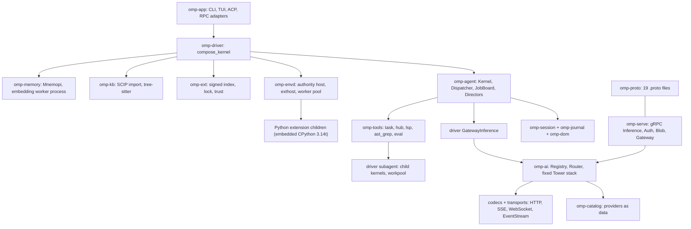

# Diagram 01: current verified OMP2 architecture

> Part of the [OMP2 gateway-capabilities research](../README.md). Status: **CURRENT, verified at 85d219ae7f**. Every box names a crate or symbol that was read on that commit; anything not read is not drawn. Research proposal: nothing here is implemented.

## Mermaid



## ASCII

```
 omp-app (CLI, TUI, ACP, RPC)
      |
 omp-driver --compose_kernel--> omp-agent: Kernel, Dispatcher, JobBoard, Directors
      |                              |-- omp-session / omp-journal / omp-dom   (durable tree)
      |                              |-- GatewayInference --> omp-ai (Registry, Router, Tower stack)
      |                              |                          |-- omp-catalog (providers as data)
      |                              |                          '-- codecs + transports (HTTP/SSE/WS/EventStream)
      |                              '-- omp-tools: task, hub, lsp, ast_grep, eval
      |                                        '-- driver subagent: child kernels + workpool
      |-- omp-envd (authority host) --exthost/worker pool--> Python extension children
      |-- omp-ext (signed index, lock, trust)
      |-- omp-kb (SCIP import, tree-sitter)
      '-- omp-memory (Mnemopi; embedding worker process, NDJSON over stdio)

 omp-serve (gRPC: Inference, Auth, Blob, Gateway) --> omp-ai      omp-proto: 19 .proto files
```

## Evidence

- Composition and kernel: `crates/driver/src/headless/kernel.rs:2457` `compose_kernel`; `crates/agent/src/loop.rs:463` `Kernel`; `crates/agent/src/dispatch.rs:1236` `Dispatcher`; `crates/agent/src/jobs.rs:699` `JobBoard`.
- Inference path: `crates/driver/src/headless/gateway.rs:30` `GatewayInference`; `crates/ai/src/registry.rs:155` `Registry`; `crates/ai/src/router.rs:148` `Router`; `crates/ai/src/layer/stack.rs:261-274` (the fixed stack); `crates/catalog/src/snapshot.rs:58` `Catalog`.
- Subagents: `crates/driver/src/subagent/workpool_runtime.rs:31` `KernelWorkpoolLauncher`; `crates/tools/src/task.rs`; `crates/tools/src/hub.rs`.
- Extensions: `crates/ext/src/lib.rs:47` `TrustTier`; `crates/envd/src/exthost/`; `crates/envd/src/worker_pool.rs`.
- Code intelligence and memory: `crates/kb/src/graph.rs:408` `read_scip`; `crates/memory/src/embedding/supervisor.rs:50` `EmbeddingSupervisor`.
- gRPC surface: `crates/proto/proto/omp/gateway/v1/gateway.proto:21` `service Gateway`; `crates/proto/proto/omp/inference/v1/inference.proto:39` `service Inference`; `crates/serve/src/lib.rs`.
- Narrative and caveats: [deliverable 2](../02-verified-current-state.md).

## Legend

Solid arrows are composition or call direction as read in code, not a statement about runtime frequency. `---` links a contract crate to its server. Nothing here is proposed; the proposed architecture is in [diagram 19](19-complete-proposed-architecture.md) once written.
