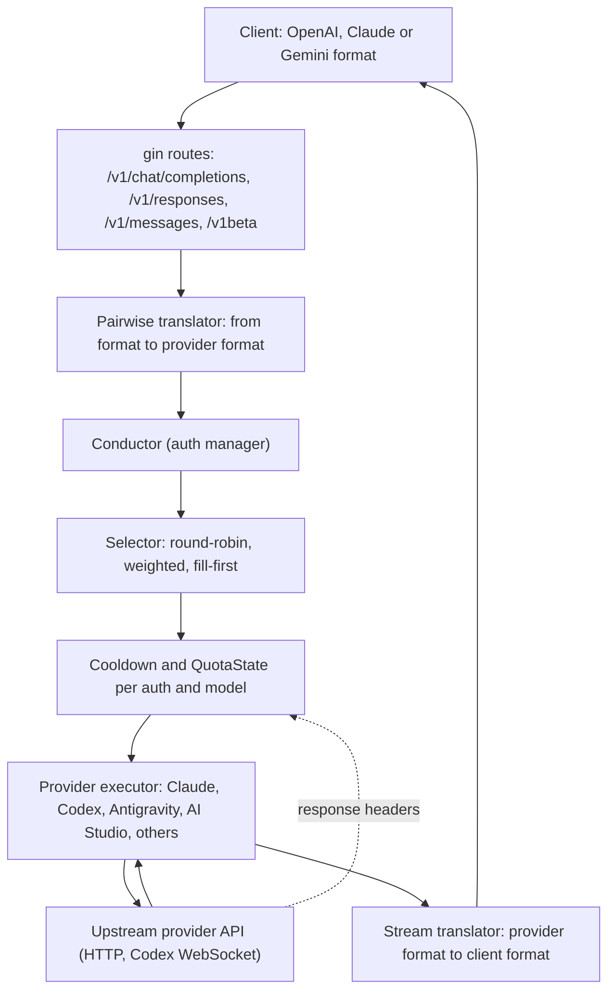

# CLIProxyAPI architecture

> Part of the [OMP2 gateway-capabilities research](../README.md). Deliverable 12. Audited commit `85d219ae7f` (`origin/omp2`). Research proposal: nothing here is implemented.

Status: CURRENT, verified at `router-for-me/CLIProxyAPI@dbe641f` (reference repository, not OMP2). Code read for the cited symbols only.



```
client(openai|claude|gemini) -> gin route -> translator[from->to] (one per pair)
   -> Conductor -> Selector{RoundRobin | WeightedRR | FillFirst}
        -> cooldown + QuotaState (persisted; fed by response headers)
        -> executor(provider) -> upstream (HTTP | Codex WebSocket)
   <- stream translator[to->from] <- executor
```

## Evidence

- Routes: `router-for-me/CLIProxyAPI@dbe641f:internal/api` (`POST /v1/chat/completions`, `/v1/responses`, `/v1/messages`, `/v1beta/...`).
- Pairwise translation: `sdk/translator/helpers.go:TranslateRequestByFormatName`, `TranslateStreamByFormatName`; `internal/translator/openai/claude/init.go:RegisterRequestEnvelope`.
- Selectors: `sdk/cliproxy/auth/selector.go:RoundRobinSelector,WeightedRoundRobinSelector,FillFirstSelector`.
- Cooldown and quota: `sdk/cliproxy/auth/conductor_cooldown.go:RestoreCooldownStates`; `sdk/cliproxy/auth/quota_signals.go:ObserveResponseHeadersForProvider`.
- Executors: `internal/runtime/executor/*`; Codex WebSocket: `codex_websockets_executor.go`.

## Legend

Rectangles are components found in code. Dashed edge is header-driven quota feedback. Compare with `06-current-provider-execution-path.md` (OMP2): OMP2 has one canonical IR instead of pairwise translators and no header-to-quota producer.

Back to the [index](../README.md).
