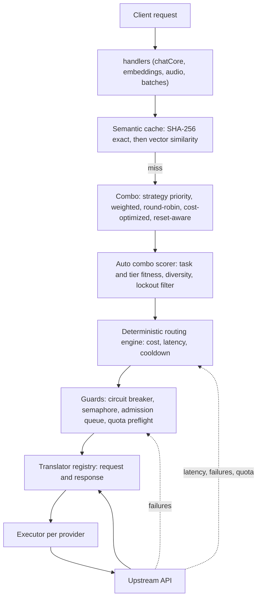

# OmniRoute architecture

> Part of the [OMP2 gateway-capabilities research](../README.md). Deliverable 12. Audited commit `85d219ae7f` (`origin/omp2`). Research proposal: nothing here is implemented.

Status: CURRENT, verified at `cheaper-inference/OmniRoute@3e23a8a` (reference repository, not OMP2). Code read for the cited symbols only; many modules located by file name.



```
request -> handler -> semantic cache (exact | vector) -> miss
  -> combo (named strategy) -> auto scorer -> routing engine (cost | latency | cooldown)
  -> guards: circuitBreaker(CLOSED/DEGRADED/OPEN/HALF_OPEN) + semaphore + admission + quota
  -> translator registry -> executor(provider) -> upstream
  feedback: latency samples, failure kinds, quota -> engine and breaker
```

## Evidence

- Cache: `cheaper-inference/OmniRoute@3e23a8a:open-sse/services/cache/semanticCacheManager.ts`.
- Combos: `open-sse/services/combo.ts`, `comboConfig.ts`; auto scorer: `open-sse/services/autoCombo/*`.
- Engine: `open-sse/services/routingStrategies.ts:DeterministicRoutingEngine`.
- Breaker: `src/shared/utils/circuitBreaker.ts`; per connection: `open-sse/services/connectionCircuitBreaker.ts`.
- Guards: `open-sse/services/accountSemaphore.ts`, `admission/queue.ts`, `quotaPreflight.ts`.
- Translators: `open-sse/translator/registry.ts`.

## Legend

Rectangles are components found in code or by file name. Dashed edges are feedback. OMP2 equivalents: `Router` plus `AccountPool` plus the route stack (`06-current-provider-execution-path.md`); the breaker, latency and cost producers are the missing parts (PRV-01, PRV-03).

Back to the [index](../README.md).
