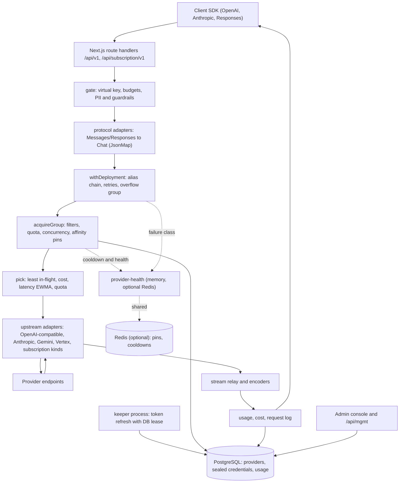

# LLMHub architecture

Status: REFERENCE REPOSITORY, read at `8bdc1de` (`nicolaeser/llmhub`, MIT, commit 2026-11-26). Not an OMP2 diagram; it shows the reference gateway as read from code.

Back to the [index](../README.md).

## Mermaid



## ASCII

```text
client --> /api/v1/* , /api/subscription/v1/*     (Next.js route handlers)
              |
        gate (virtual key, RPM/TPM, budget hold, PII, guardrails)
              |
        protocol adapters  Messages/Responses <-> Chat (untyped JsonMap)
              |
        withDeployment (alias chain, num_retries, overflow group)
              |
        acquireGroup: enabled -> allowed -> signed-in -> healthy -> untried
                      -> within quota -> concurrency room -> affinity pin
              |
        pick(strategy): in-flight | weighted | cost | priority | rr | EWMA | quota
              |
        upstream adapter (per provider kind) --> provider endpoint
              |  <-- stream relay + encoders (idle timeout)
        usage + cost + request log --> client

 side processes:  keeper (token refresh, DB lease)   worker (model sync, retention)
 state:           PostgreSQL (required)   Redis (optional: pins, cooldowns, leases)
```

## Evidence

- Route and gate: `nicolaeser/llmhub@8bdc1de:src/lib/gateway/endpoints/chat-completions-route.ts:chatCompletionsRoute`; `src/lib/gateway/endpoints/pipeline.ts:gateModelRequest`.
- Protocol adapters: `src/lib/gateway/protocols/messages.ts:messagesToChat`; `src/lib/gateway/protocols/responses.ts:responsesToChat`; `src/lib/gateway/dispatch/messages-dispatch.ts:chatFallback`.
- Retry and fallback loop: `src/lib/gateway/dispatch/chat.ts:withDeployment`, `failureClass`.
- Selection: `src/lib/gateway/routing/runtime.ts:acquireGroup`, `pick`; `src/lib/gateway/routing/router.ts`.
- Health and cooldown: `src/lib/gateway/routing/provider-health.ts:recordFailure`.
- Affinity: `src/lib/gateway/routing/deployment-affinity.ts`; `src/lib/gateway/routing/session-fingerprint.ts`.
- Keeper: `src/keeper/main.ts`; `src/keeper/cycle.ts:runKeeperCycle`; `src/lib/gateway/upstreams/credentials.ts:LEASE_MS`.
- Streaming: `src/lib/gateway/dispatch/chat.ts:openUpstreamStream`; `src/lib/gateway/protocols/chat-stream.ts:pipeChatStream`.

## Legend

Solid arrows are the request path; dotted arrows are state lookups or writes. Boxes with `( )` are stores. The diagram is a reading aid, not a statement about OMP2.
