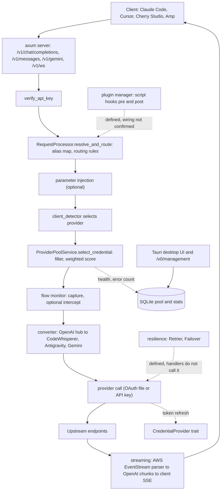

# ProxyCast architecture

Status: REFERENCE REPOSITORY, read at `3ad8ff6` (`hank9999/proxycast`, no licence file, README says GPL-3.0, commit 2025-12-26). Not an OMP2 diagram; it shows the reference desktop proxy as read from code.

Back to the [index](../README.md).

## Mermaid



## ASCII

```text
client --> axum (/v1/chat/completions | /v1/messages | /v1/gemini/* | /v1/ws)
              |
        verify_api_key -> RequestProcessor.resolve_and_route (alias, rules)
              |
        injection (optional) -> client_detector -> provider type
              |
        ProviderPoolService.select_credential (SQLite rows, health, score)
              |
        flow monitor (capture / intercept / replay)
              |
        converter: Anthropic -> OpenAI (hub) -> CodeWhisperer | Antigravity | Gemini
              |
        provider call with OAuth file or API key  --> upstream
              |  <-- AWS EventStream / SSE --> chunk converter --> client
 desktop: Tauri UI, tray, config hot reload, /v0/management/*
 defined but not on the handler path: processor steps, Retrier, Failover, plugins
```

## Evidence

- Routes: `hank9999/proxycast@3ad8ff6:src-tauri/src/server/mod.rs:842-882`.
- Handler flow: `src-tauri/src/server/handlers/api.rs:621-800` (`chat_completions`).
- Routing and alias: `src-tauri/src/processor/mod.rs:resolve_and_route`; `src-tauri/src/router/rules.rs`.
- Credential selection and score: `src-tauri/src/services/provider_pool_service.rs:181-300`.
- Converters: `src-tauri/src/converter/protocol_selector.rs:Protocol`; `openai_to_cw.rs`; `openai_to_antigravity.rs`.
- Streaming: `src-tauri/src/streaming/aws_parser.rs:AwsEventStreamParser`; `streaming/traits.rs:StreamingProvider`.
- Resilience not wired: grep for `execute_with_resilience` finds only its definition in `src-tauri/src/processor/steps/provider.rs:328`.

## Legend

Solid arrows are the request path; dotted arrows are side effects or code that exists but was not found on the request path. Boxes with `( )` are stores.
