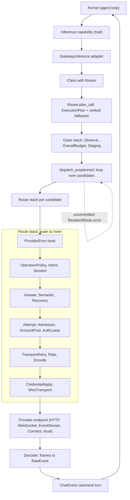

# Current provider execution path

> Part of the [OMP2 gateway-capabilities research](../README.md). Deliverable 12. Audited commit `85d219ae7f` (`origin/omp2`). Research proposal: nothing here is implemented.

Status: CURRENT, verified at 85d219ae7f

One logical call from the agent kernel to the wire and back.



```
Kernel -> Inference -> GatewayInference -> Client(Router)
   Router.plan_call -> ExecutionPlan { model, route, codec, fallbacks[] }
   Observe > OverallBudget > Staging
     dispatch_preplanned  (for candidate in [primary, fallbacks...])
        ProviderError
         OperationPolicy > Intent > Session > Answer > Semantic > Recovery
          Attempt
           Admission > AccountPool > AuthLease > TransportRetry > Rate
             > Encode > CredentialApply > WireTransport ---> provider
        <-- Decoder(frames -> RawEvent) <-- ChatEvent --> Kernel
     on uncommitted ReselectRoute error: next candidate
```

## Evidence

- Composition and kernel: `crates/driver/src/headless/kernel.rs:2457 compose_kernel`; `crates/agent/src/loop.rs:115 trait Inference`, `:463 Kernel`; `crates/driver/src/headless/gateway.rs:30 GatewayInference`.
- Client and router: `crates/driver/src/registry.rs:942`; `crates/ai/src/router.rs:173 plan_call`.
- Outer stack and fallback loop: `crates/ai/src/layer/stack.rs:228 OuterExecutionService`; `crates/ai/src/registry.rs:651 dispatch_preplanned`, `:874 fallback_is_safe`.
- Route stack order: `crates/ai/src/layer/stack.rs:236-274 build_route_stack`.
- Decode path: `crates/ai/src/codec/mod.rs:844 Decoder`, `:797 RawEvent`; `crates/ai/src/event.rs:178 ChatEvent`.
- Router runtime evidence is the default in production: `crates/ai/src/router.rs:785-794`.

## Legend

Boxes are components in code on the audited commit. Dashed edge is the cross-route fallback loop. Router health, quota and latency inputs exist but receive default values in production (see `evidence/omp2-provider-runtime.md` S03).

Back to the [index](../README.md).
