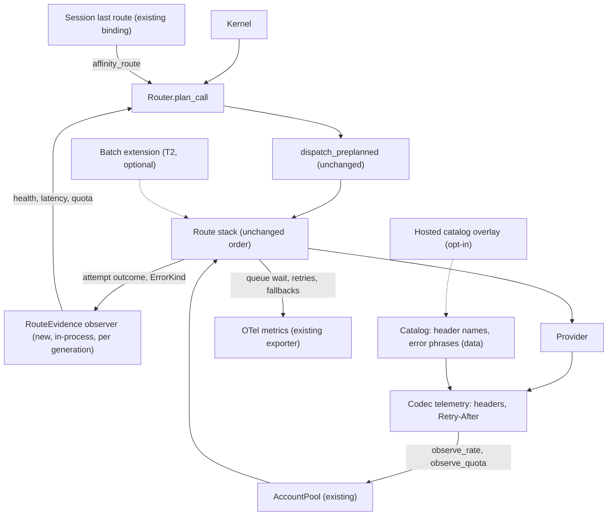

# Proposed provider runtime

> Part of the [OMP2 gateway-capabilities research](../README.md). Deliverable 12. Audited commit `85d219ae7f` (`origin/omp2`). Research proposal: nothing here is implemented.

Status: PROPOSED, not implemented

The proposal adds producers and consumers to the existing runtime. It adds no second runtime, scheduler or store.



```
              +----------------- existing -----------------+
Kernel -> Router.plan_call -> dispatch_preplanned -> route stack -> provider
              ^   ^                                     |    |
  [new] RouteEvidence observer <--- attempt outcome ----+    |
  [new] affinity_route (session binding)                     |
              AccountPool <--- observe_rate/observe_quota <--+--- codec telemetry
  [new] OTel: queue wait, retries, fallbacks <---------------+
  Catalog data: header names, error phrases  (providers-as-data)
  Optional: hosted catalog overlay, batch extension (T2)
```

## Evidence

- Existing hooks the proposal reuses: `crates/ai/src/plan.rs:401 RuntimeRouteEvidence`; `crates/ai/src/router.rs:166 with_runtime_evidence`, `:285 affinity_route`; `crates/ai/src/account/pool.rs:750,769 observe_rate, observe_quota`; `crates/ai/src/codec/mod.rs:666 ProviderTelemetryEvent`; `crates/observability/src/metrics.rs:73`.
- Overlay: `crates/catalog/src/snapshot.rs:236 additive_shared_catalog_overlay`.
- Cards: PRV-01, PRV-02, PRV-03, PRV-04, PRV-05, PRV-06, PRV-16 in `../05-provider-integration-recommendations.md` and `../06-transport-and-protocol-recommendations.md`.

## Legend

`[new]` marks the only additions. Solid arrows exist in code today; dashed boxes are optional. Placement follows ADR 0049: the observer and metrics are T1 (`omp-ai`, `omp-observability`), batch is T2, catalog data stays in `omp-catalog`.

Back to the [index](../README.md).
