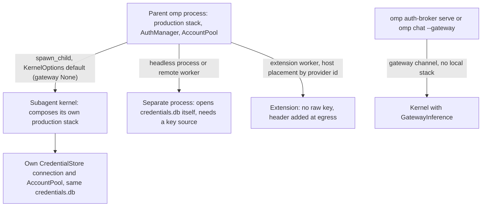
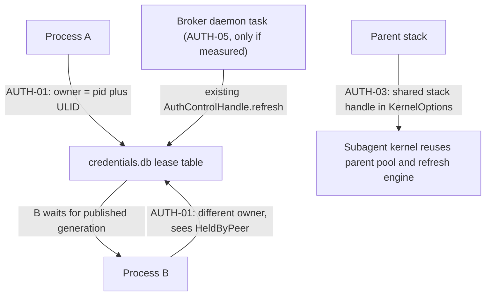

# Authentication and credential lifecycle (current sequence and proposed delta)

Back to the [index](../README.md). Cards: [`05b`](../05b-authentication-and-credential-lifecycle.md). Evidence: [`omp2-auth-credentials.md`](../evidence/omp2-auth-credentials.md).

## A. Current: lazy refresh, two OMP processes sharing one data directory

Status: CURRENT, verified at 85d219ae7f

```mermaid
sequenceDiagram
    participant PA as "Process A (session or subagent stack)"
    participant PB as "Process B (second omp process)"
    participant DB as "credentials.db (SQLite WAL)"
    participant IdP as "Provider token endpoint"
    PA->>DB: "lease(account): stored lease, expires within 60 s skew"
    DB-->>PA: "Expired"
    PA->>DB: "try_acquire_lease(owner = omp-auth-refresh)"
    DB-->>PA: "Acquired, epoch 1"
    PB->>DB: "lease(account): Expired"
    PB->>DB: "try_acquire_lease(owner = omp-auth-refresh)"
    Note over DB: "same owner string, so Held is not returned; epoch becomes 2"
    DB-->>PB: "Acquired, epoch 2"
    PA->>IdP: "refresh_token grant (old refresh token)"
    PB->>IdP: "refresh_token grant (same old refresh token)"
    IdP-->>PA: "new tokens"
    PA->>DB: "write bundle under lease epoch 1, expected_generation g"
    DB-->>PA: "LeaseLost (epoch is now 2)"
    IdP-->>PB: "new tokens, or invalid_grant if the provider rotates tokens (inference)"
    PB->>DB: "write bundle under lease epoch 2, expected_generation g"
    DB-->>PB: "committed generation g+1 (if B received tokens)"
```

```text
Process A                 credentials.db                 Process B
   | lease -> Expired          |                              |
   |-- try_acquire(owner X) -->|                              |
   |<-- Acquired epoch 1 ------|                              |
   |                           |<-- try_acquire(owner X) -----|
   |                           |--- Acquired epoch 2 -------->|   X is the same constant,
   |-- refresh grant --------> provider <---- refresh grant --|   so no HeldByPeer
   |-- write (epoch 1) ------->|                              |
   |<-- LeaseLost -------------|                              |
   |                           |<-- write (epoch 2) ----------|
Inside one process: static FLIGHTS map dedups callers per account (no duplicate refresh).
```

Evidence:
- `crates/driver/src/registry.rs:1381` `RefreshCoordinator::new("omp-auth-refresh", ...)`.
- `crates/ai/src/auth/store.rs:1196-1213` `try_acquire_lease` (`held_owner != owner` before `Held`; epoch increment).
- `crates/ai/src/auth/store.rs:591-630` `put_inner` (owner, epoch and expiry re-checked; `LeaseLost`).
- `crates/ai/src/account/refresh.rs:381` `FLIGHTS`; `:458-509` `refresh`.
- `crates/ai/src/auth/manager.rs:1314-1450` `RefreshingCredentialSource` (60 s skew, one replay).
- Not verified: the provider-side rotation behaviour in the last two messages (audit 6.2).

Legend: solid arrows are calls; `X` is the owner token; "inference" marks a consequence not tested.

## B. Current: where a worker gets its credential

Status: CURRENT, verified at 85d219ae7f



```text
parent stack --spawn_child--> child kernel --> own store + pool + coordinator  (duplicated manager)
parent stack --process--------> worker process --> own store + pool (needs OMP_LLM_KEY_SOURCE unattended)
parent stack --placement-----> extension (no key; host attaches header)
broker daemon --gateway------> kernel with no local credential stack
```

Evidence: `crates/driver/src/subagent/spawn.rs:726-738,932`; `crates/driver/src/headless/kernel.rs:2780-2825,2849`; `crates/driver/src/registry.rs:212-250,1189-1262`; `crates/app/src/cli.rs:1871`.

## C. Proposed delta (separate from A and B)

Status: PROPOSED, not implemented



```text
A (owner A1) --acquire--> lease table --Held(A1)--> B (owner B2) waits, then reads generation g+1
parent stack --handle--> child kernels (one pool, one refresh engine, one store open)
broker daemon --periodic existing refresh (if AUTH-05 passes its benchmark)--> account near expiry
```

Evidence for the proposed pieces: cards AUTH-01, AUTH-03, AUTH-05 in [`05b`](../05b-authentication-and-credential-lifecycle.md); the seams they use are the existing `RefreshLeaseStore` (`crates/ai/src/account/refresh.rs:161`), `KernelOptions` (`crates/driver/src/subagent/spawn.rs:726`) and `AuthControlHandle::refresh` (`crates/ai/src/auth/manager.rs:644`).

Legend: a "handle" means a reference to the existing production stack object, not a new manager.
