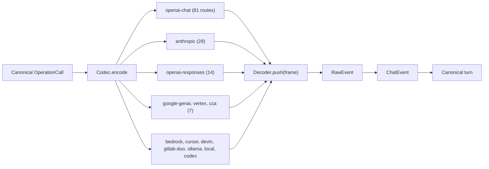

# Protocol translation

> Part of the [OMP2 gateway-capabilities research](../README.md). Deliverable 12. Audited commit `85d219ae7f` (`origin/omp2`). Research proposal: nothing here is implemented.

Status: CURRENT, verified at 85d219ae7f

Canonical intermediate representation with one codec per wire protocol, compared with the pairwise alternative that OMP2 does not use.



```
 canonical OperationCall --Codec.encode--> wire (one per protocol)
 wire frames --Decoder.push--> RawEvent --> ChatEvent --> canonical turn

 N codecs  (OMP2)            vs   N*(N-1) translators (pairwise, not used)
 33 codec ids in snapshot         e.g. 14 model-serving -> 182 directional pairs
```

## Evidence

- `crates/ai/src/codec/mod.rs:918 Codec`, `:844 Decoder`, `:797 RawEvent`; `crates/ai/src/event.rs:178 ChatEvent`.
- Codec ids and route counts: `evidence/measurements/11-catalog-census.md` (33 ids; 14 model-serving).
- Canonical decoding rule: AGENTS.md Locked Deviations ("provider frames decode to canonical semantic events"); ADR 0022 (`docs/adr/STATUS.md:40`).
- The pairwise count is arithmetic: 14 x 13 = 182.

## Legend

Route counts in parentheses come from the census. The pairwise comparison is illustrative arithmetic, not a measurement.

Back to the [index](../README.md).
