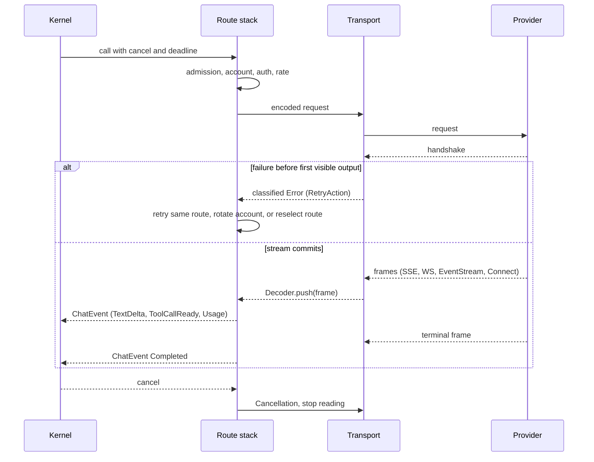

# Streaming execution

> Part of the [OMP2 gateway-capabilities research](../README.md). Deliverable 12. Audited commit `85d219ae7f` (`origin/omp2`). Research proposal: nothing here is implemented.

Status: CURRENT, verified at 85d219ae7f

A streamed turn with the commit point that decides whether retry or fallback is still allowed.



```
 pre-commit:  failure -> classify(ErrorKind, RetryAction)
              SameRoute | RotateAccount | RefreshCredential | ReselectRoute
              (only if body replay evidence allows retry)
 commit:      first visible output  => later failures surface as stream errors
              (no rollback event in ChatEvent)
 stream:      frame -> Decoder.push -> RawEvent -> ChatEvent
 terminal:    Completed + Usage (cache read/write tokens, cost) in ExecutionReceipt
 cancel:      ExecutionContext.cancelled + Notify; checkpoint() between phases
```

## Evidence

- Commit rule: `crates/ai/src/event.rs:173-176` (no restart or rollback event); `crates/ai/src/layer/retry.rs:124-197` (retry only uncommitted and replay-safe); `crates/ai/src/registry.rs:874 fallback_is_safe`.
- Cancellation: `crates/ai/src/layer/mod.rs:86-87,516`; `crates/ai/src/codec/mod.rs:957 Cancellation`.
- Framing: `crates/ai/src/transport/{sse,ndjson,websocket_transport,eventstream,connect}.rs`.
- Usage and cache accounting: `crates/ai/src/receipt.rs:147-154`; TTFT: `crates/observability/src/span.rs:123,430`.
- Not verified: HTTP body backpressure under a stalled consumer (PRV-17).

## Legend

`alt` branches show the commit point. Backpressure on realtime sessions is a bounded queue with a typed error (`crates/ai/src/operation/realtime.rs:169`).

Back to the [index](../README.md).
