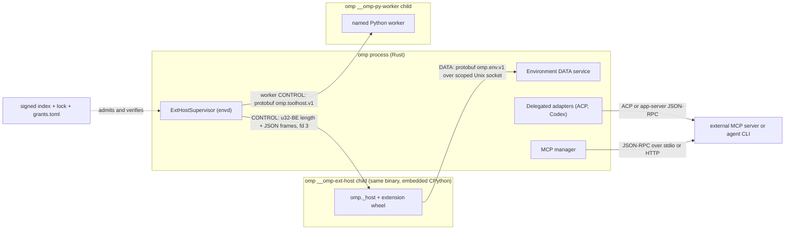
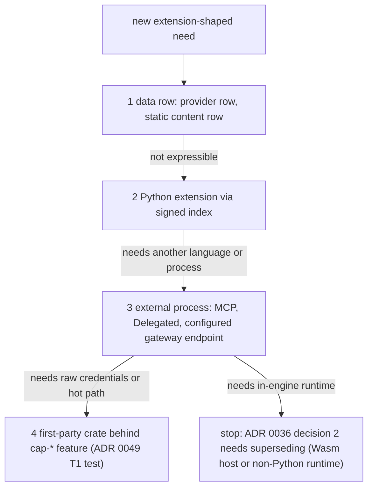

# ABI-independent extension boundaries

> Back to the [index](../README.md). Part of deliverable 12. Companion to [`07-abi-independent-extension-assessment.md`](../07-abi-independent-extension-assessment.md).

## A. Current boundaries

Status: CURRENT, verified at 85d219ae7f



```
+------------------------- omp process (Rust) --------------------------+
|  ExtHostSupervisor --CONTROL (u32-BE len + JSON, fd 3)--> ext host     |
|  Environment DATA <--protobuf omp.env.v1, scoped Unix socket-- ext host|
|  worker supervisor --protobuf omp.toolhost.v1--> python worker         |
|  MCP manager --JSON-RPC stdio/HTTP--> external MCP server              |
|  Delegated adapters --ACP / app-server JSON-RPC--> external agent CLI  |
|  signed index + lock + grants.toml admit and verify extensions         |
+------------------------------------------------------------------------+
ext host and worker = same omp binary re-entered (embedded CPython);
no shared library, no extern "C" plugin export, no Wasm host.
```

Evidence
- `crates/envd/src/exthost/spawn.rs:46, 543, 746`: hidden argument, spawn, child entry.
- `crates/app/src/main.rs:107-130`: same-binary re-entry for worker and extension host.
- `crates/envd/src/exthost/control.rs:2549, 3814-3834`: JSON CONTROL frame and u32 big-endian length.
- `crates/py/python/omp/_host.py:224, 240`: Python end of the frame codec.
- `crates/proto/proto/omp/env/v1/env.proto:12-40`: DATA framing and `ClientHello`.
- `crates/proto/proto/omp/toolhost/v1/toolhost.proto:15-36`: worker protocol and `WorkerHello`.
- `crates/envd/src/mcp/transport/`: MCP transports. `crates/driver/src/delegated_acp.rs:1-33`: delegated launch profiles.
- `crates/ext/src/index.rs:180`, `crates/ext/src/lock.rs:103`, `crates/ext/src/trust.rs:84`: index, lock, grants.

Legend: solid arrows are message channels; dashed arrow is admission and verification; every box in the engine process is Rust, every child is an OS process.

## B. Proposed boundary ladder

Status: PROPOSED, not implemented



```
need -> 1 data row            (provider row, static content row)
     -> 2 Python extension    (signed index, lock, sandboxed child)
     -> 3 external process    (MCP, Delegated, configured gateway endpoint)
     -> 4 first-party crate   (cap-* feature, ADR 0049 T1 test)
     -> STOP: Wasm host / non-Python runtime = ADR 0036 decision 2 superseded
Common wire rule: messages only; schema_rev, api_level and capability strings;
receivers skip unknown fields. Common distribution rule: signed index, hashes, lock.
```

Evidence
- Ladder source: `docs/adr/0049-tiered-integration-architecture.md:41-54` (lowest tier that satisfies the requirement) and `docs/adr/0036-python-for-extensions.md:40-41`.
- Wire rule: `crates/proto/proto/omp/env/v1/env.proto:17-23`, `crates/proto/proto/omp/gateway/v1/gateway.proto:9-17`.
- Cards: EXT-01 to EXT-12 in [`07-abi-independent-extension-assessment.md`](../07-abi-independent-extension-assessment.md).

Legend: boxes are decision points; the last box is an owner decision, not a design.
