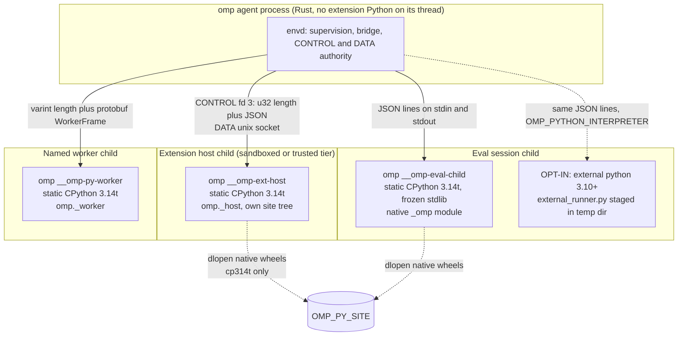
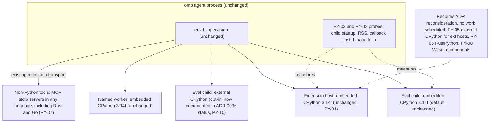

# Diagram 12: embedded versus standalone Python workers

> Part of the [OMP2 gateway-capabilities research](../README.md). Deliverable 8 (diagram 12). Audited commit `85d219ae7f` (`origin/omp2`). Research proposal: nothing here is implemented.

Status lines: the first diagram is **CURRENT** (verified at the audited commit, see [Python runtime audit](../evidence/omp2-python-runtime.md)); the second is **PROPOSED** (no runtime topology change; additions are measurement probes, documentation and a non-Python path through existing MCP stdio).

## 1. CURRENT



```text
CURRENT (audited commit 85d219ae7f)

 omp agent process (Rust)
 |  envd supervises, never runs extension Python on its own thread
 |
 +--JSON lines (stdin/stdout)--> [omp __omp-eval-child]   embedded CPython 3.14t (default)
 |                         `..--> [external python3.10+ + external_runner.py]  (opt-in, Eval only)
 +--CONTROL fd3 u32+JSON, DATA unix socket--> [omp __omp-ext-host]  embedded CPython 3.14t
 |                                             tiers: sandboxed (no network) | trusted
 +--varint+protobuf WorkerFrame--> [omp __omp-py-worker]  embedded CPython 3.14t
 
 All embedded children are the same executable re-entered with a hidden argv[1].
 Native wheels load from $OMP_PY_SITE (cp314t, abi3t or none tags only).
 One interpreter per process; a second interpreter is a second process.
```

## 2. PROPOSED



```text
PROPOSED (research proposal, nothing implemented)

 Topology unchanged. Additions only:
   + measurement probes on embedded children (PY-02 startup/RSS/binary delta, PY-03 callback cost)
   + ADR 0036 status note recording the opt-in external Eval interpreter (PY-10)
   + non-Python tools keep using MCP stdio (PY-07); no new plugin runtime
 Held behind ADR reconsideration, evidence missing: PY-05, PY-06, PY-08
```

Back to the [index](../README.md).
