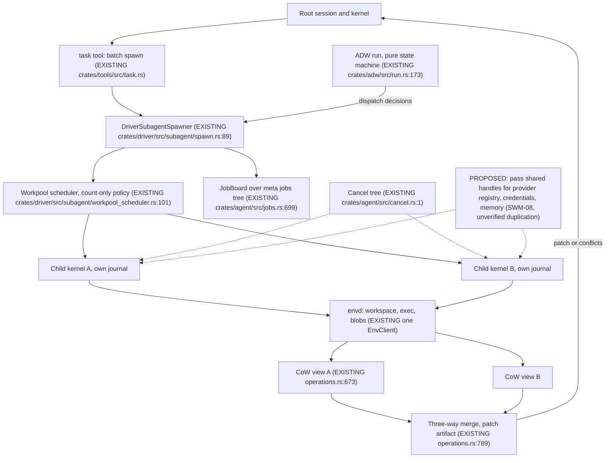

# Single-session logical swarm

> Part of the [OMP2 gateway-capabilities research](../README.md). Diagram for deliverables 9 and 12. Audited commit `85d219ae7f` (`origin/omp2`). Research proposal: nothing here is implemented.

Status: PROPOSED architecture view. Elements marked EXISTING are verified in code and cited; no element here is new code. The proposal is to keep this shape as the default and add nothing to it.



```
 root session --task--> DriverSubagentSpawner --> workpool (count limit) --+--> child kernel A --> CoW view A --+
   ^   ADW run (EXISTING) -----dispatch------^         |                  +--> child kernel B --> CoW view B --+
   |                                                    v                                                       v
   +<----------- patch artifact or conflicts <---- three-way merge (envd) <-----------------------------------+
 JobBoard (index of the meta jobs tree) tracks every child; cancel tree reaches every child.
 PROPOSED only: shared handles for provider registry, credentials, memory db (SWM-08).
 Everything else on this page is EXISTING; nothing new is added.
```

Back to the [index](../README.md).
