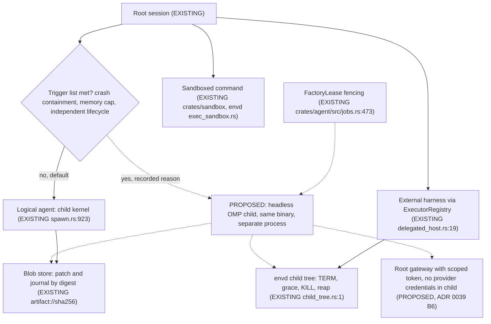

# Hybrid swarm with lightweight OMP subprocesses

> Part of the [OMP2 gateway-capabilities research](../README.md). Diagram for deliverables 9 and 12. Audited commit `85d219ae7f` (`origin/omp2`). Research proposal: nothing here is implemented.

Status: PROPOSED architecture view. Only the logical-agent path and the envd child-process teardown are EXISTING. The headless OMP child, the scoped gateway token and the journal upload are PROPOSED (ADR 0039 B1 to B6, no code found), and are gated by card SWM-07 and benchmark B5. All dotted edges are proposed.



```
                          +--> logical agent (child kernel, EXISTING, default)
 root --> trigger list ---+
                          +- - > headless OMP child (PROPOSED, SWM-07, needs B5)
                                   - - scoped gateway token to root (PROPOSED)
                                   - - FactoryLease fencing (EXISTING primitive, no transport)
                                   - - patch and journal to blob store by digest
 root --> external harness (EXISTING ExecutorRegistry) --> envd child tree teardown (EXISTING)
 root --> sandboxed command (EXISTING sandbox)
 Solid = existing. Dashes = proposed.
```

Back to the [index](../README.md).
