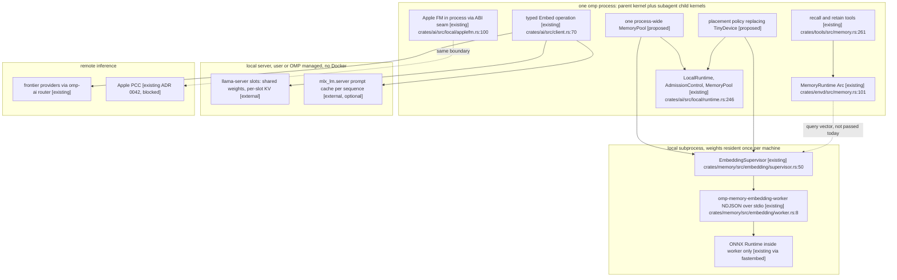

# Diagram 15: shared inference workers

> Part of the [OMP2 gateway-capabilities research](../README.md). Diagram 15 for [deliverable 10](../10-local-inference-assessment.md). Audited commit `85d219ae7f` (`origin/omp2`). Research proposal: nothing here is implemented.

Status: **PROPOSED**. Boxes marked `[existing]` cite code at the audited commit; boxes marked `[proposed]` do not exist.

## Mermaid



## ASCII

```
 one omp process (parent kernel + subagent child kernels)
 +----------------------------------------------------------------------+
 | recall/retain tools -> MemoryRuntime Arc [existing]                  |
 |        |                     . . . query vector (not passed today)   |
 | typed Embed op [existing]    v                                       |
 | LocalRuntime/Admission/MemoryPool [existing]   Apple FM ABI [existing]|
 | + one process-wide MemoryPool [proposed]       + placement policy    |
 |                                                  (replaces TinyDevice)|
 +--------|--------------------------|----------------------------------+
          |                          |
          v                          v
 local subprocess (weights once)   local server (no Docker)       remote
 EmbeddingSupervisor [existing]    llama-server [external]        providers via router [existing]
   -> embedding worker, NDJSON     mlx_lm.server [optional]       Apple PCC [blocked, ADR 0042]
   -> ONNX Runtime inside worker
 Weights: shared per machine.  KV / generation state: per slot or per sequence, never shared.
```

## Evidence

- Existing elements: `crates/envd/src/memory.rs:101` `session`; `crates/memory/src/embedding/supervisor.rs:50` `EmbeddingSupervisor`; `crates/ai/src/local/runtime.rs:246` `LocalRuntime`; `crates/ai/src/local/applefm.rs:100` `APPLE_ADMISSION`; `crates/ai/src/client.rs:70` `EmbedRequest`; `crates/ai/src/discovery/endpoints.rs:113` `known_loopback_endpoints`; `crates/ai/src/local/device.rs:12` `TinyDevice` (to be replaced).
- Server slot and cache facts: `ggml-org/llama.cpp@8e23278:tools/server/server-context.cpp`; `ml-explore/mlx-lm@6fe0ce4:mlx_lm/server.py`.

## Legend

Solid arrow: proposed call direction. Dotted arrow: a link that exists in code but is not driven at the audited commit. Nothing here adds a scheduler; the process-wide pool reuses `MemoryPool` and `AdmissionControl`.

Back to the [index](../README.md).
