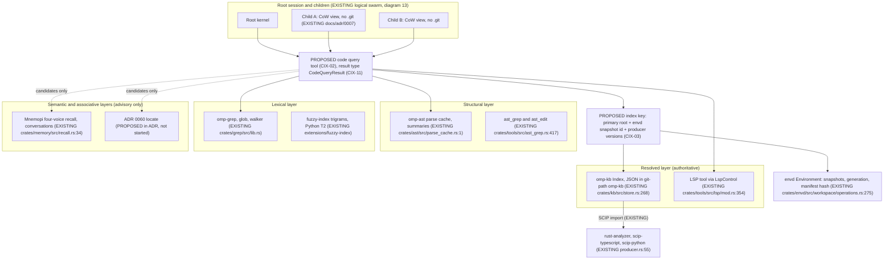

# Shared code intelligence layer

> Part of the [OMP2 gateway-capabilities research](../README.md). Diagram for deliverables 11 and 12. Audited commit `85d219ae7f` (`origin/omp2`). Research proposal: nothing here is implemented.

Status: PROPOSED architecture view. Elements marked EXISTING are verified in code and cited; elements marked PROPOSED do not exist. Authority flows from the resolved layer; semantic and associative layers only nominate candidates.



```text
 EXISTING: root and child kernels             PROPOSED: code query tool + CodeQueryResult (CIX-02, CIX-11)
        |                                                   |
        +--------------------+------------------------------+
                             |
                  PROPOSED index key (CIX-03)
        (primary root + envd snapshot id + producer versions)
             |                    |                     |
   RESOLVED (authoritative)   STRUCTURAL            LEXICAL
   omp-kb Index (EXISTING)    omp-ast, ast-grep     omp-grep, fuzzy-index
   LSP via Environment        (EXISTING)            (EXISTING)
   (EXISTING)
             ^
             | SCIP import from rust-analyzer, scip-typescript, scip-python (EXISTING)

   ADVISORY, candidates only, never a relation source:
   Mnemopi recall (EXISTING, conversations)   ADR 0060 locate (PROPOSED, not started)

 Today: only `omp kb` (EXISTING crates/app/src/kb_cmd.rs:52) reaches omp-kb; children cannot (no .git).
```

Reading notes. Dotted edges mean the result is a hint that must be rechecked in the resolved or lexical layer. The index key replaces the Git-path cache location (`store.rs:105`) for children; the parent keeps its current cache. No new daemon is proposed; the query tool runs in the session process and reads the shared index through the Environment.

Back to the [index](../README.md).
