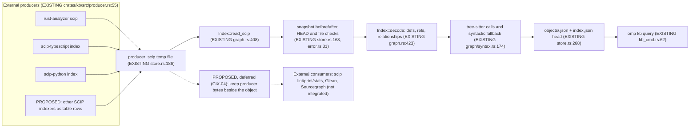

# SCIP integration

> Part of the [OMP2 gateway-capabilities research](../README.md). Diagram for deliverables 11 and 12. Audited commit `85d219ae7f` (`origin/omp2`). Research proposal: nothing here is implemented.

Status: PROPOSED architecture view for the export and sharing parts; the import path is EXISTING and cited. Export is shown as deferred (CIX-04), not as planned work.



```text
 producers (EXISTING)                      OMP2 import (EXISTING, crates/kb)
 rust-analyzer scip   \
 scip-typescript index  >--> temp .scip --> read_scip --> snapshot guard --> decode
 scip-python index    /      (store.rs:186)  (graph.rs:408)  (store.rs:168)   (graph.rs:423)
 PROPOSED: more indexers                                                         |
        (producer.rs table rows)                                   + tree-sitter calls, syntactic fallback
                                                                                 v
                                                  objects/<digest>.json + index.json  --> omp kb query
        .scip bytes
          : (PROPOSED, deferred CIX-04) keep unmodified beside the object
          v
   external consumers: scip lint/print/stats, Glean, Sourcegraph (not integrated)
```

Attach points, all in `crates/kb`: producer table rows; unused SCIP fields (roles other than Definition, `is_type_definition`, `enclosing_range`, `Diagnostic`, `documentation`) that `graph.rs` could read; per-document reuse (CIX-06); coverage report (CIX-14). SCIP carries no revision field (`scip.proto:41`), so the revision and fingerprint binding in `store.rs:20` stays the consumer's responsibility. No re-encoding exporter is proposed (CIX-04).

Back to the [index](../README.md).
