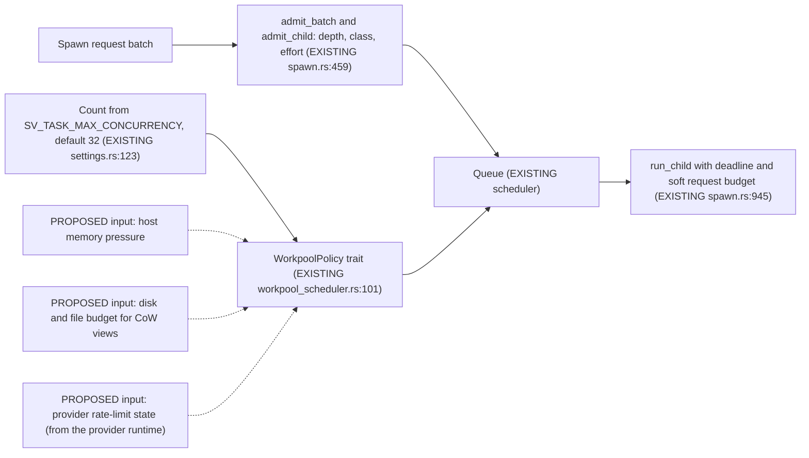

# Resource-aware scheduling

> Part of the [OMP2 gateway-capabilities research](../README.md). Diagram for deliverables 9 and 12. Audited commit `85d219ae7f` (`origin/omp2`). Research proposal: nothing here is implemented.

Status: PROPOSED architecture view. The workpool and its policy trait are EXISTING; the resource inputs are PROPOSED, gated by card SWM-06 and benchmarks B2 and B4. No new scheduler is proposed: the inputs extend `WorkpoolPolicy`.



```
 spawn batch -> admit (depth, class, effort) -> QUEUE -> run_child (deadline, request budget)
                                                  ^
                                   WorkpoolPolicy (EXISTING trait)
                          count convar (EXISTING, default 32)
                          memory pressure (PROPOSED)  disk/file budget (PROPOSED)  provider limits (PROPOSED)
 The policy is read at each dispatch, so inputs can change live (EXISTING behaviour).
```

Back to the [index](../README.md).
