# Diagram 19: complete proposed architecture

> Part of the [OMP2 gateway-capabilities research](../README.md). Status: **PROPOSED, not implemented.** Solid boxes are verified current elements (see [diagram 01](01-current-omp2-architecture.md)); dashed boxes are proposals, each labelled with the capability card that justifies it. Cards in the `P3` tier of the [backlog](../15-prioritized-architectural-backlog.md) are optional and off by default. Nothing here changes the owner's principle: one root session, shared native infrastructure, isolated workers only when justified.

## Mermaid

```mermaid
flowchart TD
  subgraph ROOT["One root OMP session (verified)"]
    KRN["Kernel + Directors + JobBoard"]
    CHILD["logical child kernels, workpool"]
    KRN --> CHILD
  end
  subgraph PROV["Provider runtime (verified stack, proposed feed)"]
    RTR["Router + Registry + Catalog"]
    OBS["attempt observer feeds RuntimeRouteEvidence (PRV-01)"]
    HDR["header observer to AccountPool (PRV-02)"]
    BRK["breaker as RouteHealth state (PRV-03, after benchmark)"]
    STK["fixed Tower stack: AccountPool, Admission, Retry, Rate, Recovery"]
    RTR --> STK
    OBS -.-> RTR
    HDR -.-> STK
    BRK -.-> RTR
  end
  subgraph AUTHB["Credentials (verified, proposed fixes)"]
    AUTH["AuthManager + RefreshCoordinator"]
    OWN["per-process refresh owner (AUTH-01)"]
    SHR["children share parent auth stack (AUTH-03)"]
    OWN -.-> AUTH
    SHR -.-> AUTH
  end
  subgraph EXTB["Extensions (verified message boundary)"]
    EXT["omp-ext signed index, envd exthost, Python children"]
    ENF["enforce declared manifest codes (EXT-03, EXT-04, EXT-05)"]
    EXP["non-Python providers as external processes (EXT-08, optional)"]
    ENF -.-> EXT
    EXP -.-> EXT
  end
  subgraph LOCB["Local inference"]
    EMB["embedding worker process (prototype, INF-01)"]
    POOL["one MemoryPool per process, placement policy (INF-02, INF-10)"]
    SRV["llama-server or MLX as managed external servers (INF-03, INF-05, optional)"]
    POOL -.-> EMB
    SRV -.-> POOL
  end
  subgraph CODEB["Code intelligence"]
    KB["omp-kb SCIP import + tree-sitter (verified)"]
    IDX["shared index keyed by workspace id and revision (CIX-03)"]
    RES["one typed CodeQueryResult, read-only query tool (CIX-11, CIX-02)"]
    KB --> IDX
    IDX -.-> RES
  end
  CHILD --> RTR
  CHILD --> AUTH
  CHILD -.-> IDX
  CHILD -.-> POOL
  KRN --> EXT
  SERVE["omp-serve gRPC Inference, Auth, Blob, Gateway (verified)"] --> RTR
  FAC["OpenAI-compatible HTTP facade (PRV-13, optional, OQ-10)"] -.-> SERVE
  classDef proposed stroke-dasharray: 5 5
  class OBS,HDR,BRK,OWN,SHR,ENF,EXP,POOL,SRV,IDX,RES,FAC proposed
```



## ASCII

```
 ROOT SESSION (verified)  Kernel + Directors + JobBoard --> logical child kernels / workpool
        |                                         |
        | provider calls                          | credentials, index, models (shared, not duplicated)
        v                                         v
 PROVIDER RUNTIME (verified stack)          AUTH (verified)                 CODE INTELLIGENCE
  Router/Registry/Catalog                    AuthManager+RefreshCoordinator   omp-kb: SCIP import, tree-sitter
  Tower: AccountPool,Admission,Retry,Rate    [P] per-process owner   AUTH-01  [P] shared index keyed by
  [P] attempt observer -> evidence PRV-01    [P] children share      AUTH-03       workspace id + revision CIX-03
  [P] header observer  -> pool    PRV-02         the parent stack             [P] CodeQueryResult + read-only
  [P] breaker = RouteHealth       PRV-03                                          query tool   CIX-11, CIX-02
        ^
        | omp-serve gRPC (verified)  <--  [P3] OpenAI-compatible facade PRV-13 (optional)

 EXTENSIONS (verified message boundary)     LOCAL INFERENCE
  omp-ext signed index, envd exthost,        embedding worker process (prototype; wire or retire INF-01)
  Python children (CONTROL JSON + DATA)      [P] one MemoryPool per process + placement policy INF-02, INF-10
  [P] enforce manifest codes EXT-03/04/05    [P3] llama-server / MLX as managed external servers INF-03, INF-05
  [P3] external-process providers EXT-08

 [P] proposed   [P3] proposed and optional   unlabelled = verified at 85d219ae7f
```

## Evidence

Every unlabelled element is cited in [diagram 01](01-current-omp2-architecture.md) and [deliverable 2](../02-verified-current-state.md). Each proposed element is a capability card: PRV-01 to PRV-03 and PRV-13 in [deliverable 5](../05-provider-integration-recommendations.md) and [6](../06-transport-and-protocol-recommendations.md); AUTH-01 and AUTH-03 in [5b](../05b-authentication-and-credential-lifecycle.md); EXT-03 to EXT-05 and EXT-08 in [7](../07-abi-independent-extension-assessment.md); INF-01 to INF-10 in [10](../10-local-inference-assessment.md); CIX-02, CIX-03 and CIX-11 in [11](../11-code-intelligence-and-scip-assessment.md). Dependencies between slices are in the [roadmap](../17-incremental-implementation-roadmap.md).

## Legend

Dashed arrows and dashed boxes are proposals. `[P]` is proposed; `[P3]` is proposed and optional (backlog tier P3, off by default). The diagram draws no new service, scheduler, credential manager or index server: every proposal is a producer, a key or a field on something that exists.
