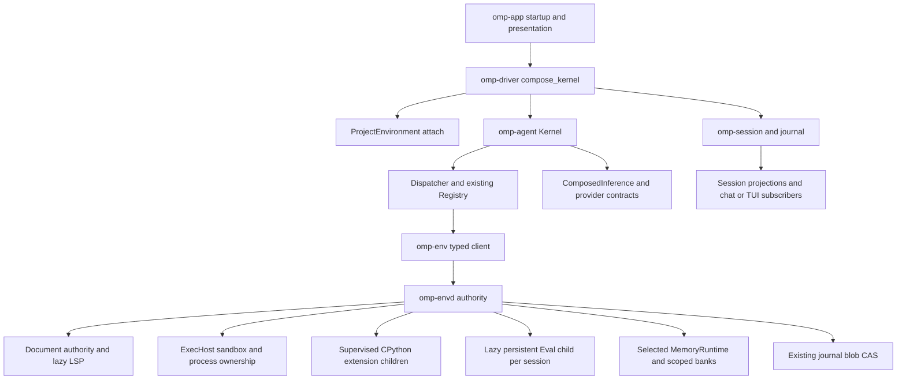

# Native baseline, ownership and resource lifecycle

Scope: source audit of composition, capability ownership and resident-resource candidates.
OMP2 pin: `blyzer/oh-my-pi`, fetched `origin/omp2`, detached checkout
`fda1315052b8b4074f9ea5acc842b2cc0b08b2b2` (2026-11-24).
This chapter makes no production change and reports no executed runtime benchmark.

All source locations below refer to that revision. **S** means implementation and
caller inspected; **I** means implemented but relevant integration incomplete or
unverified; **U** means runtime behavior/cost unmeasured. A test's existence is not
an executed test. No memory or timing estimate below is a measurement.

## Architectural result and production ownership

OMP2 already has native modularity, demand-driven LSP startup, concurrency-fenced
initialization, bounded AST/memory caches, lazy embedding workers, killable Python
children, capability features and project/session shutdown ownership. Measure and
extend those owners before adding a global resource manager, registry, scheduler
or dynamic Rust plugin ABI. Eager environment assembly, whole-index JSON loads
and unbounded notifications are measurement candidates, not demonstrated dominant
costs.



`compose_kernel` is the production composition (`crates/driver/src/headless/kernel.rs:2455-2463`):
trust/extension admission `:2476-2518`, environment attachment `:2672-2724`,
component/director installation `:2726-2731`, registry selection `:2738-2774`,
inference ownership `:2782-2885`, journal open/create `:2905-2913`. It does not
mean every registered capability starts an expensive runtime. `Kernel<C>` owns
inference, dispatcher, cancellation, directors, prompt, events and mailbox
(`crates/agent/src/loop.rs:462-531`). `Dispatcher::new` configures the existing
JobBoard's output bound and spill store (`crates/agent/src/dispatch.rs:1404-1423`);
`prepare` admits streamed arguments before execution commitment (`:1570-1595`).
These are native typed owners, not independent dylib ABI boundaries.

`ProjectEnvironment` owns client/registry/bridges and a lifecycle; its documented
Drop boundary affects only children/servers this composition started, not a
preexisting owner (`crates/envd/src/lib.rs:680-700`). Standalone daemon assembly
uses `EnvServer::open_project`, cancellation tokens, connection accounting and
`wait_idle` (`crates/envd/src/server/runtime.rs:29-58,87-150`).
`DocumentAuthority::drop` cancels its shutdown token (`:23-26`).

## ADR constraints: retain architectural knowledge

| ADR | Exact applicable wording | Evidence and implication |
|---|---|---|
| 0006 | “The **host** MUST own session state, inference, policy, tool routing, approval, limits, and journaling.” | `docs/adr/0006-host-policy-sandbox-stub.md:32-39`; defer peripheral resources without moving policy into a stub. |
| 0011 | “A tool, extension, or job MUST run in an execution unit the host can terminate”; host requests cooperative settlement, then bounded forced termination. | `docs/adr/0011-cancellation-needs-a-kill-boundary.md:29-39`; retain uncertainty recording for authorized effects. |
| 0024 | “The permanent, model-facing tool roster MUST be small and fixed for the life of a session.” | `docs/adr/0024-small-permanent-roster.md:31-44`; dormant metadata must not reshape latched schemas. |
| 0035 | “The engine — every crate under `crates/` — MUST be Rust.” | `docs/adr/0035-rust-for-the-engine.md:49-65`; internal native ownership optimization fits; a second interpreter is unnecessary for modularity. |
| 0036 | “Extensions, `Eval`, and `@remote` bodies run on ONE embedded runtime: statically linked, free-threaded CPython”; “Every extension host and every eval session is a killable child process”. | `docs/adr/0036-python-for-extensions.md:35-67`; keep embedding/termination. Interpreter code in the executable does not prove the host initialized Python. |
| 0036 bulk placement | “Function bodies ship once, content-addressed by hash”; “bulk bytes never traverse the host to reach a place they were never needed.” | Same ADR `:55-59`; normative design, not proof every placement implementation is complete. Its status section records gaps. |
| 0049 | T0 “Always compiled”; T1 behind Cargo features, “default-on in `omp-app` only”; “Tier is not roster.” | `docs/adr/0049-tiered-integration-architecture.md:45-54`; compile-time presence differs from runtime acquisition. |

These decisions remain unchanged. Upstream-derived cancellation/ownership/schema
rationale remains useful, but Pi is no behavioral oracle for this audit. The
stale compatibility phrase at the start of AGENTS does not override the user's
explicit independent-OMP2 correctness requirement.

## Source-backed lifecycle inventory

Cold/warm latency, physical footprint, heap and idle CPU are **U for every row**
unless a separately executed experiment supplies them. “Retain” retains the
owner/design, not memory forever. An Arc clone is not a deep clone; code paging
is different from object initialization.

| # | Capability / evidence (paths under `crates/`) | Current activation and retention | Safe release / disposition |
|---|---|---|---|
| 1 | Production composition, `driver/src/headless/kernel.rs:2455-2518,2672-2731` | **S** Per composition: paths/trust/discovery/environment attach. | Retain one composition; measure no-tools and ordinary remote-session effects first. |
| 2 | Kernel, `agent/src/loop.rs:462-531` | **S** Per agent/session; typed inference, prompt, dispatcher. | End with existing session/cancellation lifecycle; do not evict authoritative agent state. |
| 3 | Dispatcher/JobBoard, `agent/src/dispatch.rs:1404-1423` | **S** Constructed with kernel; output bound and spill configured. | Retain live jobs/approval obligations. |
| 4 | Kernel mailbox, `agent/src/loop.rs:502` | **S** Unbounded flume channel at construction. | Measure lag/payloads before bounding; cancellation needs a prompt path. |
| 5 | Prepared tool events, `agent/src/dispatch.rs:1570-1595` | **S** Per call; unbounded events. | Measure stalled consumers/large argument streams; preserve commitment/admission order. |
| 6 | Project environment, `envd/src/lib.rs:680-700` | **S** Client per composition; attached owner may outlive client. | Existing lifecycle decides owned versus attached shutdown. |
| 7 | Document authority, `envd/src/server/runtime.rs:23-26,98-150` | **S** Project owner with shutdown/connection/idle accounting. | Release only when existing sessions/processes no longer require it. |
| 8 | Documents/transactions, `envd/src/docserver/environment.rs:296-330` | **S** Store, leases, formatter, transactions/path services constructed together. | Preserve lease/transaction invariants; dispose whole idle authority when permitted. |
| 9 | LSP metadata, `envd/src/docserver/lsp_supervisor.rs:138-172` | **S** Trust-filtered roster plus empty client pool. | Retain metadata without spawning every declaration; no second registry. |
| 10 | LSP processes, `envd/src/docserver/daemon.rs:245-256`, `envd/src/lsp_settings.rs:20-29`, `envd/src/docserver/lsp_supervisor.rs:243-277,357-375` | **S** Lazy default (`sv_lsp_lazy=true`); matching open starts; explicit eager warmup exists. | Retain lazy default; compare cold first-diagnostic latency with idle footprint. |
| 11 | LSP startup pool, `envd/src/docserver/lsp_pool.rs:18-120`; consumer `lsp_supervisor.rs:369-375` | **S** Per server/workspace/config; serialized initialization, Arc leases, three-minute failure backoff. | Reuse pool. Eviction removes pool ownership, but active Arc leases can retain process. |
| 12 | LSP idle reaper, `envd/src/docserver/lsp_registry.rs:814-852` | **I** Configured idle timeout plus zero pending requests; no production call to `spawn_idle_reaper` found in scoped search. | Prove document/subscription/lease semantics before wiring; do not call active automatic eviction implemented end-to-end. |
| 13 | LSP explicit reload, `envd/src/docserver/lsp_supervisor.rs:192-239` | **S** Explicit restart boundary; evict/shutdown with ownership checks. | Reuse recovery/reload before adding a lifecycle state machine. |
| 14 | DAP registries, `envd/src/docserver/environment.rs:317-320` | **S** Builtin adapter and empty session registries at authority construction. | Metadata cost is distinct from spawning debug processes; process policy U here. |
| 15 | AST parse cache, `ast/src/parse_cache.rs:18-82` | **S** LazyLock, up to 12 entries and 4 MiB retained source bytes; oversized files still parsed without caching. Tree heap additional. | Retain bounds; source-byte ceiling is not total heap. Measure tree bytes before refinement. |
| 16 | Syntax/grammar code, `ast/src/lib.rs:1-16`, `ast/src/language/mod.rs` | **S** Native compiled functionality; parsing/cache invoked by structural entry points. | Keep compiled code; per-grammar active footprint U. |
| 17 | KB handle, `kb/src/store.rs:100-107`, `app/src/kb_cmd.rs:52-80`, `app/Cargo.toml:96` | **S** App links library; explicit KB command opens Store. | Linking does not prove index loaded in every chat; no resident index server needed for conceptual modularity. |
| 18 | KB graph, `kb/src/store.rs:142-165`, `kb/src/graph.rs:83-91` | **S** Full file bytes, digest validation, owned JSON decode; String and BTreeMap/BTreeSet graph. | Measure partitions/selective access; immutable derived objects already content-addressed. |
| 19 | KB freshness, `kb/src/store.rs:110-139`, `app/src/kb_cmd.rs:62-73` | **S** Indexed query loads graph then hashes repository snapshot; live query rebuilds. | Attribute hashing separately from decoding; preserve stale reporting. |
| 20 | Memory runtime, `envd/src/server/session.rs:59-83,375-376`, `memory/src/runtime.rs:265-328` | **S** Off opens no bank files; selected Mnemopi snapshots repository and opens scoped retain/recall banks during assembly. | Demand-open is an experiment; preserve migration/adoption, prompt generation, scope and failure semantics. |
| 21 | Recall cache, `memory/src/cache.rs:14-16,47-87,132-161` | **S** Default 128 entries; 256 KiB content admission limit; generation-fenced hit clones result vector. | Bounds already exist. Metadata/embeddings make the content limit different from total footprint. |
| 22 | Memory registry, `memory/src/runtime.rs:1002-1046`, `envd/src/memory.rs:89-124` | **S** Process map uses Weak references; scoped registration unregisters on Drop. | Preserve weak ownership/fences; an entry is not proof of leaked bank ownership. |
| 23 | Embedding worker, `memory/src/embedding/supervisor.rs:47-65,101-117,158-179` | **S** Unloaded constructor, AsyncMutex<Option> child; serialized generation-fenced requests and explicit reap. | Reuse child termination for optional idle eviction; active-request/reacquisition proof required. No automatic idle policy established here. |
| 24 | Extension hosts, `envd/src/worker.rs:1758-1844,2776-2806` | **S** Empty config starts no interpreter; configured host-requiring triggers start independently supervised processes; reload/shutdown exist. | Do not classify arbitrary Python state as reconstructable; metadata-only declarations differ from active hosts. |
| 25 | Eval sessions, `envd/src/eval/process.rs:77-112,123-150,282-328` | **S** Child slot starts None; first run gates startup/replacement; namespace persists. | Warm live Eval state is semantic. Reset/disposable termination is different from silently losing variables on idle eviction. |
| 26 | Forge cache, `envd/src/server/session.rs:287-293` | **S** SQLite cache opened during authority assembly. | Measure before demand-open; respect existing neutral/vendor boundary. |
| 27 | Telemetry index, `envd/src/server/session.rs:303-306` | **S** Disk/index handles open during assembly. | Deferral must preserve early observability; avoid trading dropped evidence for startup numbers. |
| 28 | Schedule authority, `envd/src/server/session.rs:318`, `envd/src/schedules.rs:373-410` | **S** Durable actor replay/command queue; unbound clock remains disarmed pending delivery owner. | Reuse actor; idle async task is not proof of CPU polling. Measure recovery/retention. |
| 29 | MCP manager/service, `envd/src/server/session.rs:309-317,362-365`, `envd/src/mcp/manager.rs` | **S** Metadata constructed and configured native startup awaited during assembly. | Compare no-config versus configured transports; preserve definitions, credentials and cancellation. |
| 30 | Blob/CAS, `envd/src/server/session.rs:294-302`, `envd/src/blobs.rs:55-105,782-824` | **S** Managed disk store; positioned/ranged reads and explicit `read_all`. | Reuse blobs/streaming before another store or shared-memory data plane. |
| 31 | HTTP egress client, `envd/src/http_egress.rs:25-34`, `envd/src/server/session.rs:180-205` | **S** Shared native client constructed per authority; actual connections are later effects. | Retain connection reuse; client construction is not eager connection to every host. |
| 32 | GPU host info, `envd/src/host_info.rs:26-35` | **S** OnceCell starts empty. | Appropriate initialize-once metadata, not a resident inference model. |
| 33 | Optional local TTS, `envd/src/media_tts.rs:93-110,113-148` | **S** Feature-gated local OnceCell empty at producer construction; backend selected per request. | OnceCell is not eviction. Only adopt lease-aware release after measured model retention. |
| 34 | Subagent/workpool policy, `driver/src/subagent/workpool_scheduler.rs:110-134,394-446,1202` | **S** Existing policy reads `sv_task_max_concurrency`; owns batch/worker/item scheduling. | Extend existing policy/accounting; no parallel scheduler. |
| 35 | Capability code, `app/Cargo.toml:24-43`, `envd/Cargo.toml:12-22` | **S** cap-* features, default-on at app. | Use existing minimal-capability checks before dylibs; compiled is not initialized. |
| 36 | Native verification, `driver/src/verification/runner.rs:1-45,57-74` | **S** Explicit deterministic package spec, captured-input leases, existing Environment/evidence. | Preserve source-bound verdicts; this path does not promise LLM review or automatic repair. |

## IR/backend name verification

The following scoped searches were executed against the pinned production tree:

```sh
rg -n '\b(CodeIR|CodeQueryIR|ChangeIR|VerificationIR|Glean|Tantivy|tgrep)\b' crates
rg -n 'omp-kb|omp_kb|\bCSL\b' Cargo.toml crates/*/Cargo.toml crates/envd/src crates/driver/src crates/tools/src
```

No exact names CodeIR, CodeQueryIR, ChangeIR, VerificationIR, Glean, Tantivy or
tgrep were found; no native CSL identifier was found in the listed areas. This
is scoped absence, not proof every equivalent concept or research branch is
absent. Actual representations include `omp_kb::graph::Index`, document
transactions/leases, `NativeVerificationSpec` and verification snapshots/evidence,
plus protocol/domain types. Do not rename these to hypothetical named IRs.

Index holds symbols, calls and implementation/reference/definition relations
(`kb/src/graph.rs:83-91`), not a demonstrated sound whole-program CFG/dataflow
analyzer. SCIP occurrence validation exists (`:151-182,410-418`); producer tests
are in `crates/kb/tests/{cli,languages}.rs`. Do not propose Glean/Tantivy activation
as if those backends were already present.

## Candidate opportunities and falsifiable acceptance

Expected gains are hypotheses; all accepted ADRs above remain unchanged.

| ID / decision | Problem, exact modules and reuse | Experiment and acceptance | Risk / complexity / rollback |
|---|---|---|---|
| N01 — Retain; configuration optimization; P0 | Existing lazy LSP: `envd/src/lsp_settings.rs`, `docserver/{daemon,lsp_supervisor}.rs`. | Compare no-file session, first open and repeated open with lazy on/off; process-tree footprint and first-diagnostic P95. Identical diagnostics/rename and unchanged project-binary trust. | Low; no source change to evaluate. Restore configuration. |
| N02 — Optimize internally; eviction; conditional P1 | Reuse `docserver/{lsp_pool,lsp_registry,lsp_supervisor}.rs`; automatic reaper integration unproved. | Concurrent first acquire once; no reap during request/document/subscription obligations; Arc lease retained; release/reopen/reload/crash contracts identical. Require measured idle reduction and acceptable cold reactivation. | Medium/high: registry removal is not proof child memory reclaimed. Existing supervisor/settings only; disable policy to rollback. |
| N03 — Defer resource acquisition; conditional P1 | Memory snapshot/bank open in `envd/src/server/session.rs:59-83`, `memory/src/runtime.rs:265-328`. | Attribute constructor stages; compare Off, selected-unused, first recall. Preserve adoption/migrations, prompt generations, concurrent-first-use dedup and failure reporting. Fallible lazy slot under existing MemoryRuntime only. | Medium/high: first-turn prompt may need recall anyway; reject if savings merely shift latency. Restore eager constructor. |
| N04 — Optimize native flow policy; P0 measurement then P1 | Unbounded mailbox/events/commands: `agent/src/loop.rs:502`, `agent/src/dispatch.rs:1581`, `envd/src/schedules.rs:389`. | Queue depth/payload bytes/lag under large output and slow subscribers. Only bound/coalesce where loss/backpressure semantics proved; preserve cancellation, approvals, commits, durable outcomes and observer contracts. | High deadlock/data-loss risk from indiscriminate bounding. Reuse CancelTree/journal, not another event bus. Restore original policy. |
| N05 — Partition representation; conditional P2 | Whole KB load and freshness hashing: `app/src/kb_cmd.rs:62-73`, `kb/src/store.rs:110-165`. | 10k/100k/1m-symbol fixtures; query selectivity, freshness cost, heap and allocations separately. Try selective partitions/immutable snapshots behind Store before mmap/new formats. Preserve digest/version/stale fences. | Medium/high migration risk; no measured deficiency yet. Derived objects rebuildable; keep JSON fallback. |
| N06 — Optimize bounded cache representation; conditional P1 | Source-byte AST cap versus tree heap, recall query/token/embedding metadata and result clones: `ast/src/parse_cache.rs`, `memory/src/cache.rs`. | Attribute actual live allocator bytes and post-eviction release; compare reparsing/recall latency. Replace deep clones only if material; Arc result representation needs immutable API analysis. Preserve collision/source checks and bank generations. | Low for metrics, medium for ownership. Bounds already exist; clone syntax is not a leak. Restore representation/capacities. |
| N07 — Retain existing lifecycle; P0 | `envd/src/{worker.rs,eval/process.rs}`, `memory/src/embedding/supervisor.rs`. | Trace zero extension children for empty config; first Eval once; reset/disposable termination; cancellation/reload/embedding fault recovery. Include child footprint. | Low tests, high automatic namespace eviction risk. Reject silent Eval state loss; use explicit disposable policy. |
| N08 — Defer native initialization; conditional P1 | Cache/index/scheduler assembly in `envd/src/server/session.rs:287-318`. | Trace constructor costs before lazy wrappers. Preserve early events and schedule recovery; use existing owner and fallible single-init slot. | Medium. Constructors may be cheap/required. Reject if no material savings; restore eager sequence. |

The minimum first slice is instrumentation and deterministic lifecycle proof,
not library extraction: trace environment constructor stages, count live children
and queue depth, then compare Off/selected-memory and lazy/eager-LSP fixtures.
This identifies active costs on a shared 16 GB Mac while retaining compiled
capabilities. Priority among N02/N03/N05 requires measured evidence. Use current
tracing, convars, fixtures and owners; no always-running manager.

## Limits and question coverage

This track used bounded rg/file searches and numbered reads; no live session,
Rust test, interpreter startup or macOS footprint experiment was executed. Heap,
physical pages, allocator release, compression and swap remain U. Historic M4
Max timings in `ast/src/parse_cache.rs:4-7` are attributed comments, not this
research's M1 Pro measurements. `spawn_idle_reaper` exists/tests exist, but scoped
production searches found no call; it is not promoted to active automatic eviction.

This chapter informs questions 1–7 (native owners/features), 8–12 (lazy/stateful
children), 13/19–21 (actual Index/load), 22–27 (lifecycles), 28–33 (measurement
priorities) and 41–50 (existing policies/owners and hard constraints).
