# Technology choices and constrained Meta-Harness research

Scope: complementary references, serialization alternatives, profiling/allocator
options, execution mechanisms and benchmark-driven policy search.
OMP2 pin: `omp2@fda1315052b8b4074f9ea5acc842b2cc0b08b2b2`.
Research date: 2026-11-24. Class **d**: optimize existing OMP2 ownership and
contracts, rather than importing another runtime or compatibility target.

**Evidence labels:** source-verified means inspected source at the cited revision,
not an executed integration test. Proposed benefits are hypotheses. No external
engine, paid model call, allocator replacement, new serializer, WASM runtime or
Meta-Harness optimizer was executed as part of this chapter. Repository metadata,
including canonical URLs and full revisions, is in
[the repository inventory](references/repositories.json); a recent commit or an
unarchived repository does not establish production readiness or a support SLA.

## 1. Complementary projects: useful methods, incompatible assumptions

| Project / inspected revision | Verified source and relevance | License evidence / adoption decision |
| --- | --- | --- |
| s0-cli `9cdd3c45407c8c431a5d9b63b6cea4a81e20bd4f` | `run_optimizer` performs bounded proposal/evaluation iterations and a final test evaluation; candidate histories and a quality/token Pareto frontier are inspectable. See [loop.py:82–218][s0-loop] and [context.py:43–90,165–184][s0-context]. | [LICENSE][s0-license] contains an Apache-2.0 notice and link; GitHub metadata says NOASSERTION. Learn the experimental organization; do not vendor its optimizer or infer complete license clearance from metadata alone. |
| PeerClaw `ecdece709f1d7351449e07a660fca145a577f5c7` | Its code-execution tool clears environment and uses Seatbelt when available, but falls back to a plain interpreter otherwise ([code_exec.rs:160–194][peer-exec]). Its messaging WASM channel loader explicitly returns “not yet implemented” ([mod.rs:139–153][peer-wasm]). This is not proof of a working replacement for OMP2 isolation. | [Cargo.toml:7][peer-cargo] declares MIT OR Apache-2.0; no root license text was found in the inspected checkout. Direct code reuse remains pending license review. Reject importing its multi-language execution boundary into ADR 0036. |
| vectX `3c0560d1d535a3b29a1635a760e3c9749ddab667` | `Collection` holds points/HNSW/BM25 behind shared locks ([collection.rs:47–83][vect-collection]); LMDB opens a large map and `get_point` materializes a `Vec` ([lmdb_storage.rs:20–30,66–70][vect-lmdb]). `ForkBasedPersistence::bgsave` forks and serializes a snapshot with Bincode ([persistence.rs:60–114][vect-fork]). LMDB mapping size is a virtual ceiling, not that amount of resident RAM; neither mapping nor a borrowed database API makes the full query pipeline zero-copy. | **Conflicting license signals:** [root LICENSE][vect-license] says GPLv3-or-later, while [Cargo.toml:8][vect-cargo] says MIT OR Apache-2.0 and separate permissive files exist. Do not copy code until clarified. Retain OMP2 storage/index owners; do not add another vector server or copy fork-based snapshots into a multithreaded host. |
| MARS `8ba9f538a84ff7648201e0120fbefd2ed621bba4` | Explicit graph/scratch memory accounting is useful as a budgeting technique. However, [memory_budget.cpp:5–55][mars-budget] derives edges from `N * avg_degree` and estimates library overhead; it is not a proof covering every execution path. [tiled_query.cu:201–210][mars-tiled] allocates top-k GPU buffers during a query, despite the broader initialization-only claim in the header. | [LICENSE][mars-license] is MIT. Its [Makefile][mars-make] and CUDA sources target CUDA/NVIDIA, not the M1 GPU. Borrow itemized budgeting and tiled-workload experiments conceptually; reject a CUDA requirement or a new memory service for OMP2. |

These are independent projects, not OMP2 compatibility requirements. No external
performance numbers from their READMEs/results are treated as OMP2 measurements.
Source presence does not establish crash recovery, cancellation or memory limits
equivalent to OMP2's verified contracts.

## 2. Meta-Harness: what exists, and what OMP2 should adapt

The canonical paper is [Meta-Harness: End-to-End Optimization of Model Harnesses,
arXiv:2603.28052v1](https://arxiv.org/html/2603.28052v1), submitted 2026-03-30;
its page identifies CC BY 4.0 and points to
[`stanford-iris-lab/meta-harness-tbench2-artifact`](https://github.com/stanford-iris-lab/meta-harness-tbench2-artifact/tree/57fefdb2ff84af3fd81b69d67814acbe69bd0743).
The paper's outer loop proposes harness code, evaluates it, and exposes prior
code, scores and traces through selective filesystem access. It separates search
feedback from final held-out evaluation and discusses Pareto trade-offs. Its
reported results are task/model-specific author measurements, not expected OMP2
speed or quality gains. This chapter adopts the methodology, not unrestricted
production self-modification. The paper artifact's repository metadata did not
identify a license; direct source reuse needs separate review.

s0-cli is a separate implementation/adaptation, **not established as the paper's
canonical implementation**. The source audit shows useful details and limits:

* `run_optimizer` rejects train/test paths resolving to the same directory
  ([loop.py:119–132][s0-loop]); distinct directory names do not prove distinct
  tasks, absence of duplicate fixtures or prevention of label leakage.
* Search iterations use an evaluation runner; final test evaluation occurs only
  after the loop ([loop.py:169–218][s0-loop]). OMP2 should additionally isolate
  held-out labels and evaluator code from both proposer and candidate execution.
* `_pareto` maximizes F1 and minimizes tokens, excluding records missing either
  quantity ([context.py:165–184][s0-context]). Its ordinary context loads at most
  30 recent runs, while frontier persistence scans up to 10,000
  ([context.py:65–107][s0-context]); “full history available” is not identical to
  “all history inserted into every prompt.”
* The proposer has explicit history-reading tools and narrowly named write
  targets ([tools.py:1–34,36–100][s0-tools]). These are application restrictions,
  not a substitute for OS confinement.
* Candidate validation uses AST checks but then executes the module through
  `spec.loader.exec_module` ([validate.py:83–92][s0-validate]); several discouraged
  imports only produce warnings ([validate.py:113–122][s0-validate]). The evaluator
  also imports candidate code. **Do not reuse this as a security sandbox or run
  generated harness code in the trusted OMP2 host.**

### Existing OMP2 machinery to reuse

OMP2 already has typed workflow intent: `PhaseKind::{Agent,Code,Review}` and
`Phase` with dependency/input edges and required posture
([workflow.rs:23–78][omp-workflow]). `Requirement::check` is explicitly
one-directional: an execution host may be stricter, never looser
([profile.rs:1–7][omp-profile]). `WorkflowDefinition` resolves prompts, commands
and `NativeVerificationSpec` before dispatch
([definition.rs:23–60][omp-definition]). These are actual types; this chapter
does not relabel them as hypothetical CodeIR/ChangeIR/VerificationIR.

`VerificationEvidence` infrastructure already retains immutable journal/CAS
artifacts, source/policy/configuration identities and host-admitted outcomes
([evidence.rs:1–98][omp-evidence]). Current defaults include an 8 MiB individual
blob and 256 MiB aggregate limit. A 1 GiB research dataset must not be silently
submitted as one oversized verification-evidence leaf or truncated to fit.
Dataset storage/access experiments and authoritative verification receipts have
different lifetimes and limits.

The native source audit in the other chapters determines which configuration
and routing knobs are already implemented. **Being a typed struct is not proof
that arbitrary resource policies can be expressed by it.** Reuse supported
configuration fields first; extending their expressiveness requires a separate,
validated native slice. Do not introduce a parallel optimizer registry,
orchestrator, evidence store or scheduler.

### Proposed fast and slow loops

```mermaid
flowchart LR
  B[Immutable source/config/data baseline] --> C[Candidate configuration or legal policy change]
  C --> V[Native schema and hard-constraint validation]
  V --> E[Existing ADW and native execution]
  E --> J[Journal/CAS results and bounded diagnostic artifacts]
  J --> Q[Deterministic metrics and train Pareto analysis]
  Q --> C
  Q --> H[Sealed held-out evaluation]
  H --> P[Reviewed promotion of versioned candidate]
  P --> R[Rollback to prior immutable configuration]
```

**Fast loop:** bounded changes to already supported prompts, retrieval limits,
provider/model selection, optional backend ordering or concurrency settings;
candidate permission is a whitelist, not arbitrary source editing. Prefer
configuration/policy instances; do not invent a new factual IR merely to express
optimization intent. Native validation rejects unknown fields and impermissible
values. Reuse existing dispatch and authorization rather than treating a model's
claim as evidence.

**Slow loop:** source, algorithm, schema and lifecycle changes run on isolated
research branches, undergo complete relevant regressions, and require explicit
promotion. No code modifications occur in the live production runtime. A warm
cache, memory history or a favorable score cannot authorize promotion.

In both loops, source facts, journal history and verification receipts remain
immutable. Required security/verification checks, workflow dependency constraints,
resource-isolation posture and ADR 0036 are hard constraints. For example,
`PhaseSpec::Prompt.accept_on_claim` is not a quality/cost tuning lever: the
optimizer must not weaken verified acceptance to claim-based acceptance.

An evaluation record should reference: immutable baseline revision, candidate
digest, producing configuration, fixture split and content hashes, model/provider
contract, toolchain/environment, evaluator version, randomness/seed policy,
resource and token observations, correctness/security results, and raw trace/blob
references. **Proposed**, not a claim that all those fields already exist in one
OMP2 record. Map them into existing journal/verification records before adding
any schema. Missing metrics are INCONCLUSIVE, never zero.

Training search may consider task success, live/peak heap, physical footprint,
startup/activation time, latency, token use and cost. Hold-out labels/results must
not feed back into continued tuning of the same hold-out set. Candidate selection
uses Pareto dominance after hard-constraint filtering; a predeclared acceptable
regression envelope prevents trading correctness for speed. Run repeated paired
baseline/candidate trials and report sample counts/variance. No numeric
improvement target is justified by this chapter's source inspection alone.

## 3. Compiler concepts: reuse the ideas, not the compiler stack

At LLVM revision `b0ea853c3779e607ceb5e1d8d677d9251dbc5ed1`, MLIR's
[PassManagement.md:224–320][mlir-passes] describes analyses, dependency-aware
invalidation and explicit preservation; unspecified analyses are invalidated.
Useful OMP2 adaptations are small and native:

1. Validate an input policy/IR against its own invariants.
2. Apply one named deterministic transformation with declared read/write scope.
3. Revalidate output, including mandatory-security and required-check invariants.
4. Invalidate derived analyses unless preservation is demonstrated against their
   dependency keys. Content equality or unchanged filenames alone is insufficient.
5. Execute through existing consumers and bind measured evidence to the output
   candidate. Never rewrite source facts to make a benchmark appear successful.

A trait or helper around an existing transformation may be enough; a generic
global pass manager, LLVM/MLIR runtime dependency, new dialect or compiler-sized
infrastructure is rejected without a demonstrated workload. Analysis preservation
is a correctness promise, not an optimization hint that can silently reuse stale
verification results. LLVM/MLIR source licensing is Apache-2.0 with LLVM exceptions;
no implementation code is proposed for copying.

## 4. Serialization technology matrix

All costs below are qualitative, **not measured rankings**. Pin compiler, crate
version, features and schema before any experiment. Modern source HEAD is not the
version already selected by OMP2's Cargo.lock. Portable Rust libraries still need
Linux AMD64/ARM64 and macOS ARM64 canaries with OMP2's pinned toolchain.

| Technology / inspected source | Access, allocation and evolution | Security/operational constraints | OMP2 decision |
| --- | --- | --- | --- |
| [Prost `Message`][prost] | Typed Protobuf messages; `encode` can target caller-owned `BufMut`, whereas `encode_to_vec` creates an output vector. Decode materializes owned types according to generated field configuration. Protobuf field numbering provides established wire evolution. | Bound framing/lengths before allocation; map ordering/canonical hashing needs an explicit contract. Wire compatibility is not a native ABI or canonical byte guarantee. | **A retain / B optimize internally.** Existing control protocol first; consider buffer reuse, Bytes-configured fields and selective/chunked access before formats change. |
| [rust-protobuf `Message`][rust-protobuf] | Another Protobuf implementation with its own reflection/runtime and code generation; not an alternative wire format. | Changing generator/runtime creates migration/behavior work without solving an established OMP2 defect. Keep version-specific parser limits and advisories in scope. | **G reject replacement** of Prost absent a demonstrated missing requirement. |
| [Serde][serde] | Serialization data model/derive framework, not a wire format; borrowing depends on deserializer/lifetimes. JSON, CBOR and Postcard do not become interchangeable contracts merely because they implement Serde. | Format/version/limits remain explicit; no automatic canonical representation or schema negotiation. | **A retain.** Reuse current mechanisms where human-readable protocols/persistence require them. |
| [FlatBuffers checked roots and verifier][flatbuffers] | Generated cross-language direct field access to a buffer; encoding/building still occurs. Supports additive table evolution with explicit schema rules. Suitable candidate for immutable cross-language selective reads. | Use checked root verification/options; unsafe unchecked APIs are not an optimization default. Bound nesting/table/vector work. Consumers must retain the buffer; alignment/endian handling and string access must be counted. Historical generated-code safety advisories require version review. | **D partition / E research only** for a measured large immutable cross-language dataset. Do not replace typed control messages. |
| [Cap'n Proto Rust serialization][capnp] | Segment-based messages/readers permit direct access and flat-slice paths; packed transport trades compactness for decode work. RPC/capabilities are additional mechanisms, not free data representation. | Reader traversal/nesting limits matter. Alignment/word representation and lifetime of the backing segments matter; framing, validation and IPC remain costs. | **G reject new RPC stack**; data-only experiment only if existing streaming/blob references fail. |
| [rkyv checked archive access][rkyv-access] | Rust-native archived immutable data can support checked borrowed field access or full deserialization; suitable for rebuildable derived snapshots. [Format controls][rkyv-format] include endian, alignment and pointer-width choices; defaults must not silently define a durable contract. | Pin format/schema/version/features, validate before references, retain owning map, and invalidate/rebuild on mismatch. Checked APIs have a security history; “checked” is not proof that every version is safe. | **E research only**, behind an existing derived-cache owner. Authoritative journal/source/evidence formats unchanged. |
| [Bincode archive status][bincode] | Compact Rust/Serde materialization, not field-addressable archival storage; schema/config choices are application responsibilities. | Repository archived; primary [RUSTSEC-2025-0141](https://rustsec.org/advisories/RUSTSEC-2025-0141) reports unmaintained status. This is maintenance information, not proof of a current exploit. | **G reject new adoption.** Existing uses require an inventory, not an unreviewed format migration. |
| [Postcard][postcard] | Compact Serde-oriented format with no-std support; useful for bounded small messages, not arbitrary large graph random access. | Version/schema/limits and borrowing must be specified. Adding it would create another format alongside an already adequate control protocol. | **G reject new format** unless a concrete embedded/size-constrained consumer appears. |
| [MessagePack / rmp-serde][msgpack] | Cross-language materializing format; borrowed reads are API/data dependent. Array-vs-map struct representation changes schema evolution properties. | Explicit nesting/length budgets; no automatic canonical content addressing. | **A retain only where already required; G reject gratuitous new format.** |
| [minicbor][minicbor] / [ciborium][ciborium] | CBOR libraries with different derive/Serde and no-std-oriented interfaces. Canonical/deterministic CBOR requires explicit rules; ordinary CBOR encoding alone is insufficient. | Current canonical repos are `twittner/minicbor` and `enarx/ciborium`, not `minicbor/minicbor`. Prefer reviewing these over archived `pyfisch/cbor`; see [RUSTSEC-2021-0127](https://rustsec.org/advisories/RUSTSEC-2021-0127.html). | **Research only** if an external protocol requires CBOR. Not another IR-specific default. |
| [Apache Arrow Rust arrays][arrow] | Shared typed columnar buffers and array views can reduce copies for genuinely tabular/vectorized scans; validity bitmaps, offsets, IPC metadata and buffer alignment still cost memory/work. Arbitrary pointer-heavy symbol graphs do not become columnar for free. | Distinguish Arrow arrays/IPC from Parquet; feature sets, schema/null semantics and imported buffers need validation. Not a universal object persistence format. | **G reject blanket graph/IR replacement**; optional experiment only for batch embedding/analytics columns with demonstrated benefits. |

The safe default is **direct typed Rust objects inside one native process,
existing Protobuf/Prost across established control boundaries, existing
journal/CAS for durable evidence, and selective/streamed access before new
formats**. New data formats are not mandated by a 10–50 MiB payload alone.

### End-to-end experiment required before any alternative format

Use the same representative symbol/path/edge payload and the same set of fields
consumed. Include constructing input objects, encode/build, framing, validation,
copy/transport or file creation, map/page faults, selected-field access, optional
full materialization, teardown and retained backing storage. Test sequential
scans and random lookups separately. Record live/peak heap, encoded size,
allocation count, CPU, p50/p95/p99 where sample size supports them, and mapping
residency/private footprint—not only serialized byte count or the fastest field
access operation. Test 1/10/50 MiB first; progress to larger datasets only within
explicit host headroom. Cold/warm filesystem cache conditions are separate.

Malicious/truncated/misaligned/cyclic/oversized inputs, schema-version mismatch,
crash during snapshot publication and stale source/toolchain dependencies are
correctness tests. A buildable optimization that accepts malformed data or
weakens cancellation is rejected regardless of throughput.

### Maintenance and security scope

The primary RustSec pages record historical FlatBuffers safe-generated-code
issues ([RUSTSEC-2021-0122](https://rustsec.org/advisories/RUSTSEC-2021-0122.html)),
rkyv validation/deserialization reports
([package history](https://rustsec.org/packages/rkyv.html),
[RUSTSEC-2026-0233](https://rustsec.org/advisories/RUSTSEC-2026-0233.html)),
and rkyv panic-safety issues
([RUSTSEC-2026-0122](https://rustsec.org/advisories/RUSTSEC-2026-0122.html)).
The last two pages identify patched ranges including 0.8.17 and 0.8.16,
respectively. Search/category snapshots can differ on withdrawn status; verify
the advisory database revision and exact candidate Cargo.lock before action.
This is not an exhaustive security audit, a claim that inspected HEAD is
vulnerable, or a claim that OMP2's dependencies were run through `cargo audit`.
No absence-of-advisory guarantee is made for other formats.

## 5. Profiling and allocator options

OMP2 already owns tracing/logging/metrics/collector/export/redaction in
[`crates/observability/src/lib.rs:10–18`][omp-observability]. Extend that
infrastructure for lifecycle/copy/byte counters instead of introducing a second
telemetry framework. Profiled builds and normal production timings must remain
separate; profilers change allocation, synchronization, scheduling and page use.

| Tool / mechanism | What it can establish | Limit / platform / adoption |
| --- | --- | --- |
| Instruments Allocations, VM Tracker, Time Profiler; `vmmap`, `footprint`, `heap`, `sample` | On the actual Mac, distinguish live allocations, resident/dirty mappings, physical footprint, stack/sample attribution and child processes. | Availability/permissions/Xcode/macOS version must be recorded. A Linux run cannot produce M1 physical-footprint measurements. Do not sum shared RSS as private physical memory. First-choice Mac investigation, no production dependency. |
| `perf`, `/proc/<pid>/smaps_rollup`, cgroup v2 memory/CPU/PSI | Linux CPU/page faults/private/shared accounting and pressure at process/cgroup scope. | Container/host permissions and kernel features vary; kernel accounting differs from macOS footprint. Include children in an explicit group and distinguish cgroup charge from individual process RSS. Existing process/scheduler ownership remains authoritative. |
| Heaptrack / Valgrind Massif / Bytehound | Allocation stacks and retained-memory timelines; useful offline follow-up to a reproduced hotspot. | Linux-oriented deployment; Valgrind instrumentation changes execution and platform support must be tested. Not a mandatory macOS ARM64 CI dependency, and not production overhead. Bytehound may require preload/permissions and large trace storage. |
| [DHAT Rust][dhat] | Optional instrumented global allocator and heap/testing mode; allocation counts/live/peak and lifetime attribution in Rust-controlled paths. | Source documents one profiler at a time and test-thread contamination. Separate profiling binary/feature; it does not see all native CPython/C++/GPU allocations. No always-on replacement allocator. |
| [stats_alloc `0.1.10` source][stats] | `StatsAlloc` wraps a `GlobalAlloc`, atomics count allocations/reallocations/bytes; `Region` measures deltas. Useful for deterministic isolated native microbenchmarks. | Supplied `rafaelcaricio/stats_alloc` URL returns 404; published manifest identifies `neoeinstein/stats_alloc`. A region does not isolate allocations from unrelated concurrent threads, and these counters are not RSS/physical footprint. |
| [tracking-allocator][tracking] | Allocation hooks/groups allow workload tagging through a Rust global allocator. | Canonical repository `tobz/tracking-allocator`; avoid guessed `tikv`/`metrics-rs` URLs. Callback recursion/synchronization and instrumentation overhead need a canary. MPL-2.0 metadata is not interchangeable with MIT. |
| [tracing][tracing] | Existing spans/metrics can identify activation/context/encode/dispatch/cancellation durations with no new observability owner. | Enabling detailed payload capture can itself allocate and expose content; preserve masking and bounded capture. Normal builds should not log every allocation. |
| [Criterion][criterion] / [Divan][divan] | Optional benchmark harnesses for repeatable isolated workloads, statistical timing and framework-specific allocation investigation. | Neither makes a noisy full remote-provider call deterministic or distinguishes host memory automatically. Prefer existing OMP2 benchmarks before adding dependencies; include compiler/profile/features and baseline variance. |
| [Iai-Callgrind → Gungraun][gungraun] | Valgrind-based instruction/cache/heap analyses useful for stable Linux regression signals. | Canonical project renamed from 0.17.0; do not install a stale similarly named fork by accident. It is not direct M1 hardware performance or a zero-overhead timing measurement; Linux canary and supported Valgrind/toolchain required. |

Optional profiling mode proposal: an existing build/test profile enables one
instrumentation backend, records scenario boundaries through current tracing,
and emits research artifacts with tool/version/overhead metadata. Production
defaults do not change. First measure plain-process baselines; compare profiler
results only against equivalent instrumented baselines. Allocation regression
tests should isolate one operation/process and gate meaningful counts/retained
bytes, not `Arc::clone` spelling or raw `clone()` counts.

| Allocator candidate | Relevant source / plausible use | Decision and required evidence |
| --- | --- | --- |
| System allocator | Keeps OS defaults and native-library expectations; no new dependency. | **A retain** until the same representative concurrent workloads demonstrate fragmentation or release behavior worth changing. Rust allocation instrumentation does not automatically interpose CPython's internal allocators. |
| [jemalloc][jemalloc] | Alternative allocator with its own arenas/purging behavior and platform build requirements. | **Research only.** Measure retained/private memory after idle, concurrency, startup/build/binary costs and full process tree; do not infer smaller RSS from allocator reputation. |
| [mimalloc native API][mimalloc] | `mi_collect`, allocation/statistics APIs and alternative allocation implementation. | **Research only.** Integration must respect allocator ownership boundaries; Rust global allocator replacement is not equivalent to safely freeing arbitrary foreign allocations. Mac/Linux canaries and failure/panic behavior required. |
| [snmalloc][snmalloc] | Alternative allocator with cross-thread allocation/deallocation design. | **Research only.** Its workload assumptions, C++/Rust binding/build costs and target support must be evaluated; no additional allocator is introduced by this report. |

No precise allocator ranking or reduction percentage can be supported by the
source audit. On a 16 GiB machine, not starting an unused process/index/model is
often a more promising first experiment than substituting the allocator for all
of them; that is a prioritization hypothesis, not a measured result.

## 6. Security mechanisms and alternative execution

The architecture remains constrained by accepted ADRs:
[`0006`][adr6] keeps trusted-host policy and bounded environment execution,
[`0011`][adr11] requires a kill boundary, and [`0036`][adr36] keeps embedded
free-threaded CPython in independently terminable extension/eval children. None
is changed here. Native ABI compatibility, sandbox confinement, crash isolation,
credential isolation and resource control are different properties.

| Mechanism | Placement / benefit | Limits and decision |
| --- | --- | --- |
| Static Rust modules/crates/traits | Trusted native components can share typed objects and call native functions directly. | **A retain; B/C optimize/defer** initialization without IPC. A crate boundary is not a runtime resource boundary. |
| Existing supervised native or CPython child | Independent cancellation/crash recovery and reclaiming a process's private memory. | **A retain.** A process alone does not deny files/network/credentials or bound descendants. Preserve current authorization, environment/credential policy and termination semantics. |
| Seatbelt / Landlock / Seccomp-BPF / namespaces | OS-specific filesystem/syscall/network confinement behind current execution contracts. | Use existing backends first. Seatbelt is macOS-specific; Landlock/seccomp/namespaces are Linux-specific and kernel/permission dependent. No mandatory container. Do not downgrade silently when unavailable. |
| cgroups v2 / rlimits | Aggregate child-process resource accounting/limits where kernel/privilege permits. | Resource accounting, not capability authorization or a filesystem sandbox. macOS needs an independent accounting/pressure design; no false portable cgroup abstraction. |
| [Wasmtime resource limits][wasmtime] | Optional untrusted WASM workload can have module-level memory/table limits and separate fuel/epoch control. Runtime source explicitly distinguishes those limits from all host-process allocations. | Production Wasmtime is not proof that OMP2 needs it. [Official platform support](https://docs.wasmtime.dev/stability-platform-support.html) includes native x86-64/AArch64 routes, but features/versions require canaries. Adds runtime/codegen/linear-memory costs and imported-host-function authority. **G reject replacement** of ADR 0036 extensions; research only for a separately justified workload. |
| [WebAssembly Component Model Canonical ABI][component] and [wasm-tools component commands][wasm-tools] | Cross-language component contracts and validation/build tooling. | Canonical ABI lowering/lifting can copy strings/lists and use guest linear memory; it is not Rust's native ABI, process isolation, or free zero-copy access. No parallel capability registry. Tool availability does not prove OMP2 component support. |
| [Anthropic sandbox-runtime Linux][sandbox-linux] / [macOS][sandbox-macos] | Reference implementations of command wrapping, Linux bubblewrap/seccomp integration and macOS sandbox-exec profiles. | Supplied experimental URL redirects to `anthropics/sandbox-runtime`. Native isolation concepts can inform tests, but adopting a separate TypeScript runtime duplicates OMP2 ownership and adds dependencies. **G reject default replacement**, selectively study policy tests only after license review. |
| Shared-memory workers | May reduce repeated bulk transfer for immutable read-only data. | No measured OMP2 need established here. Shared mappings complicate lifetime/revocation, TOCTOU and malicious retention; map only validated immutable content with explicit leases and crash cleanup. Try selective queries/CAS/streaming first. |
| MicroVM / remote execution | Stronger independent operational/isolation boundary where required. | Substantial boot/memory/operational costs; no Docker/Podman requirement introduced. Use existing remote execution authority only for demonstrated workloads. **F defer**, not a modularity default. |

Trusted dynamic native libraries remain part of the host trust boundary, not a
sandbox; the ABI chapter evaluates them. Neither WASM nor an external service is
required merely to keep compiled-but-unused Rust code from allocating resources.
No proposed resource policy may skip required checks on memory pressure: it must
wait, fail explicitly or select an already approved equivalent execution backend.

## 7. Adoption records for integration into the master roadmap

All IDs below are **proposals**, not implemented optimizations. Benefits have no
numeric estimate. Current native owners and accepted ADRs are reused; no accepted
ADR requires replacement for these slices. Source/upstream pins above apply.

| ID / priority / decision / method | Problem, intended modules and dependencies | Acceptance / experiment / rollback |
| --- | --- | --- |
| **T01 P0 — B optimize internally; existing observability reuse** | Missing comparable startup/lifecycle/allocation accounting prevents rational optimization. Extend optional research instrumentation around existing `crates/observability`, owning activation/context/serialization paths and benchmarks. Depends on baseline source inventory and representative fixtures, not a new global manager. ADR 0006/0011/0035/0036 unchanged. | Same behavior/cancellation traces with profiling disabled; declare profiler overhead and children/accounting scope; repeat plain and instrumented baselines independently on Linux/Mac. Security redaction stays enforced. Rollback disables the profiling feature/artifacts. Complexity medium; no protocol/IR change initially; high confidence in measurement need, unknown savings. |
| **T02 P1 — B optimize internally; policy/configuration optimization** | A controlled search over existing supported settings can test useful execution choices without source rewrites. Reuse `crates/adw/src/{workflow,profile}.rs`, `crates/driver/src/adw/definition.rs`, journal and verification evidence. Depends on T01 and a sealed benchmark/evaluator corpus. | Native validator refuses forbidden posture/gate changes and unknown fields; candidate/labels/evaluator isolation tested; train/held-out fixtures disjoint by content; identical candidate replay has declared nondeterminism only; missing data INCONCLUSIVE; promotion requires held-out/security/regression acceptance. Rollback selects the prior immutable configuration. Complexity medium/high; no new registry or scheduler; remote Bedrock compatible. |
| **T03 P2 — D partition / E replace selectively; data representation research** | Repeated full materialization of a genuinely measured large immutable dataset may justify an alternate derived layout. First use existing native owner/selective APIs/blob references; only then compare native structs, Prost, rkyv and FlatBuffers on the same dataset. Depends on measured hotspot and authoritative-vs-derived data classification. | Full encode/validate/transport/access/teardown cost measured; malformed input/schema/source/toolchain drift rejected; source facts and receipts immutable; map lifetime remains valid during access; cold/warm/memory-pressure trials pass. A winning derived cache must be discardable/rebuildable. Complexity high; library/format license and exact-version security review mandatory; physical savings unknown. |
| **T04 P2 — B optimize internally; bounded scratch/resource budgeting** | MARS illustrates itemized buffers/tiled work, but CUDA is inappropriate for M1. Apply only to an existing measured OMP2 indexing/retrieval owner; derive graph/vector/temporary/buffer/child-process budgets with real dimensions. No MARS dependency or extra storage service. Depends on T01 and owner lifecycle/lease design. | Boundary/overflow tests, failed initialization recovery, peak-vs-predicted memory comparison and no-evict-while-active test; pressure cannot disable mandatory verification. Tile size sweeps include page faults and total scan CPU, not just peak buffer size. Rollback uses the existing execution strategy. Complexity medium; portable CPU approach first; optional GPU remains separate. |
| **T05 defer — E selective replacement; allocator experiment** | Only a reproduced fragmentation/contention/release issue justifies a new global allocator. Keep a profiling-only build branch using one candidate at a time. Depends on T01 and whole-session/native-library workloads. | Compare same source/compiler/profile with system allocator; require statistically credible improvement in relevant physical/private/peak memory or CPU without startup/cancellation/ABI regressions. Include idle release and multi-threaded cross-thread frees. Restore system allocator on failure. Complexity medium/high; not a production recommendation today. |
| **T06 reject now — G new runtime/format/server stack** | No workload evidence here justifies importing vectX, MARS CUDA, general Cap'n Proto RPC, a global pass manager, a WASM extension replacement or an in-host Python harness optimizer. Existing native component/process/protocol owners already supply the relevant boundaries. | Reconsider only with an isolated workload, precise missing requirement, ADR/licensing/security review and full-pipeline benchmark beating simpler alternatives. No implementation/IR/protocol/config change is authorized by this record; no performance claim. |

T01 precedes T02/T03/T04/T05. T02 can run independently of serializer/allocator
experiments after a sealed baseline exists. T03 and T04 can be independent only
when they own disjoint resources and their combined memory effects are evaluated.
No Pareto score can promote a candidate violating hard architectural constraints.

## Source links

The references below pin inspected code, rather than mutable repository heads.
License metadata for the technology repositories is inventory evidence only;
none of their implementation code is copied by this report. New direct reuse
requires inspecting the selected artifact's complete license/NOTICE and dependency
licenses, not treating GitHub SPDX metadata as a legal conclusion.

[s0-loop]: https://github.com/antonellof/s0-cli/blob/9cdd3c45407c8c431a5d9b63b6cea4a81e20bd4f/src/s0_cli/optimizer/loop.py#L82-L218
[s0-context]: https://github.com/antonellof/s0-cli/blob/9cdd3c45407c8c431a5d9b63b6cea4a81e20bd4f/src/s0_cli/optimizer/context.py#L43-L184
[s0-tools]: https://github.com/antonellof/s0-cli/blob/9cdd3c45407c8c431a5d9b63b6cea4a81e20bd4f/src/s0_cli/optimizer/tools.py#L1-L100
[s0-validate]: https://github.com/antonellof/s0-cli/blob/9cdd3c45407c8c431a5d9b63b6cea4a81e20bd4f/src/s0_cli/eval/validate.py#L83-L122
[s0-license]: https://github.com/antonellof/s0-cli/blob/9cdd3c45407c8c431a5d9b63b6cea4a81e20bd4f/LICENSE
[peer-exec]: https://github.com/antonellof/peerclaw/blob/ecdece709f1d7351449e07a660fca145a577f5c7/src/tools/builtin/code_exec.rs#L160-L194
[peer-wasm]: https://github.com/antonellof/peerclaw/blob/ecdece709f1d7351449e07a660fca145a577f5c7/src/messaging/platforms/mod.rs#L139-L153
[peer-cargo]: https://github.com/antonellof/peerclaw/blob/ecdece709f1d7351449e07a660fca145a577f5c7/Cargo.toml#L1-L7
[vect-collection]: https://github.com/antonellof/vectX/blob/3c0560d1d535a3b29a1635a760e3c9749ddab667/lib/core/src/collection.rs#L47-L83
[vect-lmdb]: https://github.com/antonellof/vectX/blob/3c0560d1d535a3b29a1635a760e3c9749ddab667/lib/storage/src/lmdb_storage.rs#L20-L70
[vect-fork]: https://github.com/antonellof/vectX/blob/3c0560d1d535a3b29a1635a760e3c9749ddab667/lib/storage/src/persistence.rs#L60-L114
[vect-license]: https://github.com/antonellof/vectX/blob/3c0560d1d535a3b29a1635a760e3c9749ddab667/LICENSE
[vect-cargo]: https://github.com/antonellof/vectX/blob/3c0560d1d535a3b29a1635a760e3c9749ddab667/Cargo.toml#L1-L10
[mars-budget]: https://github.com/antonellof/MARS/blob/8ba9f538a84ff7648201e0120fbefd2ed621bba4/src/memory_budget.cpp#L5-L55
[mars-tiled]: https://github.com/antonellof/MARS/blob/8ba9f538a84ff7648201e0120fbefd2ed621bba4/src/tiled_query.cu#L181-L210
[mars-license]: https://github.com/antonellof/MARS/blob/8ba9f538a84ff7648201e0120fbefd2ed621bba4/LICENSE
[mars-make]: https://github.com/antonellof/MARS/blob/8ba9f538a84ff7648201e0120fbefd2ed621bba4/Makefile#L1-L48
[omp-workflow]: https://github.com/blyzer/oh-my-pi/blob/fda1315052b8b4074f9ea5acc842b2cc0b08b2b2/crates/adw/src/workflow.rs#L23-L78
[omp-profile]: https://github.com/blyzer/oh-my-pi/blob/fda1315052b8b4074f9ea5acc842b2cc0b08b2b2/crates/adw/src/profile.rs#L1-L7
[omp-definition]: https://github.com/blyzer/oh-my-pi/blob/fda1315052b8b4074f9ea5acc842b2cc0b08b2b2/crates/driver/src/adw/definition.rs#L23-L60
[omp-evidence]: https://github.com/blyzer/oh-my-pi/blob/fda1315052b8b4074f9ea5acc842b2cc0b08b2b2/crates/driver/src/verification/evidence.rs#L1-L98
[omp-observability]: https://github.com/blyzer/oh-my-pi/blob/fda1315052b8b4074f9ea5acc842b2cc0b08b2b2/crates/observability/src/lib.rs#L10-L18
[mlir-passes]: https://github.com/llvm/llvm-project/blob/b0ea853c3779e607ceb5e1d8d677d9251dbc5ed1/mlir/docs/PassManagement.md#L224-L320
[prost]: https://github.com/tokio-rs/prost/blob/894f4a7f9c41f1afb8455fb6e521c067815f608d/prost/src/message.rs#L41-L114
[rust-protobuf]: https://github.com/stepancheg/rust-protobuf/blob/0118c79e51c8d54ac40deb8b82631ddef81fb00e/protobuf/src/message.rs
[serde]: https://github.com/serde-rs/serde/blob/5be4690236e16d8a16d80f76703e59091ac3be2e/serde/src/lib.rs
[flatbuffers]: https://github.com/google/flatbuffers/blob/5eb190f00005b8dd1aa4f7ab2db9f01a39e3c76d/rust/flatbuffers/src/get_root.rs#L21-L111
[capnp]: https://github.com/capnproto/capnproto-rust/blob/033d4833964589ce9029c59ef868389f51c68d03/capnp/src/serialize.rs
[rkyv-access]: https://github.com/rkyv/rkyv/blob/d963abc24301a571605a9bafd963dfed72187fd7/rkyv/src/api/high/checked.rs#L70-L258
[rkyv-format]: https://github.com/rkyv/rkyv/blob/d963abc24301a571605a9bafd963dfed72187fd7/rkyv/src/lib.rs#L80-L130
[bincode]: https://github.com/bincode-org/bincode/blob/5565ee164515ccc5161b66c7f573b905336ba1ef/README.md
[postcard]: https://github.com/jamesmunns/postcard/blob/abf40ba7149301b0fdfe89181c5c86027e962416/source/postcard/src/lib.rs
[msgpack]: https://github.com/3Hren/msgpack-rust/blob/cf880019f72e35a884659a9b29d9eb89b862670b/rmp-serde/src/decode.rs
[minicbor]: https://github.com/twittner/minicbor/blob/833f87543043cf512d366b76d6b9d30982133d62/minicbor/src/lib.rs
[ciborium]: https://github.com/enarx/ciborium/blob/00279e48e75ecf9546aae36f6d004447c676065b/ciborium/src/lib.rs
[arrow]: https://github.com/apache/arrow-rs/blob/6b18e2db3dfe34b54d916fd7ebf5fca5b8e07165/arrow-array/src/array/mod.rs
[dhat]: https://github.com/nnethercote/dhat-rs/blob/30e041bbf5bc1d160366494a9489d0ca340db3a8/src/lib.rs#L267-L295
[stats]: https://github.com/neoeinstein/stats_alloc/blob/be31f749696faab326bf18b5dd75eaf93010693d/src/lib.rs#L48-L150
[tracking]: https://github.com/tobz/tracking-allocator/blob/8d1e79b025011e5b8d445856eb51ab98ee915b6c/src/lib.rs
[tracing]: https://github.com/tokio-rs/tracing/blob/8d4d4d6ceaba222a1fcf94d98f030d2970a26611/tracing/src/lib.rs
[criterion]: https://github.com/bheisler/criterion.rs/blob/3dbc6c618acb48885066422d81d50729aa17b2b7/src/lib.rs
[divan]: https://github.com/nvzqz/divan/blob/55ec68e31526c28c7825fa1bb884f326b619a879/src/lib.rs
[gungraun]: https://github.com/gungraun/gungraun/blob/0a64aa2a2d20d1716eaeac83789c579bcd4f3b7c/CHANGELOG.md
[jemalloc]: https://github.com/jemalloc/jemalloc/blob/600de223cc1734cad698d52abf74cdf44b649431/README
[mimalloc]: https://github.com/microsoft/mimalloc/blob/1d8fd85aa3abe719cd9c42c855f1fc27dbccf84d/include/mimalloc.h
[snmalloc]: https://github.com/microsoft/snmalloc/blob/8338112ea553549f554b1e666767c2b4540315a8/README.md
[wasmtime]: https://github.com/bytecodealliance/wasmtime/blob/b6ddf6f3213659bc9838a9006c554a232173242a/crates/wasmtime/src/runtime/limits.rs#L9-L32
[component]: https://github.com/WebAssembly/component-model/blob/585526aa1f2c7f76f07557d16e265dede38b3acb/design/mvp/CanonicalABI.md
[wasm-tools]: https://github.com/bytecodealliance/wasm-tools/blob/97a984fd8eb54c055b2516af16489cf4cbf05065/src/bin/wasm-tools/component.rs
[sandbox-linux]: https://github.com/anthropics/sandbox-runtime/blob/0bbebed0aa9a8e628dc4df8bc30293550a1988eb/src/sandbox/linux-sandbox-utils.ts#L3863-L3921
[sandbox-macos]: https://github.com/anthropics/sandbox-runtime/blob/0bbebed0aa9a8e628dc4df8bc30293550a1988eb/src/sandbox/macos-sandbox-utils.ts#L1556-L1596
[adr6]: https://github.com/blyzer/oh-my-pi/blob/fda1315052b8b4074f9ea5acc842b2cc0b08b2b2/docs/adr/0006-host-policy-sandbox-stub.md#L32-L45
[adr11]: https://github.com/blyzer/oh-my-pi/blob/fda1315052b8b4074f9ea5acc842b2cc0b08b2b2/docs/adr/0011-cancellation-needs-a-kill-boundary.md
[adr36]: https://github.com/blyzer/oh-my-pi/blob/fda1315052b8b4074f9ea5acc842b2cc0b08b2b2/docs/adr/0036-python-for-extensions.md#L34-L68
