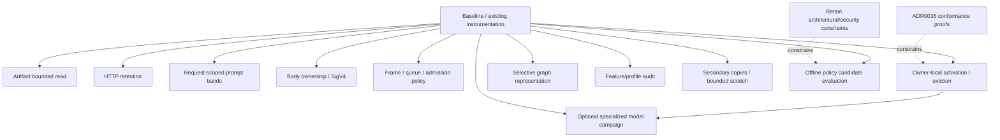

# Prioritized vertical slices and ADR impact

Pin: `fda1315052b8b4074f9ea5acc842b2cc0b08b2b2`.
All slices below are proposals. No production implementation is authorized in this
research phase, no accepted ADR changes are made, and no upstream compatibility
layer is proposed. Effort labels are **relative estimates**, not delivery dates.

## Recommended order

| Slice | Problem and smallest intended change | Owning files / existing infrastructure | Priority; estimated complexity | Acceptance / rollback |
| --- | --- | --- | --- | --- |
| R01 | Attribute startup, long-session, allocation and process-tree costs | `crates/e2e/src/baseline/{workloads,census,recorder}.rs`, `crates/observability`, existing stream allocation tests | P0; small instrumentation, medium platform campaign | Versioned fixtures/raw data; no new always-running service or normal-mode allocator overhead. Disable optional profiling to rollback. |
| R02 | Bounded artifact reads rather than full-read-backed slices | `envd/src/tool_url/artifact.rs`, `journal/src/blob.rs`; existing BlobAuthority/open_range | P0; small native change | Identical bytes/errors/security/source identity; empty/reversed/end/overflow/missing/corrupt cases; memory grows with selection, not blob size. Revert adapter, preserve full-read API. |
| R03 | Measure and bound settled HTTP diagnostic retention | `ai/src/transport/http.rs`, existing attempt evidence/capture consumers | P0 investigation, then small/medium change | Long-session record/heap plateau; no loss of required live/failure evidence or redaction. Restore ownership policy on regression. |
| R04 | Render canonical prompt bands once per request | `agent/src/prompt/mod.rs`, `agent/src/loop.rs`, production PromptSource | P1; small/medium | Exact prompt/tool/cache-prefix/proof order on hooks/rewind/compaction; no cross-request stale cache. Revert scoped optimization. |
| R05 | Transfer existing contiguous request bytes during signing | `ai/src/transport/http.rs`, Bedrock codec/body/evidence abstractions | P1; medium | Fixed-time signature/wire equality, single/multi-chunk limits and retry/cancel behavior; fewer copies on eligible requests. Retain collection fallback. |
| R06 | Bound reachable Python-frame/queue work and reuse buffers only legally | `py/python/omp_remote.py`, `envd/src/{worker_pool,eval/process}.rs`, native mailbox/dispatcher/schedules | P1 conditional; medium/high | No allocation for rejected declared oversize, cumulative limits, no cancellation deadlock/truncation/lost outcomes. Restore prior negotiated policy; do not silently rewrite protocols. |
| R07 | Activate/retain/evict resources inside current owners | `envd/src/server/session.rs`, `docserver/{lsp_pool,lsp_registry,lsp_supervisor}.rs`, `memory/src/{runtime,embedding/supervisor}.rs` | P1 conditional; medium/high | Existing lazy settings first; first-use single flight, no active lease eviction, persistent state intact, bounded reactivation cost. Revert optional idle/lazy policy. |
| R08 | Resolve CPython conformance and initialization-failure semantics | `py/src/lib.rs`, `envd/src/eval/process.rs`, ADR0036 unchanged | P0 investigation; small proofs, resolution separately scoped | Test default embedded path with no host Python; trace configured exception; inject invalid-path initialization in disposable children before considering safe preflight fixes. Never reset a live interpreter or erase Eval state. No behavior change until conflict resolved. |
| R09 | Partition actual graphs/queries before adopting a new snapshot format | `kb/src/{store,graph}.rs`, `app/src/kb_cmd.rs`; current freshness/digests/CAS | P2 conditional; medium/high | Same factual relationships and query answers; full encode/validate/access/fault/corruption benchmark. Keep original representation as rebuild/rollback source. |
| R10 | Evaluate optional specialized inference within measured residual budget | Existing `ai/src/local/runtime.rs` leases/admission/memory pool; memory embedding supervisor | P2 optional; medium/high | Held-out quality, real concurrent Mac physical footprint, cold/warm/unload/reload and Linux backend contracts. Remote remains usable with local backend disabled. |
| R11 | Audit feature/profile/dependency reachability rather than chase file size | Workspace Cargo configuration, target-specific deps, actual linker maps | P2 conditional; small audit, potentially large changes | No capability/security/recovery loss; compare active pages, heap, build/link and runtime. Restore prior profile/feature union. |
| R12 | Offline legal policy optimization using existing ADW/configuration/verifiers | `adw/src/{workflow,profile}.rs`, `driver/src/adw/definition.rs`, `driver/src/verification/*` | P2 research; medium | Immutable train/held-out baselines; hard constraints outside rewards; deterministic legality and approved promotion/rollback. No live native self-modification. |
| R13 | Retain appropriate boundaries; reject migrations without need | Accepted ADRs and existing Rust/Prost/Python/FFI owners | Continuous decision; no implementation | Reconsider only a demonstrated unmet workload after simpler alternatives; no speculative plugin/format/allocator framework. |
| R14 | Reduce measured secondary copies and idle scratch retention | `agent/src/context.rs`, `ai/src/transport/capture.rs`, `tui/src/renderer.rs`, AST/recall cache owners | P2 conditional; medium | Patch atomicity, stream/grapheme order, redaction, PTY output and cache invalidation unchanged. Trim only if real memory release exceeds warm-latency cost. |

The initial implementation slice after authorization should be **R02**, preceded
by preserving the R01 baseline and strict adapter tests. It has both a concrete
source mechanism and an actual native-API allocation experiment. R03/R04 can be
reviewed independently; their full-system memory/latency improvements are still
hypotheses. Do not start with a serialization migration or stable ABI framework.

## Dependency DAG and parallelism

R02/R03/R04/R05 touch different owners and can be separately researched after
baseline/test contracts agree. R06 and R07 need explicit shared cancellation/
resource obligations. R09 must not rewrite authoritative journal data. R12 can
evaluate existing policy knobs before any of the optional native-code slices;
it must not automatically promote candidate source code.

## Full adoption records and source-candidate crosswalk

[`adoption-records.json`](adoption-records.json) expands each consolidated slice
into the required source/pin/symbol/status, ADR/compliance, API/IR/config/protocol,
placement/lifecycle, platform/provider, memory/allocation/latency trade-off,
dependency/license/security, complexity/confidence, benchmark/acceptance and
rollback fields. The [declarative collector](references/build_decisions.py)
generates that data; it is not production orchestration.

The source chapters use finer-grained investigation identifiers. These are
aliases/experiments under the consolidated records, not extra unreviewed projects:

| Source candidates | Consolidated owner |
| --- | --- |
| Native N01 | R01/R07: evaluate existing lazy-LSP settings |
| N02/N03/N07/N08 | R07/R08: resource activation, leases, namespace/conformance |
| N04, interop I02/I03 | R06/R14: queues, aggregate frame limits, bounded buffers |
| N05, I06, technology T03 | R09: actual graph/selective data representation |
| N06 | R14/R07: cache representation/accounting and safe lifecycle |
| I01 | R02: artifact bounded reads |
| I04/I05/I07 | R08/R07: Eval records, initialization-failure proof, ADR tension |
| Provider P01/P02/P03 | R03/R04/R05 respectively |
| P04/P05/P06/P07 | R14: projection/hook/debug/TUI measured-copy and retention work |
| Saetta technique/experiment rows | R10/R04/R13: optional engines, prompt methods, rejection of incompatible assumptions |
| Technology T01/T02 | R01/R12: instrumentation and legal offline policy search |
| T04/T05/T06 | R07/R14/R13: budget concepts, allocator experiment deferred, unnecessary stack rejected |

## Phase coverage, not a commitment to implement every phase

| Requested research category | Recommended slices/status |
| --- | --- |
| 0 Baseline | R01, completed source/limited experimental evidence; full platform baseline pending |
| 1 Initialization/retention | R03/R07/R08; source candidates exist, cost measurements pending |
| 2 Deferred activation | R07, configuration first, native change conditional |
| 3 Allocation/ownership | R02/R04/R05/R14; avoid cheap-clone rewrites |
| 4 Modularity/features/ABI | R11/R13; co-built typed Rust retained |
| 5 Serialization/large data | R02/R06/R09; no broad replacement approved |
| 6 Python/external execution | R08/R07; preserve kill boundary and durable Eval semantics |
| 7 Remote providers | R03/R04/R05; Bedrock semantics retained |
| 8 Resource policy | R07/R10; existing owners/admission, no global manager |
| 9 Existing IR/policy | R12 with actual workflows/config, no fictional IR types |
| 10 Optional inference/execution | R10/R13; large Saetta packs and speculative boundaries rejected |
| 11 Meta-Harness | R12 research; approved promotion is a separate slice |
| 12 Regression prevention | R01 plus each owner's contract/replay/fault/performance tests |

## ADR compliance and decision process

Preserve the exact rationale and amendments in accepted ADRs. Applicable anchors
include 0002 ownership, 0003 session authority, 0004 lifecycle derivation, 0006
host policy, 0008 execution streams, 0009 bounded output, 0011 termination, 0024
stable permanent roster, 0035 native engine/allocation discipline, 0036 embedded
CPython boundaries, 0049 vendor-neutral ownership and 0050 controlled schemes.
The exact quoted constraints and implementation status are in chapters 01/03.

R02–R05 are internal optimizations with no necessary accepted-decision change.
R06 must not silently change frame contracts. R07 preserves active ownership and
metadata registration. R08 records a real conflict instead of modifying an ADR.
R09 might need an **additive** derived-artifact schema/lifetime decision only after
evidence. R10 uses an existing native backend boundary; it is not arbitrary Rust
plugins or another extension language. R12's hard constraints cannot become
optional objective weights. No superseding accepted ADR is proposed by this study.

## Executable development handoff

For each authorized follow-up: freeze the source/workload baseline; implement one
owner-scoped change; run that crate's existing `just test-pkg` nextest/doctest
recipe and joined-system contracts; execute the paired held-out experiment;
inspect allocation/live memory and cold/warm trade-offs; reject noisy or illegal
improvements; retain raw evidence and review the diff; promote only under the
existing repository workflow. TUI changes additionally require real PTY tests.
No unavailable runner, zero selected tests, successful compilation alone or LLM
judgment may stand in for a required proof. Production changes, ADR decisions and
publication remain separate from this uncommitted research phase.
