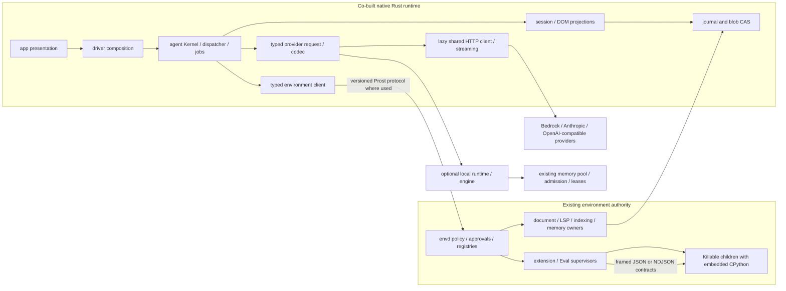
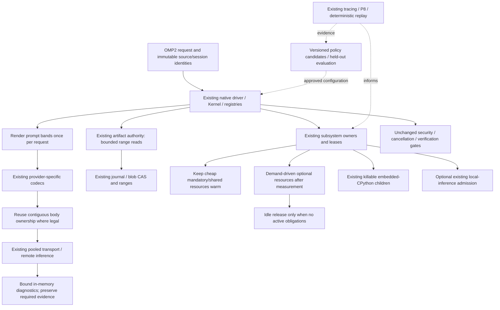

# Target architecture, resource ownership and the 16 GiB platform

Pin: `fda1315052b8b4074f9ea5acc842b2cc0b08b2b2`. This chapter is architectural
inference/proposal grounded in chapters 01–05; it does not claim implementation
of the proposed optimizations or a measured Apple Silicon footprint.

## Current architecture



Native components compiled together use Rust's own APIs, traits and ownership;
no stable external Rust ABI is needed for their calls. Typed protocols are used
where an actual process/network/persistence boundary requires them. Existing
trusted system C-ABI library loading is distinct from arbitrary plugin loading.
The diagram groups ownership; it does not assert one process per box or one
serialization format for every edge. See chapter 03 for exact transport inventory.

## Proposed state: preserve the owners, reduce active work



Every production box above has an existing owner. “Demand” and “idle” are
conditional changes inside those owners, not a new global manager. No new native
library boundary, process tier, data plane, registry or protocol is approved by
this diagram. Cache/index mmap, shared memory and alternative snapshots remain
experiments until existing selective queries/ranges/streaming are insufficient.

```mermaid
sequenceDiagram
  participant C as Existing caller
  participant O as Existing resource owner
  participant R as Resource or supervised child
  participant V as Existing journal and verifier
  C->>O: Authorized acquisition with cancellation/budget
  alt Resource absent
    O->>O: Single-flight initialization under existing owner
    O->>R: Initialize within declared effects
    R-->>O: Ready or typed failure
  end
  O-->>C: Scoped lease / generation identity
  C->>R: Execute with backpressure and cancellation
  R-->>V: Required result/evidence through current authority
  C->>O: Release lease
  alt Idle and no active references, obligations or durable state at risk
    O->>R: Existing shutdown/unload path, if implemented and safe
  else Resource still needed
    O->>O: Retain warm; do not evict an active dependency
  end
```

This is a lifecycle **contract**, not a request to introduce a universal state
enum. `OnceLock`/`LazyLock` fit non-evictable shared resources. Existing lease/
supervisor generations fit evictable models/processes. Failed initialization
needs bounded retries and cancellation; metadata may remain registered while
resource acquisition is delayed. Persistent journal/bank state must survive.

## M1 Pro, 16 GiB: operational feasibility

The machine is shared with macOS, OMPv1, IDE/browser, LSP/indexing, Rust builds,
Python children and possibly GPU workloads. Available model capacity is **not**
16 GiB. Determine a residual budget from observed concurrent workload envelopes:

`local optional budget <= physical capacity - measured concurrent baseline - safety headroom`

No fixed headroom value is asserted without measurements. Record normal and
heavy-development cases, memory-pressure/compression and swap growth, and the
first useful interaction of both OMP runtimes. A low apparent free-memory count
can be file cache; conversely compressed memory/swap can hide contention while
RSS looks acceptable. Shared clean code pages, private dirty heap, compressed
pages, GPU allocations and child processes must be interpreted together.

On macOS collect `vmmap -summary`, `footprint`, Instruments Allocations/VM Tracker,
Time Profiler and system pressure/swap observations where available and permitted.
Do not sum child RSS as unique physical usage. On Linux use `smaps_rollup`
RSS/PSS/private fields plus cgroup-v2 totals/limits, pressure and faults; retain
platform definitions rather than pretending PSS and macOS physical footprint
are interchangeable. See chapter 06 for repeatable procedures and tool gaps.

**Prefer remote inference as the normal generation path.** Bedrock/Claude clients
still benefit from bounded diagnostics, less prompt work, body reuse and stable
cacheable prefixes. Remote APIs do not expose their internal tensors or KV cache.
Use provider-reported cache-token usage to verify cache behavior; cached-input
pricing and provider prefill reuse do not imply the client can omit required
conversation history from stateless requests.

Specialized local embedding/reranking/classification may be worthwhile only if
quality and end-to-end concurrent-memory tests pass. Ideal quantized weight bytes
(`parameters × bits / 8`) exclude metadata, temporary activations, KV, Metal
buffers, driver overhead, allocator fragmentation and page residency; they are
not a runnable-model memory estimate. Saetta's normal pack guards/requirements
already rule out its advertised large packs on this machine. Keep those guards;
do not bypass them to produce a favorable screenshot or microbenchmark.

Before a specialized model is promoted: use existing local-runtime admission and
leases; bound concurrent inference; keep heavyweight weights off the default path;
test cold load, warm request, idle unload, reload, cancellation and concurrent
activation; verify memory is actually released rather than merely removing a
registry entry. Hysteresis prevents repeated load/evict thrashing. On pressure,
optional work may wait, fail explicitly or use an already approved equivalent
remote backend. Required security/verification cannot silently disappear.

## Execution placement decisions

| Mechanism | Placement decision and limiting factor |
| --- | --- |
| Co-built static Rust, modules/crates/traits | Default trusted hot path; defer runtime construction without externalizing code |
| Trusted system C ABI / existing engine FFI | Retain at actual supported library boundary; allocator/error/callback/version contracts remain explicit |
| Independently compiled Rust dylib plugins | Reject absent a demonstrated requirement and owner-approved ABI policy |
| Embedded CPython in supervised children | Retain ADR 0036; release idle reconstructable children only through existing owner and state contracts |
| Native subprocess | Use for independent termination/dependency/isolation needs, not conceptual modularity alone |
| Shared-memory worker | Defer until selective CAS/ranges/streaming fail measured requirements; validation/lifetime/revocation not free |
| WebAssembly/WASI component | Optional research for a distinct constrained workload; not replacement for Python extensions or an automatic sandbox |
| Local HTTP inference | Only if an existing supported backend operationally warrants it; no mandatory always-running service |
| Remote protocol execution/provider | Retain native typed client policies, auth, cancellation and accounting |
| MicroVM | Reject as a default development dependency; revisit only for a demonstrated isolation problem and available platform |

Dynamic unloading alone does not guarantee memory reclamation: allocators,
threads/TLS, callbacks, statics and retained function pointers can keep resources
alive or make unloading unsound. Some ABI tools intentionally retain libraries.
Demand-paged executable code also need not be physically resident before use.

## ADR impact

All accepted ADRs stay unchanged. The target retains 0035 native-engine/allocation
principles; 0036 one embedded extension language and kill boundaries; 0006
host-owned policy; 0011 cancellation/termination; journal/replay authority;
0049 vendor-neutral core and vendor extensions; 0050 controlled registration.
The exact excerpts, implementation gaps and applicable record links are in
chapters 01/03 and the per-opportunity decision records.

No superseding ADR is justified merely by smaller executables, zero-copy marketing
or Rust's unstable native ABI. A future new bulk-data format/ownership contract
may need an additive decision after benchmark evidence. The current optional
external-Python path versus embedded-only ADR 0036 needs explicit conformance
resolution; research does not quietly change either the accepted text or runtime.
