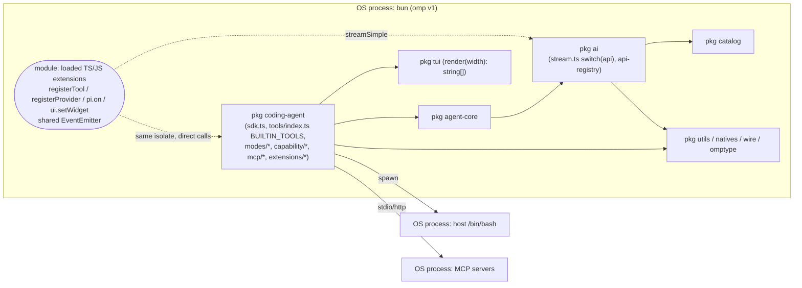
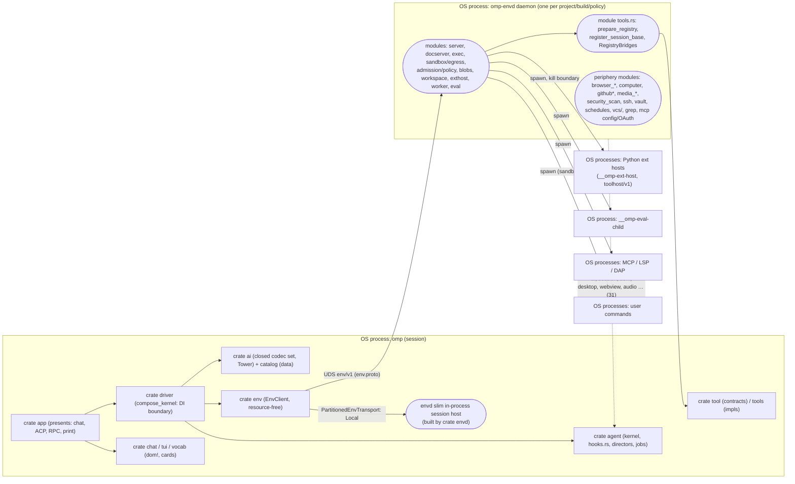

# OMP v1 (TypeScript) vs OMP² (Rust): Modularity, Extensibility and the Role of envd

Status: research; production refactor **not authorized** (see proposed ADR 0046)
Date: 2026-10-11

Evidence convention: **OBSERVED** means read directly from source or git history and cited as `file:symbol`/`file:line` or as a commit. **[INFERENCE]** means derived and not directly observed. No performance figure here was re-measured; numbers quoted from ADRs are labelled as quotations.

## Executive conclusion

1. **Is v1 more modular?** v1 is more *extensible*: third parties can add more kinds of things without core edits. It is also more *local for first-party additions*: a new built-in tool is one file plus one table row. It is **not** more modular in structure. About 60% of v1's code is a single 480k-line package (`coding-agent`), built around god-objects (`sdk.ts`, `ToolSession`).
2. **OMP² does need more central edits per feature** for new built-in tools, new hook/event types, host verbs and host-touching tools. Part of that cost is caused by envd: it composes the tool roster, depends upward on `omp-agent` vocabulary, and has absorbed about 36k lines of integration periphery. The rest is inherent to owner-locked decisions: an out-of-process typed protocol, a closed roster, a closed vocabulary and a closed codec set. That inherent part would surface in any crate that hosts those boundaries.
3. **Verdict: Modularize, with selective Delegation.** Preserve envd's authority core and the process model. Move roster composition and shared vocabulary out of envd, split its two largest files, and extract its peripheral integrations behind seams that already exist (`RegistryBridges`, `DynamicToolFactory`). Recover a few v1 extension *properties* as idiomatic Rust (ADR 0046). Do **not** restructure into more processes or port v1's TypeScript extension shape.

## 1. What was compared

| Role | Ref | SHA | Notes |
|---|---|---|---|
| **v1 (TypeScript)** | `upstream/main` (`can1357/oh-my-pi`) | `80577ebff543a993598d751db704cf1a0b0859e1` (2026-09-14) | Last version bump in history is 18.1.21 (`a2501722aa`). Analysed read-only via `git archive`. |
| **OMP² authoritative** | `omp2` (`blyzer/oh-my-pi`) | `bc1e12d21b4a44e0a0ce8bd812c6d1a68be6fe79` | 1,667 commits (1,353 non-merge, 530 `feat`). |
| OMP² checkout used for crate-graph metrics | `research/apple-pcc-integration` | `0996656a61030715439f8ae8d2047bd436f3b59e` | `Cargo.toml` diff to `bc1e12d21b` is empty, so the crate graph is identical. |
| Local oh-my-pi working tree (**not v1**) | `fix/omp2-tui-immediate-input-render` | `e58a0969a0` | This is an OMP² Rust tree. Its untracked `packages/` are leftovers and were not analysed as v1. |

**Disjoint histories (OBSERVED).** `git rev-list --count HEAD..upstream/main` = 22,337, which is all of upstream. OMP²'s root commit is `9c85c97b6a` "Initial commit" (can1357, 2026-08-11). **OMP² is a ground-up rewrite, not a fork with shared history.** Concepts carried over are re-implementations, so "regression" here means a lost *property*, not reverted code.

## 2. Documented author intent

The quotes are verbatim from the repository.

- **PHILOSOPHY.md:** omp started "first as a growing pile of diffs against Pi, now as omp², a ground-up Rust rewrite". The aim: "build a coding harness so good that the model is the only replaceable part."
- **AGENTS.md:5-6:** "Rust rewrite of `pi`: port observable behavior, not TS shape."
- **ADR 0030 (one-pass rendering):** "pi's component contract is `render(width): string[]`… A CPU profile of one full pi session… is dominated by the renderer" (`wrapAnsi` 98.6 s, `containsImage` 43.0 s, `visibleWidth` 24.2 s + 12.4 s). "Replacing the contract took one session's render time from 267 s to 90 ms." It also says "a fetched page can inject escape sequences into the user's terminal." *(Quoted measurement, not re-run.)*
- **ADR 0031 (typed component model):** with `string[]`, "Structure is unrecoverable… all your tools are indistinguishable gray rectangles." The decision is typed `(Element, Props, Children)`; unknown tags degrade to `CustomElement`.
- **ADR 0035 (Rust for the engine):** "TypeScript is the extreme case: it always ends up becoming *your* language." A harness "demand[s] a lower-level language". Every crate under `crates/` "MUST be Rust".
- **ADR 0036 (Python for extensions):** "extensions sharing the engine's isolate cannot be killed once they escape cooperative cancellation, and hot reload becomes nearly impossible." Decision: "NO JavaScript/TypeScript plugin runtime… Every extension host and every eval session is a killable child process… pi's TypeScript extensions are not portable; the ecosystem restarts in Python."
- **AGENTS.md:489 "Locked Deviations from pi (owner decisions — NEVER port back)"** (abridged):
  - Extensions and eval use embedded CPython only.
  - Bash is an in-process interpreter.
  - Edits go through the envd document authority.
  - A "minimal fixed wire roster; optional capabilities/MCP ride `dyn`… NEVER pi's discoverable `loadMode`/dynamic schema mutation (prompt-cache invalidation)… never pi's renderCall/execute/renderResult callbacks."
  - Providers are data, with typed serde/prost wire structs.
  - Prompts use scribe templates.
  - "Directors + Components, no regimes"; the agent loop is a generic hook surface.
  - Runtime is tokio + rayon.
  - "Feature graphs earn their weight… cold `cargo run --bin omp` build time is a gate."
- **AGENTS.md:15-17:** "`compose_kernel` is the production construction boundary. `crates/driver` + `crates/app` = the production stack (driver composes, app presents)."
- **AGENTS.md:355-358:** "Enums before `dyn`…" Dyn erasure happens at most once, at the outer boundary; "Layers compose ONCE at build."
- **docs/py/00-overview.md:** the cost the authors accepted is "Extensions no longer share `sys.modules`, so the in-process inter-extension event bus is gone… the sanctioned shape is the typed service surface — `@omp.service`." The reason given: "On Codex, TTFT scales roughly 1:1 with registered tool count."

**Reading:** the owner deliberately traded extension *breadth* (v1) for typed, sealed, killable boundaries and a fixed roster. Any recommendation that restores v1 breadth by reopening those decisions is out of scope.

## 3. Evolution timeline (OBSERVED unless marked)

| Date | Event | Evidence |
|---|---|---|
| ≤2026-08 | v1 evolves as diffs on pi, reaching 16 npm packages | `upstream/main` |
| 2026-08-11 | OMP² initial commit; disjoint history begins | `9c85c97b6a` |
| 2026-08-14 | envd born *inside app* (blobs, docs, exec, server, worker, workspace) | `768749cf01` |
| 2026-08-14 | Typed client crate `omp-env` created | `d77d4b6995` |
| 2026-08-20 | "ported pi tools" (`tool_url`) | `914739cfc4` |
| 2026-08-22 | envd split into its own crate; README states "single owner of project environment resources" | `8e3f027aae` |
| 2026-08-22 | Omnibus commits add MCP, worktrees, SSH, vault (21 modules) and browser, computer, github | `caea1609c7`, `1839606706` |
| 2026-09-04 | "chore: smol refactor" (1,705 files) folds `crates/docserver` and `crates/grep` into envd | `de7a1c71a9` |
| 2026-09-14 | v1 snapshot compared here | `80577ebff5` |
| (undated in evidence) | `@omp.regime` removed in favour of Directors | `d98ed242f5`, `47e02d12a6` |
| 2026-10-06/07 | ADR 0028 amendments place approval posture and relay in envd | `admission.rs`, `approval_relay.rs` (`1b648d0f74`) |
| 2026-10-11 | Authoritative `omp2` head | `bc1e12d21b` |

[INFERENCE] The periphery accumulated in three omnibus commits. None was a recorded placement decision; ADRs 0018/0025/0027/0029 only *record* where code ended up.

## 4. Concepts: preserved, replaced, dropped

| v1 concept | OMP² fate | Evidence |
|---|---|---|
| Provider dispatch (`ai/src/stream.ts` `switch(api)`; `registerCustomApi`) | Replaced: catalog data plus closed codec set behind Tower | `crates/catalog/data/catalog.postcard`, `crates/ai/src/codec/*` |
| `pi.registerProvider(..., streamSimple)` | Replaced by `@omp.provider` (selects a codec; cannot implement one). Custom stream functions dropped on purpose | docs/py/13 |
| `registerTool` + `renderCall/renderResult` + `loadMode`/`setActiveTools` | Replaced by `@omp.tool`/`@omp.device` behind `dyn`; dynamic activation dropped | Locked Deviations (Tools) |
| `pi.on(event)` (~50 events) | Replaced by `@omp.hook` returning `HookDecision` | `crates/agent/src/hooks.rs:362` `HookEvent` |
| Shared in-process EventEmitter | Dropped; `@omp.service` RPC replaces part of it | docs/py/00 |
| `string[]` Components, `ui.setWidget/setFooter/setHeader` | Replaced by `dom!`/TML/`CustomElement`. **Extension slot/overlay/dynamic-mount host arms not wired** (§6) | ADR 0030/0031 |
| Capability/discovery registry (`capability/index.ts:67-105`) | Partly preserved, as per-kind modules | `crates/driver/src/discovery/*` |
| JS plugins / Claude plugin JS hooks | Dropped as executable code; kept as data | ADR 0036 |
| Markdown custom agents | Replaced by `<agent>.cfg` + rule (importer exists) | `crates/driver/src/v1_import/agents.rs`, ADR 0013 |
| Host-shell bash | Replaced by in-process interpreter | ADR 0028 |
| Direct fs edits | Replaced by envd document authority | Locked Deviations |
| Settings schema | Replaced by convars | ADR 0012 |
| Session JSONL | Replaced by journal → DOM → Components | ADR 0003/0004 |
| Job manager | Unified into one job primitive | ADR 0010; `crates/agent/src/jobs.rs:40`, `crates/tool/src/lib.rs:2111` `JobKind` |
| MCP manager | Preserved and moved into `crates/envd/src/mcp/*`; mounted as `dyn` | — |
| Multi-language eval | Dropped; Python only | ADR 0036 |
| JS plugin marketplace | Replaced by signed Python index, TOFU, grants, locks | `crates/ext/src/{index,trust,lock}.rs` |

## 5. Modularity

### 5.1 Definition used

Modularity here means **how far an independent change stays independent**. It is measured on five axes, none of which is raw package or crate count:

1. Dependency direction and depth (fan-in, fan-out, transitive closure).
2. Enforced visibility: can a boundary be crossed without a compile error?
3. Change locality: how many units co-change per feature commit.
4. Runtime isolation: can one part fail or be killed without the others?
5. Extension reach: what a third party can add without a core edit.

### 5.2 Dependency findings (OBSERVED)

| Metric | v1 (npm packages, runtime `@oh-my-pi/*` deps) | OMP² (`cargo metadata`, path deps, no dev/build) |
|---|---|---|
| Units | 16 packages | 48 crates |
| Internal runtime edges | 54 | 246 |
| Max depth | 8 (`metaharness`) | 11 (`e2e`) |
| Fan-in leaders | `pi-utils` 11, `pi-natives` 9, `pi-catalog` 7, `pi-ai` 7 | `core` 41, `proto` 16, `tool` 12, `con`/`dom`/`journal` 9 |
| Largest fan-out | `coding-agent` 11 | `app` 37, **`envd` 31** (transitive 35/48), `driver` 27 |
| Largest unit | `coding-agent` 479,810 TS lines (~60% of code) | `envd` 203,267 Rust lines (`server.rs` 17,434; `tools.rs` 6,963) |
| Runtime cycles | none | none (Cargo forbids them) |
| Dev cycles | `catalog` ⇄ `ai` | `con` → dev `session` → … → `con` |

**envd direction (OBSERVED).**
- envd is a *sink-side hub*: only `app`, `driver` and `e2e` depend on it.
- It depends upward on `omp-agent` for approval vocabulary (`ApprovalBook`, `ApprovalRoute`…), hook vocabulary (`HookGate`, `HookEvent`…), `ExtensionRegistrar` and `SessionAuthority`.
- It depends broadly on `omp-tools`: 50 files, 275 references.
- `driver` in turn imports envd-internal policy types: `admission::*` (21 refs), `tool_settings::ApprovalMode` (19), `eval::*` (36).
- [INFERENCE] This is a logical bidirectionality between kernel and environment vocabulary, not a Cargo cycle. The shared vocabulary has no neutral home.

### 5.3 Change co-occurrence (OBSERVED)

| | v1 (`upstream/main` since 2026-06-01, n=11,151) | OMP² (`omp2` non-merge commits touching ≤12 crates, n=1,169) |
|---|---|---|
| Mean units per commit | 1.28 packages | 1.86 crates |
| Most-touched | coding-agent 8,114; ai 2,205 | app 263; envd 183; driver 159; agent 129; tools 119 |
| Solo share | ai 53%, tui 53%; inside coding-agent, `src/tools` solo only 4% | envd 36%; tui ~40% |

Share of a crate's commits that also touch a central crate (envd, driver, app, proto or agent): tools 52% (envd 26%), ai 72% (driver 53%), ext 64%, chat 57%, py 52%, catalog 40%.

In the last 400 `omp2` commits, 79 of 185 crate-touching commits hit envd. Of those 79, 36 are sandbox/approval/admission work (ADR 0028), and 17 touch five or more crates. Full detail is in `docs/research/envd-responsibility-audit.md`.

### 5.4 TypeScript vs Rust caveats

- **Granularity bias.** v1's lower packages-per-commit mostly reflects one 480k-line package. Its couplings (`sdk.ts`: 4,428 lines and 105 imports; the `ToolSession` interface of about 90 members) are intra-package and invisible at package level. **Raw counts are not comparable across the two systems.**
- **Cost asymmetry.** A Rust crate is also a compile unit. A cross-crate edit costs rebuild time but buys enforced visibility; an intra-package TS edit is cheap and unenforced. Fewer co-changed units in v1 does not mean less coupling.
- **Process asymmetry.** v1 is one process. OMP² is a daemon, killable children and two sockets. Some OMP² edits cross a typed wire because the code runs in different processes, which v1 never had to pay for.
- **What the finer grain does show:** OMP²'s concentration is *visible and real* (envd fan-out 31, transitive 35/48). The fix should target the specific edges, not the crate count.

## 6. Component diagrams

### 6.1 v1: one OS process, npm packages, in-process extensions

### 6.2 OMP²: crates mapped onto OS processes

Legend: subgraphs are OS processes, rectangles are crates, rounded nodes are modules inside a crate, and dotted edges are compile-time dependencies only.

## 7. Extension scenarios (10)

"Core edit" means envd, the agent runtime, driver composition or proto for OMP². For v1 it means `sdk.ts`, `tools/index.ts`, `stream.ts` or `extensions/types.ts`/`runner.ts`. File lists come from single sample commits and are **indicative only**.

| # | Scenario | v1: what changes | v1 core edit? | OMP²: what changes | OMP² core edit? | Advantage |
|---|---|---|---|---|---|---|
| 1 | Model provider on an existing wire API | `models.yml` or extension `pi.registerProvider()` (`types.ts:1554`) | No | Catalog KDL/postcard, or `@omp.provider` selecting `Api.*` | No | Equal |
| 1b | Provider with a new wire protocol | Built-in: `KnownApi`, `stream.ts` two `switch` sites, `register-builtins.ts`, compat (Devin `fc01e3b6cb`: 100 files; Ollama `03aad88db7`: 21). An extension can supply `streamSimple` with no core edit | Built-in yes; extension no | New `crates/ai/src/codec/<x>.rs` + `codec/mod.rs` + `provider/builtin.rs` + catalog data. **Not possible from an extension, by design** | ai/catalog only; driver co-changes in 53% of ai commits [INFERENCE: wiring/settings] | v1 reach is broader; OMP² is locked |
| 2 | Built-in agent tool | `tools/<x>.ts` + `BUILTIN_TOOLS` row (`tools/index.ts:461`) + renderer + prompt (tts `bde0114f87`: **3 files**) | Light | `crates/tools/src/<x>.rs`, `BUILTIN_TOOL_IDENTITIES` (`crates/tools/src/lib.rs:21`), **`crates/envd/src/tools.rs`** (`prepare_registry` 30-name list :3671, `register_session_base` :3736), `chat/src/cards/<x>.rs`. `"todo"` literal appears in 23 non-test files across 10 crates | **Yes: envd** | **v1** |
| 2b | Extension tool | `pi.registerTool()` in process | No | `@omp.tool`/`@omp.device` + manifest `[[tools]]`; behind `dyn` unless granted `tools.hard` | No | Equal reach; OMP² isolated |
| 3 | Custom agent | `agents/<name>.md` | No | `<agent>.cfg` + `agent/rules/agent-<name>.md` | No | Equal |
| 4 | Execution backend | `exec/bash-executor.ts`, `ssh/*`, `eval-backends.ts` | Yes (coding-agent internals) | `crates/sandbox/src/backends/<x>.rs` + closed `enum Backend` (`crates/sandbox/src/capability.rs:22`) + envd consumers. Router ADR 0040 not started | Yes: envd [INFERENCE from consumer list] | Both central |
| 5 | UI component | `ui.setWidget/setFooter`, `registerMessageRenderer` | No | Built-in: `chat/src/cards/*.rs` with `dom!`; new tag/prop edits `crates/vocab` closed enums. Extension: TML renderers. **Slots/overlays/dynamic mount not served by the chat host** | No for cards; vocab for new tags | **v1 for extensions** (until host arms land) |
| 6 | Event subscriber, existing event | `pi.on("x")` | No | `@omp.hook("x")` | No | Equal |
| 6b | New event type | `types.ts` + `runner.ts` + emit site + `sdk.ts` bridge (`6872a73977`: 11 files, 2 packages) | Yes | agent hooks/events/loop/director + **proto** `toolhost.proto` + **envd** `exthost/dispatch.rs` + 4 app adapters + chat + py (`f7dd7a8414`: **29 files**, 8 crates) | **Yes: agent + proto + envd + app** | **v1** |
| 7 | Environment capability (host verb) | `defineCapability` + `registerProvider`; host effects are direct Node/Bun calls | No | `env.proto` `ClientFrame` + envd authority + `omp-env` client (+ caller). AGENTS.md: "Host changes go to `omp-envd`" | **Yes, by design** | Not comparable (v1 has no host boundary) |
| 8 | Communication adapter (ACP/RPC/editor) | `modes/acp/*`, `jsonrpc/`, `modes/rpc` | Moderate | `crates/app/src/{acp_mode,acp_events,rpc_mode,print_mode}.rs`, `crates/rpc`, `crates/serve` | Usually app only; every new event fans out to each adapter | Equal; OMP² event fan-out is the cost |
| 9 | External integration | MCP config, extension, plugin (incl. JS Claude plugins) | No | MCP: config only (`dyn`). First-party (GitHub, search): `tools` + **envd** (`github.rs`, `search_backend.rs`, `register_session_base`) | MCP no; first-party **envd yes** | v1 for first-party |
| 10 | Background operation | `async/job-manager.ts`; extension timers | Light | Job primitive (`jobs.rs`, closed `JobKind`), envd `schedules.rs`, `@omp.service`/workers | New `JobKind` touches tool + agent | Equal; OMP² more uniform |

More samples:
- OMP² feature commits that stayed inside `tools`: `staging.rs` `f5d25b1e13` (4 files), `device_ctl.rs` `ee54a2a3ed` (7), `review.rs` `e0f47b8286` (13).
- A host-touching tool, editor_sync `1de18c74e3`, spanned app, e2e, env, envd, proto, tool and tools.

## 8. v1 patterns: recover / already equivalent / reject

Rejections follow the AGENTS.md Locked Deviations. Recovery means recovering the *property*, not the TypeScript shape (ADR 0046).

| v1 pattern | Problem it solved | Class | OMP² status and rationale |
|---|---|---|---|
| Table-driven built-in registry (`BUILTIN_TOOLS: Record<Name, ToolFactory>`) | One place to add a tool | **Recover** | A static identity table already exists in `omp-tools` (`BUILTIN_TOOL_IDENTITIES`), but envd re-enumerates names and constructors by hand. Extend that table with a construction entry and let the composer iterate it. Build-time only; the roster stays fixed (no Locked conflict); erasure stays at the existing `Arc<dyn ErasedTool>` boundary. |
| One generic event path across adapters | New event without per-adapter edits | **Recover (property)** | Keep typed payloads (Locked: typed wire structs). Give adapters a default arm driven by an event-catalog descriptor, so only adapters that render an event specially change. Needs an owner ruling (open question 3). |
| Extension UI slots (`setWidget/setFooter/setHeader`) | Persistent extension UI | **Recover** | Python API is frozen (`omp.ui.mount`, `omp.ui.set_status` in `crates/tool/src/spec_generated.rs`; `omp.ui.dynamic_mount` at `crates/py/python/omp/ui/__init__.py:1437`). The chat host returns `unsupported_operation` for `DynamicMount` and overlays (`crates/app/src/chat_services/extension_ui.rs:499-510`). Wire it with TML, which is compatible with ADR 0031. |
| Data-only discovery providers (`defineCapability` + priority providers) | Pluggable foreign-config discovery | **Recover (data-only)** | Per-kind modules exist (`driver/src/discovery/*`). A static provider slice per resource kind is enough; loading foreign *executables* stays rejected (ADR 0036). |
| Middleware / tool wrapper | Cross-cutting interception | **Already equivalent** | `HookGate` + phase-ordered `HookControlFactory::compose`; Tower layers in ai. Better bounded than v1. |
| Markdown custom agents | Zero-code agents | **Already equivalent** | cfg + rule; importer `v1_import/agents.rs`. |
| MCP via config | No-code integrations | **Already equivalent** | `dyn` devices. |
| Job manager | Background work | **Already equivalent** | One job primitive (ADR 0010). |
| Extension `streamSimple` provider | Exotic providers without core | **Reject** | Locked: providers-as-data; "Codecs are selected, never implemented". |
| `loadMode` / `setActiveTools` | Context-sensitive tool sets | **Reject** | Locked: prompt-cache invalidation; ADR 0024 small permanent roster. |
| `renderCall/renderResult` callbacks | Per-tool UI | **Reject** | Locked; ADR 0030 (cost, ANSI injection). |
| In-process inter-extension bus | Extension ↔ extension RPC | **Reject** | Conflicts with per-extension killable process; `@omp.service` instead. |
| JS/TS plugin runtime, multi-language eval | Ecosystem reuse | **Reject** | ADR 0036. |

## 9. envd summary

The full audit is `docs/research/envd-responsibility-audit.md`, with companion proposed ADR 0045.

- **Intent (OBSERVED).** The founding README (`8e3f027aae`) says: "The daemon is the single owner of project environment resources… Capabilities that require campaign state, inference composition, application-authored content… enter through `RegistryBridges`." AGENTS.md:39-44 assigns it transport, filesystem/process/document/tool authorities and Python extension-host/worker supervision.
- **Legitimate core (Preserve).** Transport, document authority, exec/sandbox/egress, admission/approval, blobs, workspace generations, exthost/worker/eval and MCP process transports. These are authority and state needing one owner per project and a kill boundary (ADR 0006/0011/0036).
- **Accumulated periphery (~36k lines, ~18% [INFERENCE estimate]).** browser, computer, github/github_url, media/TTS, security_scan, report_issue, ssh, vault, memory/reflection, managed_skills, schedules, model_discovery, `vcs/` (duplicates `omp-vcs`), `grep.rs`, and MCP config/OAuth/smithery. These entered mostly via `caea1609c7`, `1839606706` and `de7a1c71a9`. They explain the dependencies on `omp-webview`, `omp-desktop`, `omp-audio` and most `omp-ai` uses.
- **God crate, not God process.** Churn is dominated by the core theme ADR 0028 placed there (36/79 recent commits); the periphery had 0 commits in that window. The coupling cost is compile-time and vocabulary placement, not runtime serialization [INFERENCE: no runtime measurement exists].

## 10. Alternatives

| Option | Description | Assessment | Status |
|---|---|---|---|
| **A. Preserve** | No change | Leaves envd composing the roster, the upward `omp-agent` dependency, and the periphery dependencies. Change amplification for tools and events persists. | Rejected as the end state; acceptable default until owner review |
| **B. Internally modularize envd** | Split `server.rs` (17.4k) into dispatch/control-factories/devices/diagnostics; split `tools.rs`; separate MCP transport from config | Low risk, no new IPC. Improves reviewability and merge locality, but does not remove crate dependencies or roster edits | **Recommended (part)** |
| **C. Thin supervisor + delegated components** | Move periphery implementations to crates behind the existing `RegistryBridges`/`DynamicToolFactory`/`ContentResolver` seams; envd keeps admission and supervision | Drops `omp-webview`, `omp-desktop`, `omp-audio` and most `omp-ai` from envd [INFERENCE until measured]. Uses seams that already exist. No new process | **Recommended (selective)** |
| **D. Capability-oriented** | Scoped capability handles instead of a broad client | Partly present (`ExtensionEnvClient`, `WorkerEnvClient`, policy leases). Extending it to agents is an execution-plane change with revocation and lifecycle risk and no measured need | Defer |
| **E. v1-inspired extensibility** | Recover registry locality, event fan-out reduction, UI slots, data-only discovery | Only the properties compatible with Locked Deviations (§8) | **Recommended (as ADR 0046)** |
| **F. Hybrid** | B + C + E + a contract crate for shared vocabulary | Combines the above without new processes | **Recommended overall** |
| **G. Discovered: move roster composition to `driver` and approval/hook/eval-bridge vocabulary to a contract crate** | AGENTS.md already names driver as the composer (`compose_kernel`) | Addresses the root of the envd ↔ agent ↔ driver vocabulary inversion. Smallest structural fix | **Recommended (first step)** |
| *(rejected)* Restructure into more processes | Split envd core into several daemons | Violates single ownership (README, ADR 0006/0011/0036); adds IPC and ops cost with no evidence of benefit | Reject |

## 11. Scorecard

Weights follow documented priorities. PHILOSOPHY.md, ADR 0035/0036 and the Locked Deviations rank correctness, isolation and security, runtime efficiency and build-time gates above third-party breadth. Weights are a qualitative ranking, not a computed score.

| Dimension | Weight | v1 | OMP² | Preferred / verdict | Confidence | Evidence |
|---|---|---|---|---|---|---|
| Modularity (structural) | High | 16 pkgs; one 480k-line package; god-objects `sdk.ts`, `ToolSession` | 48 crates; enforced boundaries; hubs envd (out 31), driver (27), app (37) | **OMP²**, with envd hub as debt | High | §5.2 |
| Extensibility (third-party reach) | Medium | Very broad, all in process: stream fns, tools+UI, events, dynamic roster | Narrower, typed and sealed: tools/devices, hooks, directors, renderers, services, provider selection; UI host arms and Python DATA binding not wired | **v1 broader**; OMP² narrower by design | High | §7, §8; docs/py/13 `NotWiredError` |
| Dependency isolation | High | Extensions share isolate and npm graph | Killable child per extension; signed index, locks | **OMP²** | High | ADR 0036; `crates/ext/src/{trust,lock}.rs` |
| Runtime efficiency | High | Renderer-dominated profile (~328 s/session, quoted) | 90 ms render (quoted); in-process shell | **OMP²** (quoted, not re-measured) | Medium | ADR 0030 |
| Agent autonomy | Medium | Extension-driven | Directors/Components, job primitive, workpools | **Not comparable** (different goals and mechanisms) | Low | — |
| Lifecycle correctness | High | Cooperative cancel; extension crash affects host | Generation-fenced activation, kill boundary, journal-derived state | **OMP²** | Medium-High | ADR 0003/0011; `crates/envd/src/exthost/lifecycle.rs` |
| Testability | Medium | Large TS suite | Typed seams, e2e, insta/proptest | Comparable; OMP² seams stronger | Medium | — |
| Change amplification | Medium | Tool: 3 files/1 pkg; new wire API: 100 files | Tool needs envd edit; new event 29 files/8 crates; 52-72% of tools/ai/ext commits touch a central crate | **v1 lower for tools and events**; similar for providers | Medium-High | §5.3, §7 |
| Build isolation | High (Locked: build-time gate) | Bun, no compile graph | envd pulls 35/48 crates transitively | **Not comparable** across toolchains; within OMP², envd is the bottleneck [INFERENCE: no per-module compile timing] | Medium | §5.2 |
| Reliability | High | Shared-process failure domain | Supervised children; typed errors (1,287 legacy string-error sites under ratchet, envd largest) | **OMP²** structurally; envd holds the debt | Medium | ADR 0035 status |
| Security boundaries | High | ANSI injection path; unsigned JS plugins execute | Decompose-once rendering; signed/granted extensions; sandbox and policy | **OMP²** | High | ADR 0030/0036 |
| Operational complexity | Low-Medium | One process | Daemon + children + two sockets + proto evolution | **v1 simpler** (cost accepted by design) | High | docs/py/00; `env.proto` |

## 12. Minimum-change recommendation

Each step is independent and reversible. None changes the process model or any Locked Deviation, and no performance improvement is claimed before measurement.

1. **Roster composition out of envd (G).** Extend `omp-tools`' `BUILTIN_TOOL_IDENTITIES` into a construction table. Have `prepare_registry` and `register_session_base` iterate it, and have driver own the selection, consistent with "driver composes". This removes the per-tool envd edit for tools that need no new host verb.
2. **Contract crate for shared vocabulary (G).** Move approval, posture, hook-gate and eval-bridge types used by both envd and driver (`admission::{ApprovalPosture, SandboxState, ApprovalTier, ApprovalPolicy}`, `tool_settings::ApprovalMode`, `eval::{ParentSessionHost, BridgeHostError, BridgeProgressSink}`, plus the `omp-agent` approval/hook types envd imports) below agent, envd and driver. This removes envd's upward dependency on the kernel crate.
3. **Split `server.rs` and `tools.rs` (B).** Pure module moves.
4. **Delegate the periphery (C)** behind existing `RegistryBridges`/`DynamicToolFactory`/`ContentResolver`. Fold `envd/src/vcs` into `omp-vcs`; restore `grep` as its own crate; make `ssh` its own crate (app already uses it directly). Each extraction is one PR.
5. **Recover v1 properties (E, ADR 0046):** an event-catalog default arm in adapters; wire the extension slot, status and dynamic-mount host arms in the chat host; data-only discovery provider slices.
6. **Measure before and after:**
   - `cargo build --timings` for `omp-envd` and `omp`, cold and after a one-line edit in a leaf used by envd;
   - envd transitive dependency count;
   - re-run the co-change metric excluding `de7a1c71a9` and port bulk commits.
   
   Acceptance: no regression in the cold `cargo run --bin omp` gate (AGENTS.md Locked Deviations) and no new runtime IPC hop.

## 13. Answers to the Final Questions

1. **Is v1 genuinely more modular?** Not structurally: 60% of v1 sits in one package with god-objects, and `stream.ts` uses the same closed `switch(api)` shape OMP² has. v1 *is* better in two dimensions: third-party **extension reach**, and **locality of first-party additions** (tool = file + table row). OMP² is more decomposed and more isolated.
2. **Has envd accumulated responsibilities beyond its purpose?** Yes, at the periphery. The justified part is transport, documents, exec/sandbox/egress, admission, blobs, workspace generations, Python host/worker/eval and MCP transports. The accidental part is browser, computer, github, media/TTS, security_scan, report_issue, ssh, vault, schedules, model_discovery, `vcs/`, `grep`, and MCP config/OAuth/smithery, added via three omnibus commits with no placement decision. Roster composition is also misplaced: the composer should be driver.
3. **Does OMP² need more central edits per feature than v1?** Yes, for:
   - built-in tools: envd `tools.rs` `prepare_registry` :3671 and `register_session_base` :3736, against v1's 3 files for tts;
   - new events: 29 files across agent, proto, envd, app and py (`f7dd7a8414`), against 11 files in v1 (`6872a73977`);
   - host verbs: proto + envd + env, by design;
   - host-touching tools: editor_sync `1de18c74e3`.
   
   No, for providers on existing codecs, custom agents, MCP, and Python extension tools and hooks.
4. **Which v1 patterns to preserve or recover; which not?**
   - Recover the properties of: a table-driven built-in registry, a generic event path across adapters, extension UI slots, and data-only discovery providers.
   - Already equivalent: middleware/wrappers, markdown agents, MCP config, job manager.
   - Do not adopt: `streamSimple`, dynamic activation, `renderCall/renderResult`, the shared in-process bus, a JS runtime (§8).
5. **Can envd be less coupled without losing supervision, lifecycle or performance?** Yes. Steps 1-4 of §12 move code and vocabulary at build time only. They keep one daemon per project, the kill boundary and every hot-path call shape [INFERENCE: hot-path neutrality to be confirmed by §12 step 6].
6. **Is internal modularization sufficient?** No. Splitting `server.rs`/`tools.rs` helps reviewability but leaves the 31-crate fan-out, the upward `omp-agent` dependency and per-tool envd edits. Selective delegation of the periphery, a contract crate and moving roster composition are also needed. Delegating the core is **not** needed.
7. **Would separating control, execution and data improve OMP²?** As *logical* module boundaries inside envd, yes; it is part of B. As separate processes, no. CONTROL and DATA are already separate sockets (docs/py/00 "Two sockets"), and splitting authority from state would break single ownership (ADR 0006/0011/0036) for no measured gain. *(The plane mapping itself is covered by the envd lifecycle research; it was not re-derived here.)*
8. **Smallest set with greatest improvement?** §12 steps 1 and 2 (roster to a table plus driver composition; contract crate). They remove the two edges that make unrelated features touch envd, and they are pure build-graph moves. Steps 3-5 follow incrementally.
9. **What stays unchanged in a redesign today?**
   - Rust engine; Python-only killable extensions.
   - Single envd authority per project with document CAS, exec kill boundary, sandbox/egress and admission.
   - Typed proto boundary; fixed roster with `dyn` long tail; providers as data.
   - Journal → DOM → Components; one-pass typed rendering; Directors and hooks.
   
   [INFERENCE] Changes would be limited to *placement* (composition in driver, vocabulary below both sides, periphery outside envd), not to *mechanism*.
10. **Is the problem caused by envd or only visible there?** Both, and the parts can be separated.
    - *Caused by envd:* roster composition, the upward kernel-vocabulary dependency, and the periphery, which together produce fan-out 31.
    - *Only visible there:* the typed multi-process boundary means any new host verb or event must cross `env.proto`/`toolhost.proto` and the envd dispatcher, so the cost lands wherever the boundary is hosted.
    - *Not related to envd at all:* event fan-out across app adapters (ACP/print/RPC/chat).
    
    Fixing only envd's size without the vocabulary placement and adapter fan-out would treat the symptom.

## Verdict

**Modularize, with selective Delegation. Preserve the core and the process model. Do not Restructure.**

- **Preserve:** the owner-locked mechanisms and envd's authority core are the reasons OMP² exists. The evidence supports their correctness, isolation and security value (ADR 0030/0035/0036, Locked Deviations).
- **Modularize:** envd's two largest files and its composition role are the measurable sources of per-feature central edits.
- **Delegate:** about 36k lines of integrations have no assigned reason to be in envd, and they account for most of its crate fan-out.
- **Not Restructure:** no evidence shows a runtime bottleneck or a correctness defect that more processes would fix. A restructure would undo the single-ownership contract.

## Open questions

1. Should driver own native-tool roster composition? AGENTS.md says "driver composes", but `register_session_base` lives in envd.
2. Is envd's dependency on `omp-agent` an owner decision or incidental?
3. Is a catalog-driven default adapter arm for typed hook events acceptable under "typed wire structs"?
4. When does the Python DATA binding land? Python provider proxies depend on it, and so does the `omp.env.*` surface, which raises `NotWiredError` until then.
5. Who owns MCP in the default attached composition? The README says "stay in the attaching process"; `mcp/mod.rs` says "Environment-scoped".

## Confidence & gaps

- **High:** commits, crate and package graphs, line and pub counts, co-change counts, quoted documents.
- **Medium:** per-scenario file lists (single commit samples), feature bucketing of commit subjects, the periphery line estimate.
- **[INFERENCE]:**
  - envd edits needed for a new sandbox backend (from the consumer list);
  - the cause of driver co-change on ai commits;
  - the dependency drop from delegation;
  - hot-path neutrality of §12.
- **Not done:** no build or runtime measurement; ADR 0030 numbers are quoted. No per-module compile-time attribution exists yet; §12 step 6 is the plan to obtain it.
