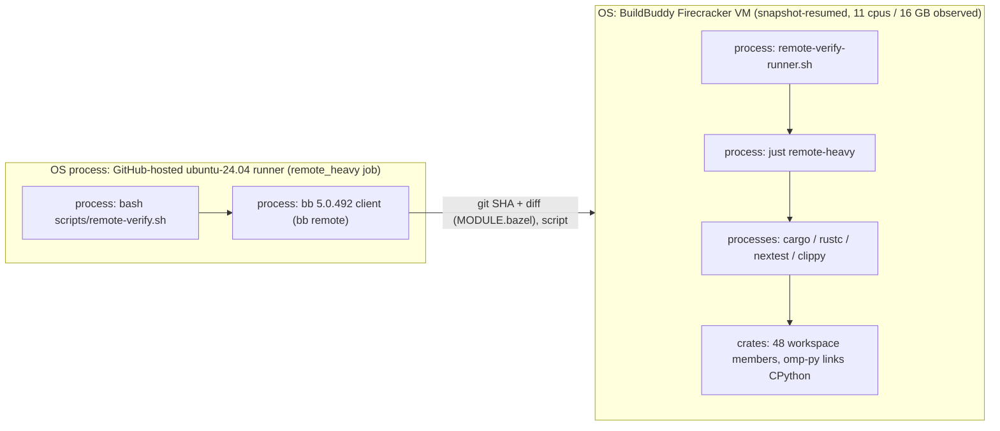

# OMP² Build and Test Acceleration: Inventory, Reconciliation and Plan

Status: research. Phase A is partly done: PR #250 is merged, and the first remote run passed
afterwards. Phases B–F are proposed plans. None of them is authorized, and none has been measured.
Date: 2026-10-11

Scope. This report covers:
- what the repository builds and how CI builds it;
- every earlier Bazel, BuildBuddy, remote-execution and CI item, reconciled against today's tree;
- why the BuildBuddy workflow failed;
- a phased plan with acceptance criteria.

It records no new decision. ADR 0040 (proposed, with its 2026-10-10 Amendment, option D) is still
the governing record. Its owner constraints apply unchanged: **no Bazel migration**, and
**BuildBuddy is never a hard dependency**.

Evidence conventions:
- **OBSERVED** means read from the tree at `origin/omp2` `506b7c143e`, or from the GitHub Actions
  API/logs on 2026-10-11.
- **[INFERENCE]** marks reasoning that was not observed.
- **UNVERIFIED** means it could not be checked.
- Repository paths are cited as `path:symbol` or `path:line`.

## Status legend

| Label | Meaning |
|---|---|
| **IV** implemented + validated | In the tree and proven by a recorded run or measurement |
| **IN** implemented, not remotely validated | In the tree; no remote/CI run proves it |
| **R** researched | Analysed or planned; nothing in the tree |
| **B** blocked | Cannot proceed without a named prerequisite |
| **X** rejected | Decided against, with a recorded reason |
| **D** deferred | Valid, intentionally not scheduled |

## 1. Repository inventory

### Languages, toolchains, lockfiles

| Area | What | Pins / lockfile | Evidence |
|---|---|---|---|
| Rust (main build) | One Cargo workspace, `members = ["crates/*"]`, **48 crates**, **1363 `[[package]]` entries** in `Cargo.lock`. Edition 2024, resolver 3, workspace dependencies only. | `Cargo.lock`; `rust-toolchain.toml` = `nightly-2026-08-08` + rustfmt, clippy, rust-analyzer, `rustc-codegen-cranelift-preview` | `Cargo.toml`, `rust-toolchain.toml:2-3` (OBSERVED) |
| Rust (separate workspace) | `tools/lintx` | `tools/lintx/Cargo.lock` | `justfile:lintx*` |
| Build scripts | 8: `crates/{ai,app,catalog,e2e,proto,py,tools,tui}/build.rs` | — | OBSERVED |
| Embedded CPython | python-build-standalone `TAG=20260807`, `VER=3.14.7`, free-threaded, statically linked. Generated `vendor/python/{stdlib.bin,pyo3-config.txt,bundled/}`. macOS also gets `vendor/python-release` (pgo+lto). | `crates/py/requirements.txt` (hash-pinned, `uv pip install --require-hashes`) | `crates/py/scripts/fetch-python.sh:27-28`; `crates/py/build.rs:main` |
| Python (non-Rust) | `crates/py/stub` (hatchling), `crates/app/tests/stock_sdk`. CI scripts use system `python3`. | `crates/py/stub/uv.lock`, `crates/app/tests/stock_sdk/uv.lock` | OBSERVED |
| TS/JS | `.omp/tools` only. Local only: neither CI nor `just test` runs it. | `.omp/tools/bun.lock` | `justfile` `tools-test` comment |
| Protobuf | 18 `.proto` files. Compiled by `protox` + `tonic-prost-build` (no `protoc`). `buf` is used only for format and lint. | `crates/proto/buf.yaml` | §2 |
| nextest | Floor `0.9.143`. CI and the remote runner use `0.9.146`. | `.config/nextest.toml`, `ci.yml` (taiki-e), `scripts/remote-verify-runner.sh` | OBSERVED |
| `bb` | 5.0.492, sha256 `e9e996a1…` | `.github/workflows/buildbuddy-remote.yml` | OBSERVED |
| Remote image | `gcr.io/flame-public/rbe-ubuntu24-04@sha256:f7db0d47…` | `scripts/remote-verify.sh:args` | OBSERVED |
| Compliance tools | just 1.58.0, cargo-deny 0.20.2, cargo-about 0.8.2 | `ci.yml` `licenses` | OBSERVED |
| macOS linker | Homebrew `lld@22` → `/opt/homebrew/bin/ld64.lld` | `.cargo/config.toml` `[target.aarch64-apple-darwin]` | OBSERVED |

Build configuration that affects acceleration (`.cargo/config.toml`):
- `[env] PYO3_CONFIG_FILE` (relative), `CMAKE_GENERATOR=Ninja`, `CMAKE_POLICY_VERSION_MINIMUM=3.5`.
- `-Z threads=8` is set **only** for `aarch64-apple-darwin`.
- `[unstable]` enables `embed-metadata=false`, `profile-hint-mostly-unused`, `codegen-backend`,
  `checksum-freshness` and `feature-unification`.
- `[profile.dev] codegen-backend = "cranelift"` for members.
- LLVM is used for dependencies, `omp-ar`, `omp-con` (linkme), `omp-observability` (catch_unwind)
  and build-overrides.
- `[profile.test] codegen-backend = "llvm"`: every test build recompiles all members a second time.

### Caches in use

| Mechanism | Scope | Where | Notes |
|---|---|---|---|
| GitHub `actions/cache` v4.3.0 | Per key and per ref, 10 GB per repository | `ci.yml`: `cargo-…` (hosted macOS `rust`), `cargo-lint-linux-…`, `cargo-e2e-linux-…` (falls back to `cargo-p7-…`), `cargo-p7-…`, `python-…`, `lintx-…`, `compliance-tools-…` | Cargo keys end in `${{ github.sha }}` (see §6) |
| Self-hosted Mac persistent state | Per runner | `.github/actions/macos-build-state/action.yml` (`CARGO_TARGET_DIR` outside the checkout, `CI_MIN_FREE_GB`) | Unused while `rust` runs hosted (§5) |
| BuildBuddy Run API Firecracker snapshot | Snapshot key = platform properties + branch | `scripts/remote-verify.sh` (fixed properties; `none-available` save; `local-first` read); runner keeps `$HOME/.cache/omp-target` and `$HOME/.cache/omp-vendor` | `bb remote` runs `git clean -x -d --force` before every run |
| sccache | — | not configured | Measured locally: mixed (`docs/audits/sccache-mac-measurement.md`) |

### Workflows (OBSERVED at `506b7c143e`; durations from the Actions API)

| Workflow | Triggers | Job → runner, timeout | Observed duration |
|---|---|---|---|
| `ci.yml` | push to `main`/`omp2` (path filter = `.github/ci-paths.txt`); every PR to those branches (no filter; the `changes` job decides); dispatch | `changes` ubuntu-24.04 5m · `format` ubuntu 10m · `lintx_ratchet` ubuntu 20m · `runtime_spec` ubuntu 10m · `licenses` ubuntu 30m · `push_verified` ubuntu 5m · **`rust`** `vars.MACOS_RUNNER` or `macos-15`, 120m · `lint_linux` ubuntu 45m · `p9_p10_linux` ubuntu 60m · `p7_linux` ubuntu 45m | Last 30 successful runs. **`rust` (n=14): min 1897 s, median 3275 s (~54.6 min), max 4471 s**, all on hosted `macos-15`. `lint_linux` median 290 s · `p7_linux` 401 s · `p9_p10_linux` 331 s · `runtime_spec` 139 s · `format` 91 s · `licenses` 127 s (bimodal: 26–35 s on a tools-cache hit, 219–342 s on a miss) · `lintx_ratchet` ~30 s |
| `buildbuddy-remote.yml` | push to `main`/`omp2` (paths: itself, `justfile`, `Cargo.{toml,lock}`, `crates/**`, `scripts/**`, `rust-toolchain.toml`, `rustfmt.toml`); dispatch | `remote_heavy` ubuntu-24.04, 90m | 9 failures in ≤1 s at the script step; **first success run `38127067863` @ `506b7c143e`, job 09:04:34–09:19:30 (~15 min)** |
| `p8-baseline.yml` | push `omp2` (paths), PR (paths), dispatch | `record` on `MACOS_RUNNER`/`macos-15`, 90m | not sampled |
| `package-macos.yml` | dispatch; PR (paths) | `package` on `MACOS_RUNNER`/`macos-15`, 180m | not sampled |
| `pr-labels.yml` | `pull_request_target` (no checkout), dispatch | `paths`, `size`: ubuntu, 5m each | not sampled |
| `semantic-index-eval.yml` | dispatch; PR (paths) | `evaluate` ubuntu, 120m | not sampled |

Hosted macOS `rust` step durations (6 recent runs, OBSERVED):

| Step | Duration |
|---|---|
| Test workspace | 1144–2499 s |
| Lint workspace | 373–647 s |
| Compile acceptance proofs | 109–249 s |
| P7 | 86–94 s |
| Doctests | 41–60 s |
| Post Cache Cargo (save) | 76–93 s |
| Install native build tools | 16–27 s |



## 2. Protobuf

- **Files (OBSERVED), 18 under `crates/proto/proto/omp/`:**
  - `auth/v1/auth`, `blob/v1/blob`, `collab/v1/collab`, `control/v1/control`
  - `document/v1/document`, `env/v1/env`, `gateway/v1/gateway`, `identity/v1/identity`
  - `inference/v1/{common,inference,media,models,search}`
  - `policy/v1/policy`, `telemetry/v1/telemetry`, `thread/v1/thread`, `toolhost/v1/toolhost`
  - `ui/v1/ui`
- **`crates/proto/buf.yaml`:**
  - `version: v2`, module `path: proto`;
  - `lint.use: [BASIC]`;
  - `lint.except: [PACKAGE_NO_IMPORT_CYCLE]`, because `omp.thread.v1` ↔ `omp.inference.v1` is an
    intentional package-level cycle.
- **Codegen:** `crates/proto/build.rs` runs `protox::compile` then `tonic-prost-build`. No `buf`
  and no `protoc` are needed to build.
- **`justfile`:**
  - `proto-fmt` (`buf format -w`), `proto-fmt-check` (`buf format -d --exit-code`) and
    `proto-lint` (`buf lint`), all run in `crates/proto`;
  - `fmt-check: fmt-check-rust proto-fmt-check`;
  - `lint: fmt-check clippy proto-lint lint-locked-maps lintx-ratchet`.
- **Gap (OBSERVED):** no workflow runs `buf`. A search of `.github/workflows` for `buf|proto`
  returns nothing. CI's `format` job runs `cargo fmt --all -- --check` directly, not
  `just fmt-check`.
  - The `justfile` comment above `remote-heavy` says "Protobuf checks remain in the GitHub gate
    because they need the repository's `buf`". **No such gate exists today.**
- **In progress:** a dedicated Protobuf CI job (`ci/protobuf-gate`) is being added. At the time of
  writing no remote branch or PR of that name could be found, so its status is **R**.
- **Acceptance criteria for that job:**
  1. It runs on every PR and on push. It sits inside `ci.yml` behind the existing `changes` gate,
     or in its own workflow with `crates/proto/**` in its path filter. `just check-ci-paths` must
     still pass.
  2. It installs `buf` at a pinned version with a checksum check, the same way
     `buildbuddy-remote.yml` installs `bb`.
  3. It runs `just proto-fmt-check` and `just proto-lint` and fails on any diff or finding.
  4. Optional and separately decided: `buf breaking` against `omp2`.
  5. The `justfile` comment then becomes true. If the job is dropped, the comment must be
     corrected instead.

## 3. Task reconciliation

Covers every Bazel, BuildBuddy, remote and CI item in ADR 0040, `docs/audits/remote-verification-trial.md`,
`docs/parked/2026-10-09-remote-execution-next-steps.md` and `docs/parked/2026-10-09-handoff-pending-work.md`.
Disposition values: **preserve**, **amend**, **merge**, **supersede**, **close**.

| # | Source | Original scope | Status | Finding (2026-10-11) | Disposition | Deps | Updated acceptance | Evidence |
|---|---|---|---|---|---|---|---|---|
| 1 | ADR 0040 Option A / R7 | Bazel `rules_rust` + `crate_universe` | **X** | Unchanged; owner constraint | preserve | — | — | ADR 0040 "Options considered" |
| 2 | ADR 0040 Option B | REAPI-native omp executor as backend protocol | **R** | No `omp-exec*` crate exists | amend (by #3) | Slice 1 | Generic REAPI is the portable *cold* backend | ADR 0040 Amendment |
| 3 | ADR 0040 Amendment, option D | Backend-neutral `omp-exec`; BB Run API is the optimized backend | **R** | Probe evidence now recorded (Slice 0c); Slice 1 unblocked on evidence, not started | preserve | owner go-ahead | As ADR 0040 PR 1a–1d, Run-API backend first | audit "Slice 0c" |
| 4 | ADR 0040 Option C | Hybrid shape | **R** | — | preserve | — | — | ADR 0040 |
| 5 | ADR 0040 route a / R5 | sccache → BuildBuddy | **X** | No HTTP cache on BuildBuddy; linked crates are never cached | preserve | — | — | ADR 0040 |
| 6 | ADR 0040 route b | One coarse action per verification command | **IV** (via Run API) | `just remote*` + CI `remote_heavy` passed | preserve | — | — | run `38127067863` |
| 7 | ADR 0040 route c / R6 | Per-rustc `RUSTC_WRAPPER` REAPI | **D** | — | preserve | — | — | ADR 0040 |
| 8 | ADR 0040 R0 / owner Q1 | Stop the laptop serving omp CI | **IV** (observed) | The last 14 successful `rust` jobs ran on hosted `macos-15` (runner "GitHub Actions 1000011897…"). `GET /actions/variables` returned `total_count: 0`. The runner service itself is still installed per ADR 0040 [UNVERIFIED today]. | amend → owner confirms and removes the runner service | — | `MACOS_RUNNER` unset, and no omp job on a self-hosted runner for 7 days | Actions API |
| 9 | ADR 0040 R1 / Slice 0 | `bb remote` operator trial | **IV** | Warm 3 min 12 s with 1 s of Mac CPU | close (done) | — | — | audit "Results" |
| 10 | ADR 0040 R3 / Slice 0b | Raw REAPI via `bb execute` | **IV** | Arbitrary argv works; no recycling; mtimes not preserved | close | — | — | audit "Slice 0b" |
| 11 | Amendment / Slice 0c | Recycling with `preserve-workspace` | **IV** | 4 distinct `boot_id`s; no warm workspace | close | — | — | audit "Slice 0c" |
| 12 | ADR 0040 Slice 1 PR 1a–1d | `omp-exec`, `omp-exec-reapi`, envd capture, wiring | **R** | Not started | amend (Run-API backend first, per D) | #3, owner | ADR 0040 test plan + P13 | ADR 0040 "Implementation plan" |
| 13 | ADR 0040 Slice 2 | Local backend, router, fallback | **D** | — | preserve | #12 | — | ADR 0040 |
| 14 | ADR 0040 R4 / Slice 3 | SSH backend | **D** | — | preserve | #12 | — | ADR 0040 |
| 15 | ADR 0040 R4b / owner Q5 | Managed Mac executors | **R** | Price and terms UNVERIFIED | preserve | owner budget | Written BuildBuddy answer | ADR 0040 Problem 3 |
| 16 | ADR 0040 Part G | Repo-versioned exec image (`scripts/exec-image/`) | **R** | Not started; the runner installs tools on first boot instead | merge into #12 | #12 | — | `scripts/remote-verify-runner.sh` |
| 17 | ADR 0040 Part G | `fetch-python.sh` lacks upstream SHA256SUMS check | **R** | Open | preserve (small, independent) | — | Script verifies the archive digest before extracting | `fetch-python.sh` |
| 18 | ADR 0040 Part H.2 | Key exposure inside the runner | **IN** | Runner script unsets `BUILDBUDDY_API_KEY REPO_TOKEN REPO_USER`. The bazelrc copy is still present [UNVERIFIED]. | preserve | — | — | `remote-verify-runner.sh` |
| 19 | ADR 0040 Measurement plan | Interleaved arms, RSS, swap | **R** (partly done) | Peak combined RSS never measured | amend into Phase B | — | §7 | ADR 0040 |
| 20 | ADR 0040 P13 | E2E over a fake REAPI server | **R** | — | merge into #12 | #12 | — | ADR 0040 |
| 21 | Owner Q2 (disclosure) | Is source upload to BuildBuddy acceptable? | **R** | De facto practised (repo linked; CI uploads on push); never recorded as a decision | amend → record the owner decision | owner | ADR amendment line | `buildbuddy-remote.yml` |
| 22 | Owner Q3 (image hosting) | — | **B** | No image exists | merge into #16 | #12 | — | — |
| 23 | Owner Q4 / handoff item 9 | Gate the Linux workspace suite | **IN** | `remote_heavy` ran `nextest --workspace --exclude omp-e2e` + doctests + clippy on Linux and passed **once**. It is push-only and not a required check; PRs never see it. `AGENTS.md` still overstates. | amend (Phase D) | owner | Required check, or a documented non-gating status | run `38127067863`; `AGENTS.md` CI paragraph |
| 24 | Owner Q6 | `.gitignore` `/vendor` | **IV** | Done in #226 | close | — | — | audit item 8 |
| 25 | Audit | `just remote`, `remote-test-pkg`, `remote-seed` | **IV** | — | preserve | — | — | `justfile` group `remote` |
| 26 | Audit / handoff item 1 | External Python 3.10 check | **R** | Product item, not build | close here; track in product backlog | — | — | handoff |
| 27 | Audit | `editor_base` flake | **IV** | Fixed in #224 | close | — | — | audit |
| 28 | Audit 0b | `GetCapabilities` not called | **R** | Needed only for the generic REAPI backend | merge into #12 | #12 | — | audit |
| 29 | Parked next-steps | Choose A/B/C for Slice 1 | — | Answered by the Amendment (D) | supersede (by #3) | — | — | ADR 0040 Amendment |
| 30 | Parked next-steps | Dedicated BuildBuddy org | **R** | Workflow comment says the key is separate from Nostro's `BB_API_KEY`; whether the org is separate is UNVERIFIED | preserve | owner | Org name recorded; key scoped to it | `buildbuddy-remote.yml` env comment |
| 31 | Parked / handoff §6 | Delete `rbe-trial`, `omp2-wt-bb`, `~/rbe-trial.sh`; revoke trial key | **R** | `refs/heads/rbe-trial` still on origin (`6dab718`); `~/repositories/omp2-wt-bb` exists (OBSERVED) | preserve (owner housekeeping) | — | `git ls-remote` shows no `rbe-trial`; worktree removed; key revoked in BB UI | OBSERVED |
| 32 | Parked | Other self-hosted runners on the Mac | **R** | Outside omp | close here | — | — | parked note |
| 33 | `buildbuddy-remote.yml` (#245–#247) | Remote heavy CI | **IV** | Root cause fixed by #250 (§4) | preserve | — | — | run `38127067863` |
| 34 | Inventory | Pin `actions/checkout` by SHA | **R** | Still `@v4`; Node 20 deprecation warning in the log | preserve (Phase A) | — | SHA `fbc6f399…` (v5.1.0), as in `ci.yml` | run log |
| 35 | Inventory | Drop `--remote_run_header=x-buildbuddy-api-key=…` (key on argv) | **R** | `bb` reads the env var (ADR 0040 Findings 4) | preserve (Phase A) | must keep auth working | A run without the header still passes | `remote-verify.sh` |
| 36 | Inventory | Depth-1 checkout risk | **IV** | The runner fetched the SHA with `--depth=1` and applied only the `MODULE.bazel` diff | close | — | — | run log ("git fetch --depth=1", "git apply … MODULE.bazel") |
| 37 | Inventory | Path filter omits `.cargo/**`, `.config/**` | **R** | Config changes never refresh the remote proof | preserve (Phase A) | — | Filter matches `.github/ci-paths.txt` for Cargo inputs | `buildbuddy-remote.yml` |
| 38 | Inventory | `cargo check --workspace` redundant in `remote-heavy` | **R** | Measured cost: `Finished dev … in 2m 28s` on run `38127067863` | preserve (Phase C) | — | Removed, with clippy still in the recipe | run log |
| 39 | **New** | `remote-heavy` clippy target dir inside the checkout | **R** | `CARGO_TARGET_DIR=target/clippy` is relative to the checkout, which `bb remote` cleans each run. Observed: ~1030 `Checking/Compiling` units after doctests, `Finished … in 4m 12s` [INFERENCE: cold every run] | preserve (Phase A) | — | Clippy target under `$HOME/.cache/`; second warm run shows only member units | run log, `justfile:remote-heavy` |
| 40 | Inventory | GitHub cache keys end in `github.sha` | **R** | OBSERVED: usage 10,707,852,031 B in 15 entries (≈99.7% of 10 GiB). PR refs hold their own 1.4/1.2/0.6 GB Cargo entries. On push `506b7c1`, `cargo-lint-linux-*` restored nothing. Parallel jobs race on `python-*` ("Unable to reserve cache"). | preserve (Phase C) | — | §6 | Actions cache API, run `38127067908` |
| 41 | Inventory | `-Z threads=8` on Linux | **R** | Unmeasured | D | Phase B | — | `.cargo/config.toml` |
| 42 | `sccache-mac-measurement.md` | Local sccache | **D** | Mixed results; "nothing supports adding sccache to CI" | preserve | — | — | audit |
| 43 | P14–P16 notes (mbx) | Alternative compile cache | **X** | 1205 `unknown-flag` bypasses | preserve | — | — | `2026-10-06-p14-p16-architecture-notes.md` |
| 44 | — | Selective / affected-crate testing | **R** (gap) | No document decides it. Only the `changes` path gate and `push_verified` tree reuse exist. | preserve as Phase F | Phase B | — | `ci.yml:changes`, `push_verified` |
| 45 | §2 | Protobuf CI gate (`ci/protobuf-gate`) | **R** (in progress) | No CI runs `buf` | preserve | — | §2 criteria | `.github/workflows` |

## 4. BuildBuddy: root cause, fix, remaining proof

**Root cause (OBSERVED in the PR and code; confirmed by the outcome).**
- At `de41dc5`, `scripts/remote-verify.sh` ran under `set -euo pipefail` and assigned
  `default_branch=$(git symbolic-ref --quiet --short refs/remotes/origin/HEAD 2>/dev/null | sed …)`.
- `actions/checkout` never creates `refs/remotes/origin/HEAD`, so the pipeline returned 1.
- `set -e` then ended the script silently with **exit 1**, before `bb` started.
  - Every explicit error path exits 2.
  - All 9 earlier runs failed in ≤1 s with no invocation URL, whatever the secret or header
    changes.
  - Local runs passed because local clones have `origin/HEAD`.

**Fix.**
- PR **#250**, "fix(ci): keep remote-verify alive without origin/HEAD", merged as `506b7c143e`.
- It appends `|| true` inside the substitution, so `${default_branch:-omp2}` applies.
- PR verification: a stub `bb` on a clone without `origin/HEAD` gave exit 1 before the fix and
  invoked `bb` after it.

**Post-merge run `38127067863` (OBSERVED, conclusion `success`).**

| Proof item | Result |
|---|---|
| Invocation URL (probe) | `https://app.buildbuddy.io/invocation/f623aeb5-ec93-4a18-b52b-1559d51648bf`, `just remote-probe` exit 0 |
| Invocation URL (heavy) | `https://app.buildbuddy.io/invocation/bcdc1ef8-3287-4b57-aed0-e8e440bf0fa4`, `just remote-heavy` exit 0 after 864 s |
| Auth with `secrets.BUILDBUDDY_ORG_API_KEY` | Accepted; open question 1 of the inventory is answered |
| Runner | `Linux x86_64, 11 cpus, 16 GB` (8 CPUs were requested via `EstimatedCPU=8`) |
| Warm state | The probe printed `target 22G` before any build, so the VM resumed a snapshot with a populated `$HOME/.cache/omp-target`. In the heavy run, `cargo check` touched 22 units and the test build 20 units, all workspace members (`omp-proto` … `omp-e2e`); no registry crate was rebuilt. |
| Phase timings | `check` 2 min 28 s · test-profile build 5 min 08 s · nextest run to ~09:14:56 · doctests ~34 s · clippy 4 min 12 s (~1030 units, cold; item 39) |

**Remaining proof (not yet shown):**
1. **A second consecutive warm run.** It must show members rebuilt only when changed, and
   clippy warm after item 39.
   - [INFERENCE] Members rebuilt here because the resumed snapshot predates `506b7c1`. Its origin
     (the 2026-10-09 `just remote-seed`, or another run) is UNVERIFIED.
2. **Cache and transfer evidence from BuildBuddy.** Whether this run *saved* a snapshot under
   `none-available`, and the GB transferred, can only be read on the invocation or Usage page. It
   was not read.
   - "Cache hit" here means snapshot resume, not a REAPI action-cache hit (§5). Cargo does not use
     BuildBuddy's CAS/AC.
3. **The nextest test count.** The summary line was not extractable from the ANSI log. The run
   exited 0.

## 5. Cache mechanisms: what each one caches

| Mechanism | Unit cached | Key | Survives | Hit evidence | Used today |
|---|---|---|---|---|---|
| Cargo fingerprints (`checksum-freshness`) | Per-unit build outputs in one `target/` | Content checksums + flags | As long as the `target/` survives | Fewer `Compiling` lines | Everywhere |
| GitHub `actions/cache` | Tarball of `target/` + registry | Lockfile hash + `github.sha` | ≤10 GB per repo; ref-scoped | "Cache restored from key" | Linux jobs; hosted macOS `rust` |
| Self-hosted Mac target dir | Whole `target/` on disk | Runner name + toolchain hash | Until a low-disk purge | — | Not while `rust` is hosted |
| BB Run API snapshot | Whole VM memory + disk (~RAM + disk, ~56 GB at 16 GB/40 GB per ADR 0040 arithmetic) | Platform properties + branch | Best effort; billed transfer | `target 22G` at start; few units rebuilt | `remote_heavy`, `just remote*` |
| BB raw-REAPI runner recycling | Warm VM between actions | `runner-recycling-key` | **Not observed** (Slice 0b/0c) | — | No |
| REAPI CAS/AC | Blobs / action results | Action digest | Server policy | AC hit | No (cargo is not a REAPI client) |
| sccache | Per-rustc rlib output | Compiler args + inputs (absolute paths leak in) | Backend store | sccache stats | No (measured locally only) |
| Bazel action cache | Per action | Action digest | — | — | No (X) |

## 6. Low-risk CI hygiene (evidence and proposals)

- **Cache churn (item 40).**
  - OBSERVED: the active cache is at ~10.7 GB in 15 entries. PR refs `refs/pull/251/merge` and
    `refs/pull/253/merge` each hold `cargo-e2e-linux` (1431 MB), `cargo-p7` (1181 MB) and
    `cargo-lint-linux` (615 MB).
  - On the `omp2` push run `38127067908`, `cargo-lint-linux-*` missed both the exact key and the
    prefix restore. `p9_p10_linux` restored `cargo-p7-*` as its fallback.
  - Proposal:
    - save Cargo caches only on `push` to `omp2`, and use `actions/cache/restore` on PRs;
    - give `python-*` a single writer job.
  - [INFERENCE] This lowers eviction of `omp2` entries. Unmeasured.
- **Duplicate e2e graphs.** `p7_linux` and `p9_p10_linux` each build the `omp-e2e` test graph
  (medians 401 s and 331 s). Merging them is a trade-off of wall time against compute and needs
  Phase B numbers.
- **`remote-heavy` recipe** (items 38, 39): drop `cargo check`, and move the clippy target under
  `$HOME/.cache`.
- **`buildbuddy-remote.yml`** (items 34, 35, 37): pin checkout by SHA, remove the argv key header,
  and add `.cargo/**` and `.config/**` to the path filter.

## 7. Baseline methodology

Method from ADR 0040 "Measurement plan" and the audits:
- interleaved arms, at least 3 repetitions, crates fetched once and untimed;
- cache state is recorded, never manipulated;
- `/usr/bin/time -l`, plus `vm_stat` and `sysctl vm.swapusage` sampled once a second;
- the `target/` size delta;
- on the Mac, every cargo command runs under the machine-wide lock
  (`lockf -k <lockfile> …`, as in `docs/parked/2026-10-09-handoff-pending-work.md`).

| Arm | Exact commands |
|---|---|
| Setup (untimed) | `just setup-python` |
| Cold debug build | `just clean && /usr/bin/time -l just build` |
| No-op build | `/usr/bin/time -l just build` (immediately after) |
| Leaf edit | one-line change in `crates/app/src/…`, then `/usr/bin/time -l just build` |
| Shared-crate edit | comment appended to `crates/core/src/lib.rs`, then `just build`, then `/usr/bin/time -l just e2e-build` |
| Package tests | `/usr/bin/time -l just test-pkg omp-envd` (no change, and after a one-line change in `crates/envd/src/lib.rs`) |
| Workspace tests | `/usr/bin/time -l just test` |
| Lint | `/usr/bin/time -l just clippy`; full set `just lint` |
| Format | `just fmt-check` (needs `buf`) |
| Protobuf | `just proto-fmt-check`, `just proto-lint` |
| Remote | `/usr/bin/time -l just remote-test-pkg omp-envd`; `just remote clippy`; `just remote remote-heavy`; `just remote-seed` only after toolchain or dependency changes |
| CI | `gh run list -R blyzer/oh-my-pi --workflow ci.yml --status success -L 30 --json databaseId`, then `gh run view <id> --json jobs` (job and step durations); the same for `buildbuddy-remote.yml` |

Already recorded (do not re-measure for the record; re-measure only for comparison):
- cold `omp` build 309–731 s on M1 Pro;
- edit-core loop 352.9 s;
- `test-pkg omp-envd` local edit: 4 min 10 s, 463 s CPU, +1.6 GB swap;
- remote warm: 3 min 12 s with ~1 s of Mac CPU;
- Linux 4 vCPU cold `omp` 405.8 s;
- sources: `docs/audits/cranelift-panic-cleanup*.md`, `remote-verification-trial.md`.

**Unmeasured:**
- the combined peak RSS of any recipe;
- local timings at the current tip;
- `just test` and `just clippy` locally;
- a warm-on-warm `remote_heavy`;
- BuildBuddy transfer per run, and whether a run saves a snapshot;
- GitHub cache hit rate across a week;
- CI queue times;
- `-Z threads` on Linux;
- the money cost of any arm.

## 8. Phased plan (unverified; each phase needs owner approval)

| Phase | Scope | Acceptance criteria | Status | Rollback |
|---|---|---|---|---|
| **A. Make the remote proof trustworthy** | #250 (done). Items 34, 35, 37, 39 in one PR. Read invocation `bcdc1ef8…` for snapshot save and transfer. | (1) Two consecutive `remote_heavy` successes on `omp2`, the second rebuilding only changed members and running clippy warm. (2) Invocation URLs and transfer GB recorded in `docs/audits/remote-verification-trial.md`. (3) No `x-buildbuddy-api-key` on argv. | **IV** (#250); remainder **R** | Revert the PR; the workflow is non-gating |
| **B. Baseline** | Run §7 locally and from CI history | A table with ≥3 repetitions per arm, cache state recorded, combined RSS sampled | **R** | n/a (measurement only) |
| **C. CI hygiene** | Protobuf gate (§2); cache-save policy (§6); `remote-heavy` without `cargo check` | Protobuf job is green and fails on an injected format diff. Cache usage on `omp2` stays below 10 GB, with ≥1 exact or prefix hit per Linux job over 10 pushes. `remote_heavy` wall time drops versus Phase A. | **R** (protobuf in progress) | Revert per PR |
| **D. Gate decision** | Owner decides whether `remote_heavy` becomes required, and whether it runs on PRs (security §10) | A decision recorded in ADR 0040. If adopted: required check on `omp2`, and `AGENTS.md` CI text made accurate. | **B** (owner) | Remove the required check |
| **E. Product backend** | ADR 0040 Slice 1 (option D: Run-API backend first, generic REAPI cold) | ADR 0040 test plan, plus P13 | **R** | Feature off by default; operator-only |
| **F. Optional** | Selective testing; `-Z threads` on Linux; local sccache; managed Mac executors; Bazel PoC (§9) | Each starts only with Phase B numbers and a written hypothesis | **D** | n/a |

## 9. Bazel / `rules_rust` feasibility

**Recommendation: defer.** A full migration stays **X** (owner constraint, ADR 0040 Option A).
Only one narrow PoC is acceptable, and only if all of the following hold:
- Phase B shows a gap that per-action caching would close;
- the owner approves it;
- it is timeboxed;
- it lives off `omp2`;
- it covers crates outside the `omp-py` closure only (e.g. `omp-core`, `omp-proto`);
- it answers a single question: the cross-worktree action-cache hit rate.

Reasons:
1. **Embedded CPython.**
   - `crates/py/build.rs:main` requires `PYO3_CONFIG_FILE` pointing at a tree that the networked
     `fetch-python.sh` produces (curl, zstd, uv, generated `stdlib.bin`).
   - It reads `PYTHON.json` to emit link libraries that propagate downstream.
   - Under Bazel this becomes hermetic repository rules plus `cargo_build_script` environment.
2. **pyo3-ffi** configures itself from the same variable before `omp-py`'s script runs.
3. **protox** (`crates/proto/build.rs`) is the easy part: pure Rust, no `protoc`.
4. **Nightly specifics:**
   - per-package Cranelift dev backend with LLVM exceptions;
   - an LLVM-only test profile;
   - `-Z threads`, `embed-metadata`, `checksum-freshness`, `hint-mostly-unused`;
   - linkme in `omp-con`;
   - an absolute Homebrew `ld64.lld` path.
5. **Scale and duplication:** 48 crates and 1363 lock entries, while rust-analyzer, `just` and CI
   stay on Cargo. That means two build systems.
6. **No macOS relief:** the macOS binary and macOS-`cfg` tests still need a Mac.

## 10. GitHub Actions vs BuildBuddy Workflows vs hybrid

| Option | What | For | Against | Verdict |
|---|---|---|---|---|
| GitHub Actions only | Hosted runners plus `actions/cache` | No vendor; fork-safe defaults | 10 GB cache churn (§6); macOS `rust` median ~55 min | Baseline |
| BuildBuddy Workflows | BuildBuddy-triggered CI through its GitHub App and a `buildbuddy.yaml` | Snapshots native; big VMs | Second CI system; fork/secret policy UNVERIFIED; conflicts with R2 (no hard dependency) | **X** for now |
| **Hybrid (current)** | GitHub Actions orchestrates; `bb remote` runs heavy Linux work | Already green; replaceable by another runner (ADR 0040 Slice 3 SSH) | Run-API lock-in for warm state; snapshot transfer cost | **Keep** |

## 11. Security

- **Fork PRs.**
  - `buildbuddy-remote.yml` is push-only on purpose, because it hands a credential to a remote
    command.
  - It MUST NOT gain a `pull_request_target` trigger.
  - A `pull_request` trigger from forks receives no secrets, so it cannot authenticate anyway
    (GitHub behaviour; not tested here).
  - Any PR gating (Phase D) needs same-repo-only conditions, or a key without AC write.
- **Credential reach.** `bb remote` exposes the key and a GitHub App token to every process in the
  VM (ADR 0040 Part H.2).
  - The runner unsets the env copies.
  - Whether a bazelrc copy remains is UNVERIFIED.
  - The argv header (item 35) adds exposure on the GitHub runner.
- **Cache writes.**
  - The snapshot is warm state, never a correctness input.
  - Only `omp2`/`main` pushes write it, so a poisoned snapshot needs a merged change [INFERENCE].
  - The action cache is never an acceptance (ADR 0040 Part G).
  - GitHub caches written by PR refs are scoped to that ref.
  - The Phase C "save on `omp2` only" rule also narrows the write surface.
- **Disclosure.** Source goes to BuildBuddy on every qualifying push. This needs an explicit
  owner record (item 21).

## 12. Parameterized cost model (no prices asserted)

Per day, with `R` qualifying pushes and `P` PR runs:

- GitHub-hosted:

  $C_{GH} = (R+P)\,(m_{mac}\,p_{mac} + m_{lin}\,p_{lin})$

  - $m_{mac}$ ≈ 54.6 min (median, OBSERVED).
  - $m_{lin}$ ≈ sum of Linux job medians ≈ 24 min, excluding skipped jobs (OBSERVED).
  - $p_{mac}$ and $p_{lin}$ come from the account's GitHub billing.
- BuildBuddy, per month:
  - Transfer: $T = n_{save}\,S + N_{run}\,t_{read}$.
    - $S$ ≈ RAM + disk ≈ 56 GB (ADR 0040 arithmetic).
    - $t_{read}$ per resume is UNVERIFIED.
  - Compute: $N_{run}\,c\,\bar{d}$, with $c$ = 8 requested cores and $\bar{d}$ ≈ 15 min (one
    observation).
  - Personal-tier limits cited by ADR 0040 from BuildBuddy's pricing source are 80 Linux cores and
    100 GB transfer. Under them, $n_{save} \le 1$ per month leaves little headroom, so
    `none-available` plus rare seeds is mandatory.
- Developer Mac: CPU-seconds avoided per loop. 463 s → ~1 s was measured for the envd loop.

## 13. Developer commands

```sh
just remote-test-pkg omp-envd   # Linux tests remotely, uncommitted changes included
just remote clippy              # any recipe remotely
just remote remote-heavy        # the CI remote set
just remote-seed                # after toolchain/dependency changes only (one snapshot save)
just proto-fmt-check && just proto-lint
just fmt-check && just lint     # full local gate (needs buf)
gh run list -R blyzer/oh-my-pi --workflow buildbuddy-remote.yml -L 5
```

The key comes from `BUILDBUDDY_API_KEY`, or else from the Keychain service
`OMP_REMOTE_KEYCHAIN_SERVICE` (default `buildbuddy-omp`).

## 14. Rollback

- **BuildBuddy CI:**
  - delete or disable `buildbuddy-remote.yml`; nothing depends on it;
  - revoke `BUILDBUDDY_ORG_API_KEY`;
  - unlink the repo from the BuildBuddy GitHub App.
- **Recipes:** `just remote*` are optional by design (`AGENTS.md` "Optional offload").
- **CI hygiene and Protobuf gate:** one PR each, revertable. Cache-key changes self-heal after one
  save.
- **Product backend (Phase E):** operator-enabled through user cfg only. Default off.

## Confidence and gaps

- **High:**
  - the inventory, the workflow structure and the CI durations (Actions API);
  - the root cause and fix (#250 plus a green run);
  - cache usage figures.
- **Medium:**
  - clippy-cold cause (item 39): the unit count is observed, the cause is inferred;
  - the cache-churn mechanism.
- **Unknown:**
  - snapshot save and transfer for run `38127067863`;
  - the nextest test count;
  - whether the self-hosted runner service is still installed;
  - BuildBuddy org separation;
  - the existence of the `ci/protobuf-gate` branch;
  - any money figure.
