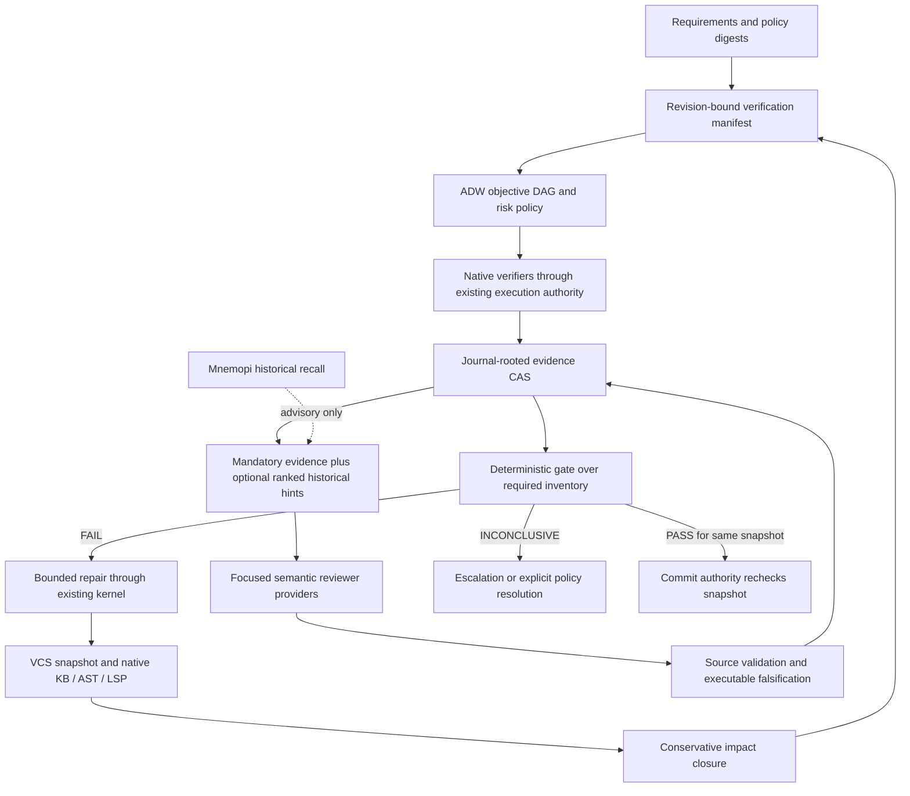

# Native-first verification architecture

Status: proposed architecture, not implemented by this research. Source baseline:
`9cb6fd638918de77913a3e6c8fc42f9d5b3365bc`. See the [capability audit](01-current-capability-audit.md)
for the implementation/maturity ledger and the [Forge audit](02-forge-source-analysis.md)
for the separate upstream algorithm. “Native” means the decision procedure and
execution authority live in OMP2; it does not mean a model can prove a program correct.

## Recommendation and ownership

Use fully native OMP2 orchestration with pluggable native and semantic verification
providers. Keep the verification domain pure and revision-bound; compose effects
only in `omp-driver`, execute them through `omp-env`/`omp-envd` and `omp-exec`, and
record them through `omp-session`/`omp-journal`. Reuse ADW's phase/version/retry
state machine. Do not construct a second agent runtime, task scheduler, indexer,
approval system, or CAS. Add no required service, container runtime, or model dependency.

The first slice should be a driver-owned verification module, with pure domain
types initially in `omp-adw` if they fit its general workflow contract. Extract a
dedicated domain crate only when its independent consumers justify it. These are
candidate API boundaries, not existing module names. This avoids confusing OMP2's
`omp-forge` (forge-neutral change-request/check types) with HouMinXi's Python Forge.

Evidence for these ownership choices:

- [`compose_kernel`, driver/headless/kernel.rs:2457](https://github.com/blyzer/oh-my-pi/blob/9cb6fd638918de77913a3e6c8fc42f9d5b3365bc/crates/driver/src/headless/kernel.rs#L2457)
  is the existing production composition seam.
- [`Run`, adw/run.rs:173](https://github.com/blyzer/oh-my-pi/blob/9cb6fd638918de77913a3e6c8fc42f9d5b3365bc/crates/adw/src/run.rs#L173)
  and [`Phase`, adw/workflow.rs:55](https://github.com/blyzer/oh-my-pi/blob/9cb6fd638918de77913a3e6c8fc42f9d5b3365bc/crates/adw/src/workflow.rs#L55)
  already represent workflow state and dependencies.
- [`ProductionAdwHost`, driver/adw/production.rs:126–162](https://github.com/blyzer/oh-my-pi/blob/9cb6fd638918de77913a3e6c8fc42f9d5b3365bc/crates/driver/src/adw/production.rs#L126)
  composes restricted child kernels and execution authorities.
- [`ExecutionRequest`, exec/request.rs:157–193](https://github.com/blyzer/oh-my-pi/blob/9cb6fd638918de77913a3e6c8fc42f9d5b3365bc/crates/exec/src/request.rs#L157-L193)
  already carries inputs, toolchain, resources, timeout and posture.
- [`Store::stale/load/build`, kb/store.rs:137–185](https://github.com/blyzer/oh-my-pi/blob/9cb6fd638918de77913a3e6c8fc42f9d5b3365bc/crates/kb/src/store.rs#L137)
  supplies revision-aware graph evidence. It is not whole-program sound analysis.

No arrow from memory to gate: historical defect patterns may nominate checks,
but only fresh, attributable evidence and declared policy can satisfy them.

## Three integration strategies

Estimates below are comparative engineering judgments, not measured results.

| Strategy | Reuse and effort | Tokens and latency | Reliability / auditability | Maintenance |
|---|---|---|---|---|
| External Forge CLI (MCP only if a real adapter is supplied) | Low initial adapter effort; reuse upstream behavior; duplicate scheduling, state and capture | Repeated shared review bodies; child process and model overhead; useful baseline | Receipt protocol already exists, but translate freshness, permissions and inconclusive outcomes; no assumed native MCP endpoint | Follow Python/backend/prompt changes and license; two operational models |
| Native Rust engine with externally orchestrated LLM reviewers | Medium/high effort; reuse native effects and evidence, external reviewer lifecycle | Bounded manifests reduce repeated payload, but protocol glue and remote round trips remain | Better deterministic checks; external reviewer tools require separate confinement and identity | Maintain reviewer protocol plus lifecycle compatibility |
| Native orchestration, pluggable verification providers | Higher initial domain/integration work; maximum reuse of kernel, ADW, CAS, KB, execution and approvals | Demand-loaded evidence and shared results; native checks parallel; model budget risk-dependent | One revision authority and durable lifecycle; strict receipt completeness; semantic limitations remain | Maintain objective/provider contracts, avoid parallel runtime; external Forge remains evaluation adapter |

Port concepts, not an entire implementation: retain explicit perspectives,
falsification, fresh evidence, adversarial testing and change-reset discipline.
Redesign source receipts as typed CAS evidence with dependency closure. Keep an
external pinned Forge runner for experimental comparison. Do not translate
Python-only def-use grouping into purported Rust semantic analysis. Discard
mandatory whole-diff retransmission and a universal nine-request counter only
after the effectiveness experiment establishes a safe policy for each risk class.

## Native and semantic responsibilities

Native providers own snapshots, parsing, diagnostics, test collection, execution,
policy evaluation, graph traversal, cache validity, finding locations and gate
aggregation. Their determinism is conditional on captured inputs: tests with
clock/network/randomness are not automatically reproducible.

Semantic providers investigate requirements, invariants, architectural tradeoffs,
attack hypotheses and missing tests. They emit hypotheses with evidence references,
not a privileged PASS. A native validator can reject stale locations, nonexistent
symbols, contradicted claims and failed reproduction; it cannot turn every
unreproduced security hypothesis into a false positive. Remaining material
uncertainty stays INCONCLUSIVE.

The nine objectives are coverage obligations, not nine compulsory LLM turns. A
single semantic investigation may serve A3/B3/C3 when its receipt explicitly
covers each obligation. Strict mode can require genuinely separate reviewers
and withheld initial findings for selected risks; independence is a policy
property, not three prompt labels sent to the same model.

## ADR-R01: Native subsystem with optional external providers

**Status:** proposed; accept through review and implementation experiments.

**Context:** OMP2 has durable workflow, agent, execution, code index and evidence
storage primitives. Forge supplies useful adversarial review protocols, but its
state and source analysis differ from OMP2's. Memory recall is fallible history.

**Decision:** implement native objective/evidence/gate logic, integrated into the
existing ADW host and kernel. Support external reviewers behind an evidence-only
contract. Retain external Forge as a version-pinned evaluation/control provider,
not a mandatory production dependency. Add optional shared reranking only after
measuring relevance improvements; never allow ranking to remove required evidence.

**Consequences:** higher initial integration effort than shelling out, but one
authority for snapshots, cancellation, permissions and durable records. Existing
behavior stays unchanged until an opt-in verification profile is selected.
More precise invalidation must be earned; begin with coarse full-input keys.
Native gates cannot establish universal semantic correctness. Unknown analysis
coverage must be visible and may block high-risk autonomous commits.

**Rejected as default:** external-only integration duplicates runtime contracts;
a second standalone Rust runtime duplicates native capabilities; mandatory local
reranker consumes resources before a quality benefit is demonstrated.

**Reconsider when:** the four-arm benchmark shows external Forge materially
better defect recall at acceptable operating cost, or native analysis coverage
cannot support conservative objective selection. Do not replace an effective
baseline merely because fewer tokens look attractive.
