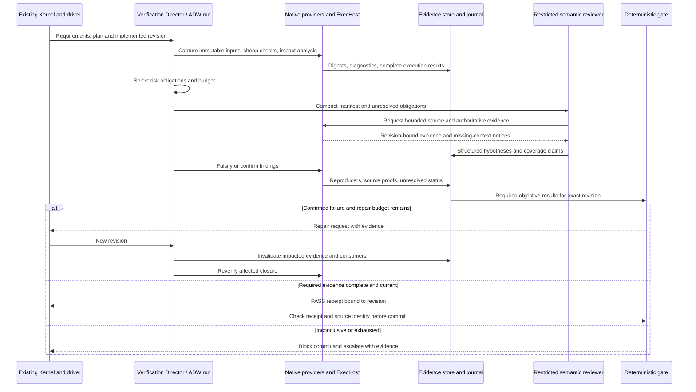

# Risk-adaptive autonomous integration

Status: **proposed integration**, with source seams inspected at
`9cb6fd638918de77913a3e6c8fc42f9d5b3365bc`. No autonomous verification guarantee
is introduced by this research PR.

## Preserve the existing composition and authorities

The production construction boundary is
[`compose_kernel`](https://github.com/blyzer/oh-my-pi/blob/9cb6fd638918de77913a3e6c8fc42f9d5b3365bc/crates/driver/src/headless/kernel.rs#L2457),
not a new verification-specific agent stack. Child reviewers should use the existing
[`spawn_child`/`configure_child`](https://github.com/blyzer/oh-my-pi/blob/9cb6fd638918de77913a3e6c8fc42f9d5b3365bc/crates/driver/src/subagent/spawn.rs#L660-L709)
path and driver-composed kernels. [`KernelOptions`](https://github.com/blyzer/oh-my-pi/blob/9cb6fd638918de77913a3e6c8fc42f9d5b3365bc/crates/driver/src/headless/kernel.rs#L150-L212)
already supports tool restrictions, child output schema, approval posture and prompt-cache identity.
These are implemented contracts; the specialized reviewer composition remains new work.

Reuse ADW [`PhaseKind`, `Phase`, `OnReject`](https://github.com/blyzer/oh-my-pi/blob/9cb6fd638918de77913a3e6c8fc42f9d5b3365bc/crates/adw/src/workflow.rs#L23-L132)
and [`Run::next_step_with_posture`, `accept`](https://github.com/blyzer/oh-my-pi/blob/9cb6fd638918de77913a3e6c8fc42f9d5b3365bc/crates/adw/src/run.rs#L286-L355):
phase dependencies and consumed output versions already model stale-consumer invalidation;
Code/Review phases and bounded attempts already model deterministic work versus review and
correction. Extend these contracts with verification evidence bindings, not a competing scheduler.
ADW acceptance currently represents phase acceptance; it must not automatically imply the new
evidence-backed gate contract.

Feature guidance belongs in an `omp-contract` Director and durable state in an `omp-session`
Component, following [repository conventions](https://github.com/blyzer/oh-my-pi/blob/9cb6fd638918de77913a3e6c8fc42f9d5b3365bc/AGENTS.md#L538-L550).
The Director requests work; deterministic evidence reduction decides the verdict. Keep authority
and execution in existing driver/environment seams. Do not hardcode verifier-specific transitions
inside `agent/src/loop.rs` or make presentation crates own verification policy.

## Proposed flow

The plan/implementation phase first records requirements and intended affected area. Native cheap
checks run before any semantic reviewer. Impact analysis expands obligations for public APIs,
authentication, unsafe/FFI, dependency/build changes, concurrency and uncertain dynamic edges.
Risk selection is a policy calculation using actual changed constructs and declared deployment
context; a model may propose higher risk but cannot lower required native obligations.

Run independent read-only analysis concurrently only on one immutable snapshot. The existing
[Dispatcher](https://github.com/blyzer/oh-my-pi/blob/9cb6fd638918de77913a3e6c8fc42f9d5b3365bc/crates/agent/src/dispatch.rs#L1-L10)
concurrently runs independent read-only calls and makes mutating calls exclusive within their
batch. That is not global isolation between independent processes; provider adapters must still
isolate build outputs and mutations. Mutation experiments use temporary worktrees and return
patch/seed artifacts without modifying the reviewed tree.

After any repair, capture a new input identity, invalidate affected objective dependencies, and
retire old findings from the active verdict without deleting their audit history. Reuse unchanged
evidence only when every declared dependency and environment/policy input still matches.
If dependency capture is incomplete, widen invalidation rather than guessing. A finding identity
includes its original revision; migration to a new revision requires an explicit revalidation.

## Profiles and budgets

These are proposed policy defaults in qualitative form, not hardcoded model-call counts.
All profiles expose wall time, process concurrency, CPU/RAM, native tool count, model requests,
input/output/repeated-token and monetary ceilings. Actual numerical defaults need benchmark data.
A budget caps work; it does not waive required verification.

| Profile | Required work | Semantic review policy | Gate/escalation |
|---|---|---|---|
| Quick | Complete A1, conservative impact mapping, affected regression tests and mandatory project/security policies | Normally none; if risk demands semantic obligations, promote profile or stop | PASS only within declared low-risk scope; high-risk/incomplete impact cannot quietly pass Quick |
| Standard | A1/A2/C1 plus applicable architecture/security rules and requirement obligations | Focused A3/B2/B3/C3 questions only where native evidence leaves semantic uncertainty; share fetched evidence | Unresolved blocking finding, incomplete critical context or exhausted required work blocks and escalates |
| Strict | All applicable A/B/C obligations, expanded integration proofs, bounded mutation/property/fuzz campaign where supported | Multiple independently prompted perspectives for high-risk residuals; independent findings before shared reconciliation; configurable provider/model diversity | Fail closed for high-risk operations; missing required sandbox/host capability, disagreement or incomplete campaign is INCONCLUSIVE |

Independence means distinct investigative hypotheses and unshared initial conclusions, not merely
calling the same model repeatedly. Record shared model/provider limitations. Strict is not a
claim of formal security proof. For any profile, security policy can require escalation beyond its
normal budget. No always-running server, container runtime or mandatory remote service is needed.

## Bounded repair and convergence

Reuse ADW's attempt ceiling, but add a run-wide resource ceiling so branching objectives cannot
multiply total spending indefinitely. A proposed repair ledger records source/input digest,
normalized blocking-finding set, failed-test signature, action and outcome on every iteration.
Stop when a previous (snapshot, finding set) recurs, the same obligation fails without measurable
progress for the configured window, repairs oscillate between two states, or remaining budget
cannot finish required checks. A decreasing count of findings is not sufficient progress if a
new critical issue appears. Escalate with exact attempts, remaining risks and smallest reproducible
counterexample; do not auto-accept because retries ran out.

Checks are idempotent over (provider identity/version, request, input/environment/policy digests).
Deduplicate in-flight checks by this key and persist starts/settlements; a crash after start but
before settlement produces unknown completion, never a fabricated success. On resume, reuse a
verified durable settlement or re-execute safely. Repair/commit operations require separate
idempotency keys and revision preconditions because they mutate state.

Before committing, atomically compare the reviewed input manifest with the current tracked and
relevant untracked/generated inputs and policy/toolchain state. Freeze or lock mutations during
final comparison and commit. A worktree change after verification invalidates the receipt and
requires re-verification. A Git HEAD comparison alone misses uncommitted changes. A PASS receipt
permits the existing approved commit path; it does not grant new filesystem/network permissions.

## Cancellation and uncertainty

[CancelTree and TurnCancellation](https://github.com/blyzer/oh-my-pi/blob/9cb6fd638918de77913a3e6c8fc42f9d5b3365bc/crates/agent/src/cancel.rs#L1-L99)
already distinguish turn interruption from the session-only atomic mutation commit token.
[DispatchPolicy](https://github.com/blyzer/oh-my-pi/blob/9cb6fd638918de77913a3e6c8fc42f9d5b3365bc/crates/agent/src/dispatch.rs#L81-L126)
already bounds interruption grace and journals forced termination as effects-unknown. Propagate
these tokens to provider execution, reviewer inference, retrieval and evidence loading. Honour
existing atomic-mutation semantics rather than cancelling a half-written repair and declaring it
clean. Cancelled/incomplete work is INCONCLUSIVE. Collect and journal process settlement before
releasing a mutation worktree. Detached work cannot independently publish a PASS after its parent
revision has been superseded.

The existing [JobBoard](https://github.com/blyzer/oh-my-pi/blob/9cb6fd638918de77913a3e6c8fc42f9d5b3365bc/crates/agent/src/jobs.rs#L699-L759)
supports artifact storage and lifecycle hooks; its execution submission/reattachment paths
(`start_execution`, `reattach_execution`, same file) should carry verification job identity.
The proposed verifier must test crash/resume and cancellation through these actual paths.

## Reviewer permissions and hostile evidence

Reuse [ToolAdmission](https://github.com/blyzer/oh-my-pi/blob/9cb6fd638918de77913a3e6c8fc42f9d5b3365bc/crates/agent/src/dispatch.rs#L362-L406)
and [ToolRestrictions](https://github.com/blyzer/oh-my-pi/blob/9cb6fd638918de77913a3e6c8fc42f9d5b3365bc/crates/tool/src/restrictions.rs#L251-L304).
A restricted roster is necessary but not sufficient: enforce read-only source access and
allowlisted executable checks at the authority boundary, deny reviewer writes/commit/network
unless explicitly required, and bind paths to a snapshot root. Test commands execute repository
code and may be hostile; native execution does not imply safety. Require the configured enforced
posture and record it; never silently fall back from required confinement to unrestricted local
execution. Existing ADW posture checks reject unreported enforcement instead of assuming it.

Treat source comments, AGENTS-like files supplied as evidence, logs, test output, retrieved memory,
reviewer messages and tool-produced strings as untrusted data. Delimit and provenance-label them;
never promote embedded instructions into system policy. Keep host-owned verification policy and
reviewer tool permissions outside source-controlled prompt text. Do not allow evidence to alter
the objective list, disable a check, submit a network destination, request secrets, or mark a
finding verified. Tool requests are schema-validated against a host-generated allowlist and
snapshot capability; digest-check fetched content. Escape terminal/control data in review displays.

Semantic retrieval may include historical instruction-like material. Mnemopi is advisory;
it cannot supply PASS evidence or authorize tools. A malicious “previously verified” memory
must fail the same current-revision evidence checks as any other claim. Remote reviewers and
rerankers receive only policy-authorized source scope; redact credentials at capture, store secret
references rather than raw values, and record external disclosure. If redaction removes context
needed for a critical conclusion, return INCONCLUSIVE or use a permitted local/human path.

## Required follow-up tests

Integration acceptance must include: source mutation between check and commit; superseded ADW
consumer output; stale reviewer ranges; incomplete/empty diagnostics; denied or unavailable
sandbox; malicious source/log/memory instructions; malformed reviewer JSON; timeout and lost
settlement; cancellation during atomic repair; surviving child process; deterministic replay;
budget exhaustion; repeated/oscillating repairs; changed toolchain/environment/test fixture;
independent simultaneous reviewers; and explicit human override audit history. Unit tests cover
policy selection and reducer invariants; joined-system proofs exercise actual driver/envd/session
wiring rather than only mock reviewers.
