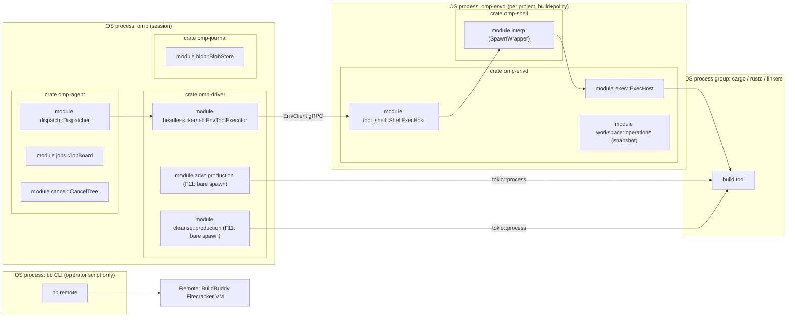

# Provider-neutral build execution for OMP² agents

Status: research only. Nothing is implemented. The vertical slice below is specified but not authorized until Gate 1 passes. See ADR 0047.
Date: 2026-10-11

Evidence keys:
- **OBSERVED** means read in code or docs. Citations use `path:symbol`. Line numbers are given only where they were re-checked in the spot-check tree, which is based on `origin/omp2`.
- **[INFERENCE]** means the author's reasoning.
- **UNVERIFIED** means no run or source confirmed it.

Primary inputs:
- The execution-abstractions map of `omp2` (code, high confidence).
- The ecosystem survey: [build-execution-ecosystem-survey.md](build-execution-ecosystem-survey.md).
- [ADR 0040](../adr/0040-remote-build-and-test-execution.md) and its 2026-10-10 Option D amendment.
- [docs/audits/remote-verification-trial.md](../audits/remote-verification-trial.md).
- The envd boundary audit: [envd-responsibility-audit.md](envd-responsibility-audit.md).

Scope. This document covers agents that build and test *any* project (Rust, Go, JVM, JS, Python, .NET, Bazel). It is not limited to OMP²'s own builds. ADR 0040 remains the record for OMP²'s own remote verification.

---

## 1. Existing architecture assessment

Every concern a build-execution feature needs already has an owner in OMP². The gaps are listed in the last column.

| Concern | Existing type / service (OBSERVED) | Gap for builds |
|---|---|---|
| Shell command execution | `crates/tools/src/shell.rs`: `ShellTool<E: ShellExec>`, `ShellExec` (spot-check `:345`), `ShellRun`, `RunRequest`, `ExecOutcome`, `TimeoutBounds` | Session-shaped: persistent cwd/exports and PTY. It is not a placeable unit. |
| Interpreter | `crates/shell` (`omp-shell`). External spawn uses `process_group`/`setsid`. The sandbox hook is `crates/shell/src/interp.rs:SpawnWrapper`. | None. It never shells out to `/bin/bash` (locked rule). |
| Process authority | `crates/envd/src/exec.rs`: `ExecHost` (`:288`), RAII `ExecRun`, `CANCEL_GRACE` = 250 ms, `detach_exec`. `crates/envd/src/tool_shell.rs:ShellExecHost`. `process_store.rs:ProcessStore`, `process_log.rs:ProcessLog`. | None. This *is* the Local backend. |
| Jobs | `crates/agent/src/jobs.rs`: `JobBoard` (`:195`), `JobSettlement`, `attach_restartable`, `adopt_tool_job`. `crates/tool/src/lib.rs`: `JobRef`, `JobOwner {NamedProcess, AgentLoop}` (`:2080`), `JobKind`. | `JobOwner` has no remote-handle variant. |
| Tool dispatch | `crates/agent/src/dispatch.rs`: `Dispatcher`, `Unit::External`, `ExternalToolExecutor`. `crates/driver/src/headless/kernel.rs:EnvToolExecutor`. | None. |
| Remote execution | **None in product code.** Operator tooling only: `scripts/remote-verify.sh`, `scripts/remote-verify-runner.sh`, the `justfile` recipes `remote`, `remote-test-pkg` and `remote-seed`, and `.github/workflows/buildbuddy-remote.yml`. | No `omp-exec`, router, REAPI or Run API client (ADR 0040 "Status: Not started"). |
| Artifact storage | `crates/journal/src/blob.rs`: `BlobStore`, `BlobRef {hash: Hash32, size}` (`:47`). `dispatch.rs:artifact_address` builds `artifact://sha256/<hex>`. `crates/envd/src/blobs.rs:BlobHost`. | No provenance record for build outputs. |
| Execution environment | `crates/env:EnvClient`. `crates/envd`: `ProjectEnvironment`, `exec_sandbox`. `env.proto:ExecBackendCapabilities` (`:1233`; fields `persistent_sessions`, `pty`, `signals`, `resize`, `final_cwd`, `materialization`). | That capability set describes *shell* backends, not build backends. |
| Workspace capture | `crates/envd/src/workspace/operations.rs`: `snapshot`, `snapshot_at`, `hash_file`, and a `{path, mode, sha256}` manifest. | Walker semantics: tracked files that match an ignore rule are dropped. ADR 0040 Part D requires git semantics. |
| Cancellation | `crates/agent/src/cancel.rs:CancelTree` (ADR 0011). Dispatcher grace 1 s, then `EffectsUnknown`. | A remote cancel cannot be guaranteed. |
| Timeouts | `TimeoutBounds` (default 300 s, ceiling 3600 s). `RunTerminal::Timeout`. `DispatchPolicy.blocking_limit` = 30 s. Auto-background threshold 15 s. | Builds routinely exceed 300 s. Detach covers it. |
| Output bounding | Live 64 KiB, complete 8 MiB (`exec.rs`). `ExecStatus.spilled_output`. `DispatchPolicy` gate (ADR 0009). | None. |
| Credentials | `crates/ai/src/auth/store.rs:CredentialStore`. `crates/driver/src/bridges.rs:CommandCredentials`. `crates/envd/src/github_url.rs:GithubCredentialBridge`. `crates/core/src/secret.rs:SecretString`. `crates/con/src/spec.rs` forbids `PROJECT` scope for redirected endpoints. | No build-backend credential seam. Scripts read `BUILDBUDDY_API_KEY` or the Keychain. |
| History | Journal `.oms` + DOM `<meta><jobs>`. `crates/journal/src/data.rs:LaunchDaemonCompletion`. | No build-run record. `omp.exec.*` telemetry is not implemented. |
| GitHub | `crates/tools/src/github.rs` `github@3` with `Operation::RunWatch`. `crates/envd/src/github.rs:GithubService`. | Observe only. There is no workflow dispatch operation [INFERENCE from the `Operation` enum]. |
| Build-system knowledge | `crates/driver/src/cleanse/checkers.rs` families: cargo, go, pytest, dotnet, gradle, maven, zig. ADW `PhaseSpec::Command`. | Each picks a command, but nothing turns it into a placeable request. |

Two spawn paths bypass envd. Both are defect **F11** (`docs/parked/2026-10-06-project-input-trust-audit.md`):
- `crates/driver/src/adw/production.rs:run_command`
- `crates/driver/src/cleanse/production.rs:run_checker`

Both spawn a bare `tokio::process::Command` with `kill_on_drop`, no process group and the full environment. Separately, `crates/app/src/adw_cmd.rs` builds `Ctx::new()` (ignoring user and project cfg) and never fires its cancel token.

### Topology (processes vs crates vs modules)



## 2. How agents run builds today

OBSERVED path for `cargo test -p x`:
1. The agent calls `bash@2`. The tool is registered in envd at `ToolLocus::Environment` (`crates/envd/src/tools.rs` `production_registry`, `environment_registry`).
2. `Dispatcher` routes it to `Unit::External`. `EnvToolExecutor::invoke` sends `InvokeTool` over `EnvClient` to the project's envd daemon.
3. `ShellTool::call` resolves cwd: an explicit `cwd`, a leading `cd X &&`, or the persistent session. It applies the env delta and clamps the timeout to `TimeoutBounds`.
4. `cargo` runs under the in-process `omp-shell`, in its own process group, under the `ExecSandbox` `SpawnWrapper` (default `workspace-write`, network `scoped`).
5. `ForegroundWait` races the result against the 15 s auto-background threshold. On expiry, `detach_exec` turns the run into a named process, the tool returns `ToolTerminal::Detached(JobRef{owner: NamedProcess})`, and the dispatcher adopts it into `JobBoard`.
6. A turn interrupt calls `ExecRun::cancel`: TERM to the pgids, 250 ms grace, then KILL. The dispatcher's 1 s grace backstops it.
7. Output is bounded host side. Complete output above 8 MiB spills to `BlobStore` and is addressed as `artifact://sha256/…`.

Consequences:
- Every language already "works" for an agent through `bash@2`, locally and generically.
- The agent gets raw text back, not structured results.
- Placement is always local.
- ADW and cleanse run the same tools *outside* this confinement (F11).

## 3. Reuse assessment of the OMP²-development BuildBuddy/Bazel/GitHub findings

| Finding | Status | Evidence |
|---|---|---|
| `bb remote` (Run API) runs a `just` recipe over the working tree, uncommitted changes included | **Validated** | Trial, runs 5-10 and branch runs |
| Warm snapshot relief: 3 min 12 s wall, about 1 s Mac CPU, 95 MB RSS, against 4 min 10 s / 463 s CPU / 3.6 GB link / +1.6 GB swap locally for the same edit-test loop | **Validated** (one recipe, one host, one org) | Trial, "Comparison for the same edit-and-test loop" |
| Cold run is about 7-8 min | **Validated** | Trial, runs 5, 7, 9 |
| `checksum-freshness` limits rebuilds despite fresh timestamps | **Validated** | Trial |
| Every runner property is part of the snapshot key | **Validated** | Trial, "What it took" 6 |
| `bb remote` needs a `MODULE.bazel` marker; `git clean -xdf` runs before each run; image must be Ubuntu 24.04 | **Validated** | Trial 1, 3, 5 |
| Raw REAPI runs arbitrary argv and returns the exit code; actions run as root in `/workspace`; mtimes are not preserved | **Validated** | Trial, Slice 0b |
| Raw REAPI runner recycling gives a warm workspace | **Refuted** (four fresh VMs in 0b and four in 0c) | Trial, Slices 0b/0c; ADR 0040 amendment |
| The API key is visible to every runner process | **Validated** (risk) | Trial "How to use it"; ADR 0040 Part H.2 |
| Live output for raw REAPI | **Assumed absent** | ADR 0040, BuildBuddy findings §2 |
| `CancelExecutions` works outside the CLI | **Unverified** | ADR 0040 Part I |
| Runs without a BES stream are browsable in the BuildBuddy UI | **Unverified** | ADR 0040 §3 |
| Managed Mac executors | **Unverified** (sales-gated) | ADR 0040 Problem 3 |
| Snapshot transfer cost | **Unverified** (usage page not read) | Trial, "Cost on the BuildBuddy side" |
| Remote verification as a CI gate (`buildbuddy-remote.yml`) | **Not proven** (see below) | `.github/workflows/buildbuddy-remote.yml` |
| Bazel as a backend | **Not applicable**: Bazel is its own REAPI client and is Local-placed (ADR 0040 Part A.4) | Survey §4.3 |
| GitHub Actions as a working-tree executor | **Not applicable**: GHA submits a ref, not a tree (fails ADR 0040 R4) | Survey §4.3–4.4 |

**The CI remote-verify failure.** `buildbuddy-remote.yml` checks out with `actions/checkout@v4` and runs `scripts/remote-verify.sh remote-probe` and then `remote-heavy`. The script runs under `set -euo pipefail` (OBSERVED, `scripts/remote-verify.sh:19`) and computes the default branch like this (OBSERVED, `:60` in the spot-check tree):

```
default_branch=$(git symbolic-ref --quiet --short refs/remotes/origin/HEAD 2>/dev/null | sed 's@^origin/@@')
```

`actions/checkout` does not create `refs/remotes/origin/HEAD`, so `git symbolic-ref` fails. `pipefail` propagates that failure through the `sed` pipeline, and `set -e` then terminates the script. Its stderr was redirected to `/dev/null`, so the step exited before `bb remote` ever ran, with no diagnostic.
- The fallback line `default_branch=${default_branch:-omp2}` is never reached.
- The fix is **PR #250, merged as `506b7c143e`** (owner-provided). The spot-check tree still shows the pre-fix line, so the patch itself was not re-read here.
- **No remote invocation from CI has been proven since the fix.** No run with a BuildBuddy invocation ID and remote exit code has been recorded. Gate 2 exists for this reason.

**What is reusable for other projects** [INFERENCE]:
- The neutral contract shape from ADR 0040 Parts A–B.
- Typed failures and no rerun after acceptance (Part C).
- Git-semantics capture (Part D).
- The user-scope-only credential rule (Part F).
- The upload trust boundary (Part H).
- The cancellation truth table (Part I).
- The `omp.exec.*` vocabulary (Part J).

**What is OMP²-specific and must not leak** into the neutral layer:
- The `remote-verify` scripts.
- The fixed snapshot properties.
- The `/opt/omp-python` toolchain.
- The `MODULE.bazel` marker trick.
- The Mac load numbers.

## 4. Critique of `BuildExecutionPort`

The proposal is one `BuildExecutionPort` with `{LocalCargo, RemoteCargo, Bazel, BuildBuddy, GitHubActions}Adapter`. These five adapters sit on six different axes:

| Axis | What it decides | Proposal conflates it in |
|---|---|---|
| Build system | Argv, cache dirs, result format, eligibility | `LocalCargo`/`RemoteCargo` (fused with placement), `Bazel` |
| Execution environment | Where processes run, isolation, OS/arch | `LocalCargo` vs `RemoteCargo` |
| Provider | Vendor account, API, auth, quotas | `BuildBuddy` (hides two products: REAPI and the Run API) |
| Cache | AC/CAS, compiler cache, snapshots | Implicit in `BuildBuddy`/`RemoteCargo` |
| CI orchestrator | Ref-based, push-triggered workflows | `GitHubActions` |
| Artifact store | Durable outputs, provenance | Implicit; competes with `BlobStore` (ADR 0003: journal + CAS is the only authority) |

Consequences:
- Adapter count grows as N build systems × M backends.
- It violates ADR 0040 R3: a backend never inspects argv, and an adapter never names a backend.
- Vendor behavior (snapshots, `CancelExecutions`) enters the domain, against the ADR 0040 amendment.
- It treats a remote cache as a backend property instead of a policy, risking a "second truth" (ADR 0003).
- GHA cannot honor "working tree, not HEAD" without pushing a scratch ref, which is an effect that needs operator approval.

**Verdict: reject.** Defer the port. ADR 0047 records this.

## 5. Models A–E

| Model | Shape | New code | Satisfies R3 / R8 | Reuses JobBoard, ExecHost, BlobStore, CancelTree | Vendor leakage risk | Verdict |
|---|---|---|---|---|---|---|
| A. Single `BuildExecutionPort` | One trait, one adapter per (tool × place × vendor) | Medium, grows N×M | No | Partially; tends to duplicate job/settlement | High | **Reject** |
| B. Build port + execution port | ADR 0040 Parts A–B in full: IR plan with edges, router, fallback, REAPI + vendor crates | High | Yes | Yes | Low | Correct but oversized for slice 1 |
| C. Generic job + build specs | Reuse JobBoard; build is a spec with no adapter | Low | No (eligibility such as `LocalRequired` for Seatbelt/PTY is lost) | Yes | Medium | Reject as a whole; keep its "no new job primitive" rule |
| D. Capability-based providers | Backends advertise capabilities; the pure router filters | Medium | Yes | Yes | Low | Owner-approved selection rule (0040 amendment) |
| **E. Extend existing, shaped as D** | Thin pure `omp-exec` (requests, capabilities, outcome, adapter trait, pure `place()`), `CargoJust` adapter, one backend; hosted on JobBoard/BlobStore/envd/CancelTree | **Lowest** | Yes | Yes, fully | Low | **Selected** |

## 6. envd impact

See [envd-responsibility-audit.md](envd-responsibility-audit.md). Rules for this feature:
- envd keeps its existing authorities: processes (`ExecHost`), filesystem and capture (`workspace::operations`), blobs (`BlobHost`) and sandbox.
- Build execution adds **one** envd capability: a capture-only `CaptureInputs` RPC that follows git semantics. Everything else is reused.
- **envd MUST NOT become a build orchestrator.** It does not choose placement, does not know build systems, does not hold vendor clients and does not retry or fall back.
  - Placement (`place()`) and adapters live in the pure `omp-exec`.
  - Composition (choosing a backend, settling a job) lives in `omp-driver`.
  - Vendor backends are driver-side modules, or their own crates, behind features.
- The Local backend is a thin driver-side wrapper over the existing `EnvClient` → `ExecHost` path. It adds no new envd process type.
- A future SSH backend may reuse envd's `russh` dependency, but it must still be selected by the driver, not by envd [INFERENCE].

## 7. Minimal capability model

The verbs are ADR 0040's traits, unchanged. Three descriptor fields come from the survey (§4.2). `snapshot` is kept separate because it is a correctness hazard.

```rust
// omp-exec (pure; no I/O, no vendor names)
pub struct BackendCapabilities {
    pub platforms: Vec<Platform>,      // os, arch
    pub enforced: Posture,             // enforced sandbox posture only (ADR 0039 B4/B5)
    pub max_timeout: Duration,
    pub input: InputTransport,         // LocalFs | Cas | Patch | GitRef
    pub stream: StreamSupport,         // Live | Tail | PostHoc
    pub cancel: CancelSupport,         // Immediate | BestEffort | Unsupported
    pub action_cache: bool,
    pub warm_caches: bool,             // named CacheDecl dirs persist
    pub snapshot: SnapshotSupport,     // None | WarmByKey{mutable} | Persistent{mutable}
}
```

Rules:
1. The caller never declares eligibility. The adapter derives the needs; `place()` matches them against capabilities. An unmet need is `Unplaceable`, never a silent downgrade.
2. Hints (caches, snapshot key) are advisory, and their effect is reported (`cache_hit`, `reused`). Correctness never depends on them.
3. Cancel always settles locally. Remote truth is reported as `Requested | Unsupported`.
4. `GitRef` transport cannot satisfy a dirty working tree. Such backends are `Unplaceable` unless the operator approves a scratch-ref push. This remains an open question.

Capabilities of the first-stage backends (from the survey §4.3 plus the trial):

| Backend | input | stream | cancel | warm_caches | snapshot |
|---|---|---|---|---|---|
| Local (envd `ExecHost`) | LocalFs | Live | Immediate | yes (the checkout) | n/a |
| BuildBuddy Run API | Patch | Live via CLI; product client UNVERIFIED | BestEffort (UNVERIFIED outside the CLI) | yes (`$HOME` in the snapshot) | WarmByKey{mutable: true} |
| Generic REAPI | Cas | PostHoc | BestEffort / Unsupported | no (refuted 0b/0c) | None |
| SSH persistent | LocalFs (rsync) | Live | Immediate while connected | yes | Persistent{mutable: true} |
| GitHub Actions | GitRef | PostHoc (T) | BestEffort | advisory | None |

## 8. Language / build-system matrix

"Supported" means a typed adapter exists. Today **none** does: every ecosystem is reachable only through raw `bash@2` text.

| Build system | Today (agent) | Structured result source | Adapter stage | Remote eligibility |
|---|---|---|---|---|
| Cargo (+ `just` recipes) | `bash@2` raw text | cargo JSON (`--message-format=json`, stable); nextest JUnit; libtest JSON unstable | **Supported in slice 1** (`CargoJust`) | Linux-valid commands only; macOS `Unplaceable` |
| Go | `bash@2` | `go test -json` (test2json, stable) | Planned (stage 3) | Yes |
| pnpm / npm / Bun (+ vitest/jest) | `bash@2` | Runner JUnit via report sub-adapter | Planned (stage 4) | Yes |
| Gradle / Maven | `bash@2` | Surefire / Gradle JUnit XML | Planned (stage 4) | Yes; tool caches passed through env |
| uv / pytest | `bash@2` | `--junitxml` | Planned (stage 4) | Yes |
| dotnet / MSBuild | `bash@2` | TRX / JUnit (MTP reporters) | Planned (stage 5) | Linux targets |
| Bazel | `bash@2` | BEP JSON + `test.xml` | Planned (stage 5), **Local-placed only** | Never wrapped; Bazel's own `.bazelrc` remote config |
| Buck2 / Pants / Please | `bash@2` | Tool reports | Unsupported (on demand, same pattern as Bazel) | Local only |
| CMake / Meson / Ninja | `bash@2` | ctest/Meson JUnit | Unsupported (on demand) | — |
| Earthly, Task, Nix-as-backend | `bash@2` | — | **Unsupported** (Earthly unmaintained; Task/Just opaque; Nix is a toolchain provider) | — |

## 9. Lifecycle

```
CREATED → QUEUED → PREPARING → RUNNING → { SUCCEEDED | FAILED | CANCELLED | TIMED_OUT }
```

| State | Meaning | Entered when |
|---|---|---|
| CREATED | Request planned by the adapter, `ExecutionId` (UUID) minted, job record written | `place()` returned a backend |
| QUEUED | Waiting for capacity (local cargo lock, remote queue) | Backend accepted, worker not started |
| PREPARING | Input capture/upload, VM boot or snapshot restore, toolchain fetch | Worker assigned |
| RUNNING | The command executes | Process started |
| SUCCEEDED | Exit 0 and declared outputs present | Terminal |
| FAILED | Split into `CommandFailed{exit}` (the build's verdict) and `InfraFailed{stage, cause}` (never confused, ADR 0040 R5) | Terminal |
| CANCELLED | `{remote: Stopped | Requested | Unsupported}` | Terminal; settles locally immediately |
| TIMED_OUT | Deadline exceeded; remote effects reported as unknown | Terminal |

Provider limitations:

| Backend | QUEUED observable | PREPARING observable | RUNNING live | Notes |
|---|---|---|---|---|
| Local | Only as cargo-lock wait [INFERENCE] | Collapses into RUNNING | Yes | Exact |
| BuildBuddy Run API | Via invocation polling (UNVERIFIED for a product client) | Runner setup is visible in logs (trial: 1 s warm / ~1 min 45 s cold) | CLI streams | |
| Generic REAPI | `ExecuteOperationMetadata` stage | Same | **No**: logs arrive at completion | `ExecutedActionMetadata` timestamps fill phases after the fact |
| GitHub Actions | `queued` status | `in_progress` covers setup | Post-job logs (T) | `conclusion` maps lossily to an exit code |
| SSH | No | rsync phase | Yes | |

## 10. Cancellation, retry, idempotency

- **Cancellation** maps the existing `CancelTree` token, via the job's settlement task, onto `ExecutionRun::cancel`.
  - Local: TERM to the pgids, 250 ms, KILL (exact).
  - Remote: request plus local settlement. BuildBuddy `Cancel` skips merged executions, so a merged action may run until `Action.timeout`.
  - Forced termination after effects were authorized is journaled as `EffectsUnknown` (ADR 0011).
- **Retry.** Never automatic after the backend *accepted* the run (ADR 0040 Part C). Infrastructure failures *before* acceptance (connect, auth, upload) MAY retry once with backoff on the same backend. A `CommandFailed` is never retried and never rerun elsewhere. Fallback to another backend is out of scope for slice 1.
- **Idempotency.**
  - A request is identified by `(ExecutionId, input manifest digest, argv digest, platform)`.
  - Reattach uses `JobOwner::RemoteExecution{backend, operation}` (new variant). Rebuilding the job after a restart reattaches; it never resubmits.
  - REAPI may execute an action more than once, so actions MUST be idempotent with respect to their declared outputs.
  - Secret-bearing or non-hermetic actions set `do_not_cache`.

## 11. Structured results

Normalized into one `BuildReport` stored as a blob and referenced from the job settlement:

| Source | Format | Stability | Normalizes to |
|---|---|---|---|
| Cargo diagnostics | cargo JSON messages | Stable | `Diagnostic{file, span, level, code, message}` |
| Cargo tests | nextest JUnit (preferred); libtest JSON only with a pinned nightly | JUnit stable; libtest JSON unstable | `TestCase{suite, name, status, duration, output_blob}` |
| Bazel | BEP (`--build_event_json_file`), `test.xml` | Stable | `TestCase` + target summary + `cache_hit` |
| JUnit XML (Maven, Gradle, pytest, vitest, Bun, dotnet) | XML | Lowest common denominator | `TestCase` |
| SARIF (clippy-sarif, ESLint, govulncheck, MSBuild `ErrorLog`) | JSON | Stable | `Diagnostic` (lint/security), never test verdicts |

Raw stdout/stderr are always kept as `BlobRef`s. The report is derived from them; it never replaces them. A parse failure degrades to the raw text with a typed `ReportUnavailable` reason.

## 12. Artifact identity and provenance

- **Identity.** Every artifact is `BlobRef{sha256, size}` in the session `BlobStore`, addressed as `artifact://sha256/<hex>`. A remote digest that matches (REAPI `Digest`) is verified on download (`BlobStore::verify`). No new digest type is introduced.
- **Provenance record** (journaled with the settlement):
  - `ExecutionId`, backend id and profile, remote operation id;
  - input manifest digest, argv digest and env allowlist digest;
  - toolchain id (`rust-toolchain.toml`, image digest), platform;
  - `cache_hit` and `snapshot_reused` flags, timestamps per phase.
- A remote AC hit is **never** a verdict by itself (ADR 0040 Part G/H). Provenance records that a result came from cache.
- Outputs are fetched only for declared paths, with size caps. Unfetched outputs remain remote references marked `fetched: false`.

## 13. Workspace snapshot semantics

- **Input set = git semantics** (ADR 0040 Part D): every tracked path in the index, including tracked-but-ignored files; plus untracked files that are not ignored; minus deleted files.
  - Untracked ignored files are excluded by default.
  - The `omp_secrets::credential_rules()` content scan and a default deny list refuse the run with `InputRefused{path, rule}`. They never silently exclude a file.
- **Capture** reuses `hash_file` (fingerprint cache) and writes a sorted manifest blob. The manifest digest is the snapshot identity.
- **Remote workspace snapshots** (BuildBuddy VM snapshots, sticky disks, persistent SSH dirs) are a *different* concept:
  - They are mutable and keyed by vendor inputs. For BuildBuddy, every platform property is in the key.
  - They are hints only, keyed per trust domain, and reported as `reused`. They are never assumed for correctness.
- Fresh-timestamp backends rely on content freshness (Cargo `checksum-freshness`). Non-Cargo adapters MUST declare whether their tool trusts mtimes.

## 14. Trust policies

| Class | Example | Remote placement | Upload | AC / cache write | Secrets to worker | Snapshot reuse |
|---|---|---|---|---|---|---|
| T1. Owner's trusted workspace | Developer's own repo on their machine | Allowed if operator-enabled in user cfg | Allowed after scan | Allowed (trusted principal) | Revocable key only; never in argv or action env where avoidable | Own key namespace |
| T2. Third-party repo cloned by the agent | Building a dependency or an issue repro | Local only by default; remote only with explicit operator approval | Approval required per repo | **Read-only** | None | Isolated namespace, never shared |
| T3. Untrusted contributor / fork PR code | PR review builds | Local sandbox only, or an ephemeral remote with **no** credentials | Only to an org no release depends on | **Never** | None (`pull_request_target` pattern forbidden) | Never |
| T4. Agent-generated changes | Subagent worktree output (`create_worktree`) | Same as the parent workspace's class | Same as parent | Same as parent, minus AC write until merged [INFERENCE] | Same as parent | Per-worktree key |
| T5. Release / protected builds | Tagged releases | Only on designated trusted backends; no hint-dependent paths | Allowed | Write only by the release principal | Scoped release credentials | Disabled (cold, reproducible) |

All `sv_exec_*` settings are `archive` and never `PROJECT`: a hostile repository cannot redirect uploads (`crates/con/src/spec.rs`).

## 15. Observability correlation chain

```
session id → turn id → tool call id | ADW phase id
  → JobRef handle (JobBoard)
  → ExecutionId (UUID; = REAPI tool_invocation_id)
  → backend operation id (REAPI operation name | BB invocation id | GHA run id | local pgid)
  → artifacts (artifact://sha256/… for stdout, stderr, BuildReport, outputs)
  → span omp.exec.execute {capture, upload, queue, run, download}
```

- Attributes follow ADR 0040 Part J (`omp.exec.id`, `.backend`, `.placement`, `.outcome`, `.exit_code`, `.failure`, `.cache_hit`, input/CAS/upload/download counters).
- Headers, credential values and env values are never recorded.
- Every link in the chain MUST appear in the journal settlement, so a failure can be traced from the transcript to the remote console without logs.

## 16. Performance requirements

These are requirements, not measurements.
- **P1.** `omp-exec` is pure with no vendor or gRPC dependencies, and adds nothing to cold `cargo run --bin omp` beyond one small crate (AGENTS.md gate).
- **P2.** `place()` is pure and does no I/O.
- **P3.** Capture of an unchanged tree reuses the `hash_file` fingerprint cache. Re-hashing cost is proportional to changed files.
- **P4.** Client-side cost of a remote run SHOULD stay in the range measured for `bb` in the trial (about 1 s CPU, about 100 MB RSS per run) [measured for `bb`; a product client is unmeasured].
- **P5.** Output bounds stay at 64 KiB live and 8 MiB complete (ADR 0009). Larger output spills.
- **P6.** Remote is default-off. It may become a default only after Gate 8 shows relief on the benchmark matrix with interleaved arms.

## 17. Gates

| Gate | Passes when | Blocks |
|---|---|---|
| **G1. Owner acceptance** | ADR 0047 accepted; ADR 0040 Option D amendment reviewed; first-backend order decided (Local first, as proposed) | All implementation, including the vertical slice |
| **G2. Remote invocation proven** | A `buildbuddy-remote.yml` run after PR #250 (`506b7c143e`) shows `remote-probe` and `remote-heavy` reaching BuildBuddy, with a recorded invocation ID and remote exit code | Any remote backend work |
| **G3. Credential containment** | Either a product client keeps the key out of runner processes (demonstrated), or the owner accepts revocable-key-in-dedicated-org as policy, in writing | Remote backend enabled by default for any class |
| **G4. Local parity / F11 closed** | ADW and cleanse spawn through envd `ExecHost`; a test shows a cancel kills `rustc` grandchildren; `omp adw run` uses `process_ctx_with` and wires Ctrl-C | Slice 1 completion |
| **G5. Capture correctness** | Golden tests: tracked-ignored included, untracked-ignored excluded, deleted absent, secret refused | Any upload |
| **G6. Structured results** | Fixture tests normalize cargo JSON and nextest JUnit into `BuildReport`; raw blobs preserved | Agent-facing reports |
| **G7. Observability** | The full correlation chain is present in a journaled settlement and in `omp.exec.execute` spans | Remote enablement |
| **G8. Measured relief** | Benchmark matrix filled for the targeted rows with interleaved arms; relief threshold set by the owner and met | Remote as a default |

## 18. Benchmark matrix (unverified unless marked)

| Workload | Local Mac (M1 Pro, 16 GB) | BB Run API warm | BB Run API cold | Raw REAPI | Linux local reference |
|---|---|---|---|---|---|
| `just test-pkg omp-envd`, one-line envd change | **4 min 10 s, 463 s CPU, 3.6 GB link, +1.6 GB swap (measured, trial)** | **3 min 12 s; Mac ~1 s CPU, 95 MB (measured, trial)** | **~7 min 45 s (measured, trial)** | Cold every time [INFERENCE from 0b/0c]; not measured | not measured |
| `just check` | not measured | 192 s (2026-10-10 runs, per map; method not re-read) | not measured | not measured | not measured |
| `just test` (workspace) | not measured | 545 s rerun (per map) | not measured | not measured | cold workspace test build 656 s (ADR 0040 table) |
| `just clippy` | not measured | 311 s (per map) | not measured | not measured | not measured |
| Go `go test ./...` (sample repo) | not measured | not measured | not measured | not measured | not measured |
| pnpm + vitest (sample repo) | not measured | not measured | not measured | not measured | not measured |
| Peak RSS of any recipe | **not measured** (ADR 0040 "Not verified") | — | — | — | — |

Method for filling the matrix: follow ADR 0040's measurement plan, with interleaved arms, `/usr/bin/time -l`, swap from `sysctl` and pageouts from `vm_stat`. Never quote a price; cost stays parameterized (survey §3.7).

## 19. Vertical slice (specified; NOT implemented pending Gate 1)

**Goal.** One ADW code phase, `just test-pkg omp-envd`, runs through `omp-exec` on the **Local** backend (envd `ExecHost`) as a journaled job and returns a structured `BuildReport`. A remote backend is not part of this slice; it waits for G2/G3.

Files it would touch:
1. `crates/exec/Cargo.toml`, `crates/exec/README.md`, `crates/exec/src/lib.rs` (new crate `omp-exec`). Contents:
   - `ExecutionId`, `ExecutionRequest`, `BackendCapabilities`;
   - `ExecutionBackend`/`ExecutionRun` (copying the `ShellExec`/`ShellRun` shape, enum-dispatched, no `dyn`);
   - `Outcome`, `ExecutionError` (`thiserror`), `BuildSystemAdapter`, `CargoJust`, pure `place()`, `BuildReport`.
   - Dependencies: `omp-core`, `omp-adw`, `thiserror`, `strum`.
2. `Cargo.toml` (workspace member and dependency) and `.github/labeler.yml` (`area/env`).
3. `crates/exec/src/report/{cargo.rs,junit.rs}`: cargo JSON and nextest JUnit normalizers.
4. `crates/driver/src/exec/mod.rs` (new): the Local backend over `EnvClient`/`ExecHost`, and job settlement via `JobBoard::attach_restartable`.
5. `crates/driver/src/exec/settings.rs` (new): `sv_exec_*` convars, archive scope, never project.
6. `crates/driver/src/adw/production.rs`: `ProductionAdwHost::open` opens an envd environment; `run_command` plans through `CargoJust` and places. This replaces the bare `tokio::process::Command` and closes F11 for ADW.
7. `crates/driver/src/adw/definition.rs`: an optional `placement` field (`local` only in this slice).
8. `crates/app/src/adw_cmd.rs`: `process_ctx_with` instead of `Ctx::new()`, Ctrl-C wired to the cancel token, a placement line in the output.
9. `crates/observability/src/semconv.rs`, `crates/observability/src/attrs.rs`: `omp.exec.*` vocabulary.
10. `.omp/workflows/verify.toml` (new): one phase, `command = ["just","test-pkg","omp-envd"]`.
11. Tests (G4–G7):
    - `crates/exec/tests/place.rs`
    - `crates/exec/tests/report_fixtures.rs`
    - `crates/driver/tests/adw_local_exec.rs` (cancel kills grandchildren)
12. Docs: ADR 0040 status note, ADR 0047 status update.

Not touched in the slice:
- `crates/tool/src/lib.rs` `JobOwner::RemoteExecution` (stage 2);
- `env.proto` `CaptureInputs` (stage 2, needed only for upload);
- cleanse routing (stage 2);
- `bash@2` remote placement (rejected for now: session semantics do not map onto coarse actions).

## 20. Staged backlog

| Stage | Content | Entry gate |
|---|---|---|
| 0 | Prove a CI remote invocation after PR #250; record the invocation ID | — (operator) → G2 |
| 1 | Vertical slice above (Local backend, `CargoJust`, `BuildReport`, F11 for ADW) | G1 |
| 2 | Cleanse through `omp-exec` (F11 for cleanse); `CaptureInputs` RPC with git semantics; `JobOwner::RemoteExecution`; agent-initiated build jobs via detach | G4, G5 |
| 3 | BuildBuddy Run API backend as a driver-side module behind a feature; trust classes T1/T4 only; `Go` adapter | G2, G3, G7 |
| 4 | Generic REAPI backend (Buildbarn conformance target); JUnit report sub-adapters for pnpm/Gradle/Maven/pytest | G6, G8 for any default |
| 5 | SSH persistent backend; Bazel (Local-placed, BEP); dotnet; GitHub Actions as an observed/dispatched CI capability (not a working-tree executor) | Owner decision on scratch-ref pushes |

## Open questions

1. Is Local-first acceptable as the slice-1 backend, given the ADR 0040 amendment orders BuildBuddy Run API first for OMP²'s own builds?
2. How does a product Run API client keep the key out of runner processes (G3)?
3. Should ref-based CI backends be allowed to push scratch refs, or stay `Unplaceable` for dirty trees?
4. Should `Outcome` gain `Concluded{conclusion}` for CI, or stay exit-code based?
5. nextest JUnit vs pinned-nightly libtest JSON for Cargo per-test results.
